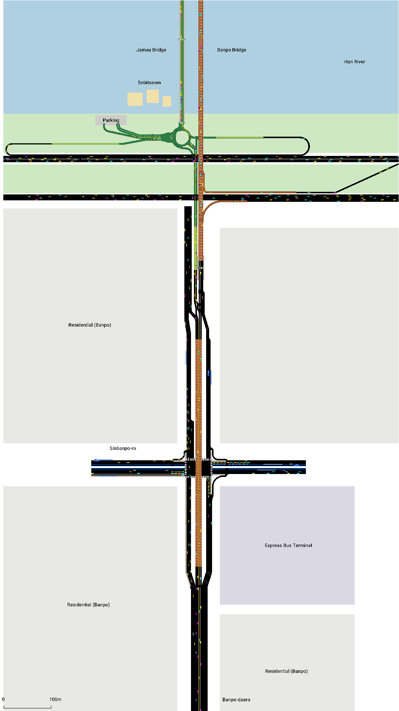

# 잠수교 보행화 전·후, 반포대교 남단을 지나는 자율주행차 (banpo-av)

성균관대 2026-2 **자율주행인공지능및제어** 12조 테슬라팀 프로젝트다. 팀원은 김재령, 배준서, 윤동건, 정상현(가나다순)이다.

서울 반포대교 남단에서 신반포사거리까지를 SUMO에 실제 규모로 만들고, 잠수교 차량 통제(2026-10-26) 전과 후의 두 교통 상황에서 자율주행차(AV)의 의사결정 모델을 학습하고 평가했다. 모델은 규칙 정책의 시범으로 BC를 한 뒤 선생님 보정 PPO로 학습했고, 최종 모델로 주행 데이터를 수집했다.

| 링크 | 주소 |
|---|---|
| GitHub 저장소 | <https://github.com/skku-aicad-2026-team12/banpo-av> |
| 프로젝트 페이지 | <https://skku-aicad-2026-team12.github.io/banpo-av/> |
| 데이터셋 (Hugging Face) | <https://huggingface.co/datasets/skku-aicad-2026-team12/banpo-av-dataset-v2> |
| 주행 영상 (YouTube) | 통제 전 [고가에서 잠수교로](https://youtu.be/xawf5CkwW48), [올림픽대로에서 잠수교로](https://youtu.be/uz9RgG4wKdQ). 통제 후 [측도에서 반포대교로](https://youtu.be/oP7Hghs4FS8), [고가에서 반포대교로](https://youtu.be/GL5udXWay8c), [신반포로에서 반포대교로](https://youtu.be/saTAr4_Oelo) |



## 결과

최종 모델은 `results/team_rl_1125_VA2/model_261632.pt`다. 학습과 모델 선별 어디에도 쓰지 않은 새 시드 **1,000판**(5개 경로 × 200판, 판 번호 800~999)에서, 출발 차로를 무작위로 두고 안전장치 없이 평가했다. 보고서는 [`evaluation/eval/final_VA2_261632/report.md`](evaluation/eval/final_VA2_261632/report.md)에 있다.

| 지표 | 값 |
|---|---|
| 도착률 | **97.6%** (976 / 1,000) |
| 충돌률 | **0.6%** (6판, 95% 구간 0.3~1.3%) |
| 그 밖의 실패 | 신호 위반 13, 시간초과 5 (경로 이탈, 비정상 정지, 순간이동, 오류는 0) |

| 시나리오 | 경로 | 도착 | 실패 |
|---|---|---|---|
| 통제 전 | `goga-jamsu` 고가에서 잠수교로 | 97.5% | 신호 위반 5 |
| 통제 전 | `oly-jamsu` 올림픽대로에서 잠수교로 | 94% | 충돌 5, 신호 위반 7 |
| 통제 후 | `side-banpo` 측도에서 반포대교로 | 96.5% | 충돌 1, 신호 위반 1, 시간초과 5 |
| 통제 후 | `goga-banpo` 고가에서 반포대교로 | 100% | 없음 |
| 통제 후 | `sbr-banpo` 신반포로에서 반포대교로 | 100% | 없음 |

과속은 합격 기준으로 삼지 않고 넘은 폭별로 공개한다. 1,000판 전체 416,916스텝 중 차로 제한속도를 넘은 스텝의 비율이다(교차로 안쪽 차로 포함).

| 초과 > 0 km/h | > 1 km/h | > 2 km/h | > 5 km/h | 최대 초과 |
|---:|---:|---:|---:|---:|
| 1.761% | 0.429% | 0.175% | 0.017% | 9.842 km/h |

## 무엇을 만들었나

| 항목 | 내용 |
|---|---|
| 도로 | 반포대로 북행 축을 따라 강남터미널고가, 신반포사거리, 올림픽대로, 잠수교 지하차도, 회전교차로, 반포대교 상층까지 넣었다. 고가와 지상, 둔치가 겹치는 3층 입체 접속부이고, 합류, 분기, 차로 감소, 신호 사거리, 회전교차로, 엮임, 버스전용차로가 모두 있다. |
| 교통 | 실측 자료를 썼다. 수요는 통제 전 TOPIS, 통제 후 t-data이고, 신호 5곳은 C-ITS 신호 기록, 버스는 공식 34개 노선이다. 보행자도 있다. 원자료와 출처는 [`environment/road/measured/`](environment/road/measured/)에 있다. |
| 시나리오 | 도로망은 하나이고, 통제 전과 후는 수요, 버스 경로, 잠수교 통행 여부만 다르다. |
| AV 관측 | 49차원이다. 수업 기본 31차원에 경로 4(분기 2곳의 방향과 거리), 내 차로 진행 방향 4, 신호 3(색, 정지선 거리, 남은 시간), 경합 차량 4, 차로 제한속도 3을 더했다. |
| AV 행동과 보상 | 가감속과 차로 변경을 낸다. 속도 명령의 상한은 수업 원본과 같이 차 최고속도뿐이다. 보상은 차로 제한속도 대비 속도 보상에 과속 감점(스텝마다 `0.5 × max(0, 속도 / 제한속도 − 1)`)을 뺀다. |
| AV 학습 | 규칙 정책(선생님)으로 시범을 모아 BC와 DAgger를 하고, 선생님 보정 PPO로 이어서 학습했다. PPO 업데이트마다 그 rollout 관측에 선생님 정답으로 BC를 한 번 더 한다. |
| 데이터 | 수업 기본 칼럼에 `sim_time`, `ego_route`, `signal_tls`, `signal_state`, `signal_remaining_s`, `end_reason`을 더했다. 10,844,678행, 26,000판이다 (도착 97.60%, 충돌 0.73%). |

수집 데이터 설명은 [Hugging Face 데이터셋 카드](https://huggingface.co/datasets/skku-aicad-2026-team12/banpo-av-dataset-v2)에, 도로망 명령과 코드 안의 규칙은 [`environment/road/README.md`](environment/road/README.md)에 있다.

### 학습 과정

최종 모델은 세 번에 걸쳐 이어서 학습한 것이다.

1. **U5.** BC 모델에서 선생님 보정 PPO로 26.2만 스텝을 학습했다. 이때는 환경이 속도 명령을 차로 제한속도로 잘라 주었다.
2. **VA.** 그 상한을 없애고 과속 감점을 넣은 환경에서 U5를 같은 설정으로 36.8만 스텝 이어서 학습했다.
3. **VA2.** VA의 마지막 모델을 같은 설정으로 다시 이어서 학습했다. 26.2만 스텝에 저장한 모델이 최종 모델이다.

학습 설정은 [`results/team_rl_1125_VA2/args.json`](results/team_rl_1125_VA2/args.json)에 있다. 상한을 빼기 전의 U5는 같은 규모의 평가(1,000판)에서 도착 98.8%, 충돌 0.8%였다.

## 폴더 구조

```
.
├── README.md
├── requirements.txt           Python 패키지 버전
├── repo_paths.py              폴더 경로를 한곳에서 정함 (모든 실행 스크립트가 맨 위에서 불러 씀)
├── environment/               [Environment] SUMO 환경
│   ├── road/                  반포 도로망 정의, 생성, 검증 (road_spec.py가 기준), 스크린샷 images/, 교통 실측 원자료 measured/
│   ├── env/                   Gym 환경. 수업 코드에 반포 도로망을 연결 (sumo_env, mdp_config, road_config, road_builder)
│   └── view_road.py           배경 교통이 흐르는 도로를 sumo-gui로 보기
├── training/                  [Training] train_team.py (BC, 병렬 PPO, 선생님 보정), 수업 원본 PPO와 BC 알고리즘
├── evaluation/                [Evaluation] 주행 지표, 기준 지표, 모델 평가 (baseline.py). 보고서는 eval/<이름>/
├── data_collection/           [Data Collection] 수업 기본 칼럼과 추가 칼럼 수집 (collect_pomdp_data.py)
├── results/team_rl_1125_VA2/  최종 모델 (model_261632.pt)과 학습 설정 (args.json)
└── docs/                      프로젝트 페이지 (index.html, assets/)
```

`data/`(수집 데이터), `environment/road/videos/`(주행 영상), 실행할 때마다 생기는 도로망 `environment/env/sumo/banpo/`는 git에 없고, 아래 명령으로 다시 만든다.

## 실행 환경과 설치

| 항목 | 버전 |
|---|---|
| Python | 3.14 (3.11에서도 동작 확인) |
| SUMO | 1.27.1 (별도 설치. Windows는 설치할 때 `Set SUMO_HOME`을 체크) |
| Python 패키지 | `python -m pip install -r requirements.txt` |
| ffmpeg | 주행 영상을 만들 때만 (Windows: `winget install Gyan.FFmpeg`) |

`traci`, `sumolib`, `libsumo`는 설치한 SUMO 버전과 맞춘다. `libsumo`가 있으면 화면 없는 평가와 수집이 훨씬 빠르다. 명령은 **저장소 루트**에서 실행하고, 한글 출력 때문에 `python -X utf8`로 실행한다.

## 실행

```bash
# 1. 도로망 생성과 검증
python -X utf8 environment/road/build_net.py
python -X utf8 environment/road/check_net.py              # 마지막 줄 "결과: 통과"
python -X utf8 environment/road/check_env.py              # 수업 환경 연결 (AV 주행과 배경 교통)

# 도로 보기: 배경 교통이 흐르는 도로를 sumo-gui로 (▶ 누르면 시작)
python -X utf8 environment/view_road.py

# 2. 최종 모델 평가: 5개 경로, 무작위 출발 차로, 경로당 200판 = 1,000판
#    결과는 evaluation/eval/<이름>/report.md 와 metrics.csv
python -X utf8 evaluation/baseline.py --model results/team_rl_1125_VA2/model_261632.pt --episode-start 800 --episodes 200 --workers 7 --depart-lane random --depart-speed limit --safety off --name final_VA2_261632

# 3. 데이터 수집: 최종 모델, 안전장치 끔. 결과는 data/<out-dir>/
python -X utf8 data_collection/collect_pomdp_data.py --model results/team_rl_1125_VA2/model_261632.pt --safety off --depart-lane random --depart-speed limit --paired-seeds --episodes 1000 --workers 7 --seed 100000 --out-dir data/final_v2 --name final_100000_safetyoff_v2

# 4. 주행 영상 (ffmpeg 필요). 결과는 environment/road/videos/
python -X utf8 environment/road/record_video.py --model results/team_rl_1125_VA2/model_261632.pt --route oly-jamsu --episode 32 --depart-lane 2 --depart-speed limit --name oly-jamsu_ep32

# 기준 지표: SUMO 기본 운전자, 경로 3개, 경로 차로 출발 (evaluation/baseline_metrics.csv 와 baseline_report.md를 덮어씀)
python -X utf8 evaluation/baseline.py --episodes 30 --workers 7
```

저장소의 `evaluation/baseline_report.md`와 `baseline_metrics.csv`는 11/16에 잰 옛 기준(경로 3개, 경로 차로 출발)이다. 최종 모델 평가 보고서의 기준 줄은 5개 경로를 무작위 출발로 잰 `evaluation/baseline_metrics_random.csv`를 쓴다. 출발 옵션이 무작위면 `baseline.py`가 자동으로 이 파일을 고른다.

학습을 처음부터 다시 하려면 `training/train_team.py`를 쓴다. `bc`로 BC 모델을 만든 뒤 `rl --init <BC 모델> --teacher-lr 2e-4`로 선생님 보정 PPO를 돌린다. 최종 모델처럼 이어서 학습하려면 `--init`에 이전 PPO 모델을 준다.

## 수업 코드와의 관계

수업 저장소 [bmil-ssu/Artificial-Intelligence-and-Control-for-Autonomous-Driving](https://github.com/bmil-ssu/Artificial-Intelligence-and-Control-for-Autonomous-Driving)의 코드를 Environment, Training, Evaluation, Data Collection으로 나눠 옮겼다.

| 수업 문서의 위치 | 이 저장소 |
|---|---|
| `env/` (road_config, road_builder, mdp_config, sumo_env) | `environment/env/` |
| `view_road.py` | `environment/view_road.py` |
| `train.py`, `algorithms/`, `utils/` | `training/` 아래 같은 이름 |
| `collect_pomdp_data.py` | `data_collection/collect_pomdp_data.py` |
| `test.py`, `train_bc.py` | 지움. 평가는 `evaluation/baseline.py`, BC는 `training/train_team.py bc` |
| `env/sumo/highway.*`, 예제 데이터, 예제 모델 | 지움. 수업 예제 직선 도로 전용 |

`environment/env/`, `environment/view_road.py`, `data_collection/collect_pomdp_data.py`, `training/train.py`는 반포 도로망 연결, 폴더 경로, 추가 옵션 때문에 고쳐져 있다. 내역은 [`environment/road/README.md`](environment/road/README.md)의 "수업 코드 연결"에 있다. 수업 데이터 기본 칼럼은 지우지 않고 추가만 했다.
