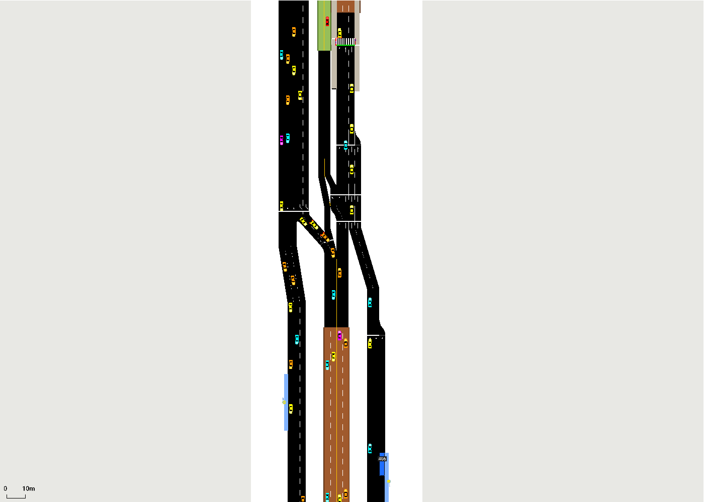
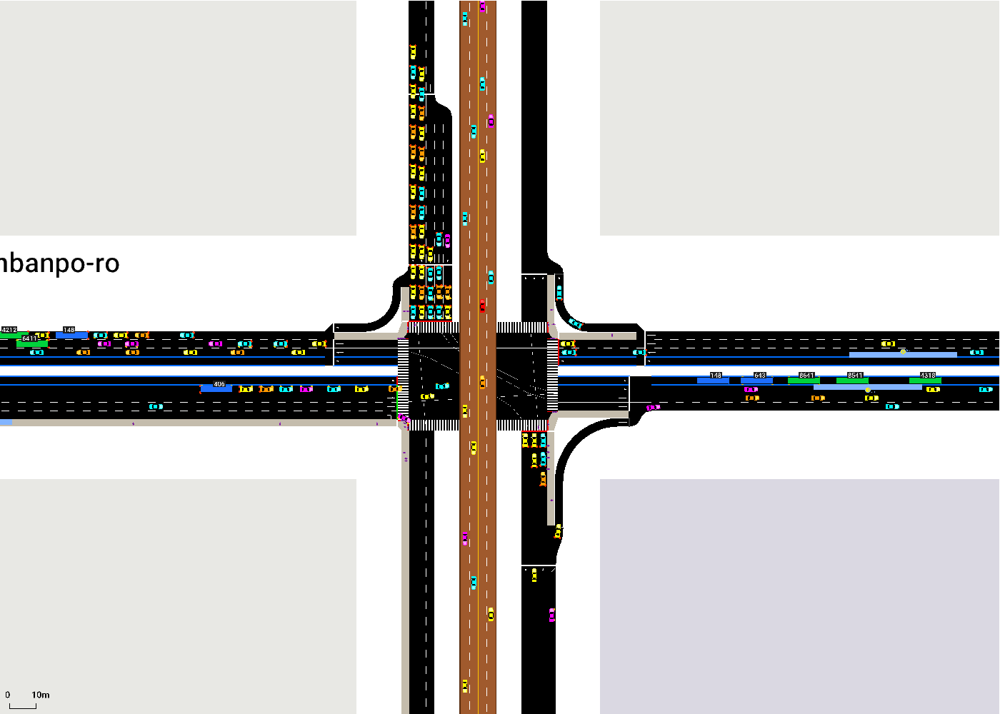
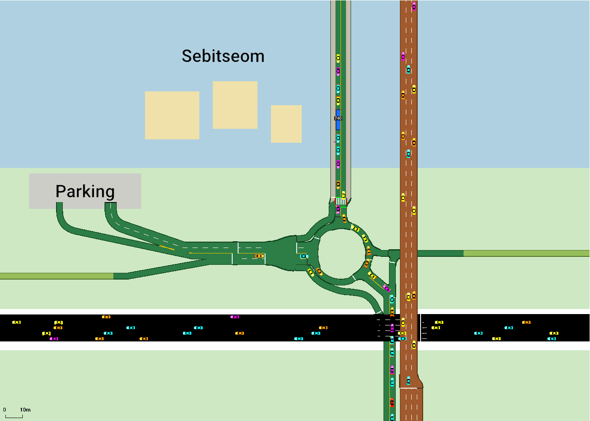
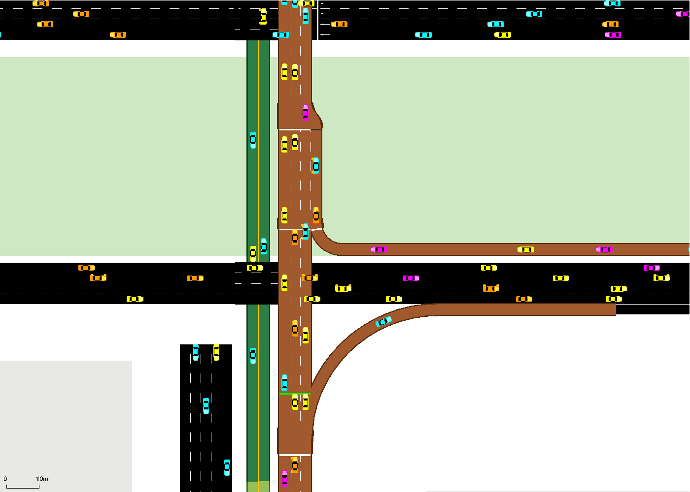

# 프로젝트 기록 — 반포대교 남단 · 잠수교 통제 전후 (SUMO)

> 도로 · 교통 · 자율주행차(AV)를 어떻게 만들었고 최종 결과가 무엇인지 정리한 문서다. 설치 · 실행은 [`README.md`](../README.md), 교통 실측 원자료는 [`environment/road/measured/`](../environment/road/measured/), 수집 데이터 설명은 [Hugging Face 데이터셋 카드](https://huggingface.co/datasets/skku-aicad-2026-team12/banpo-av-dataset)에 있다.

**목차**: 1 한눈에 · 2 왜 이 도로인가 · 3 도로 · 4 시나리오와 AV 경로 · 5 교통 · 6 구현 구조와 데이터 칼럼 · 7 AV 학습과 결과 · 8 주요 결정과 이유 · 부록 문제와 해결 기록

---

## 1. 한눈에

| 항목 | 내용 |
|---|---|
| 지역 | 서울 서초구 반포동, 신반포사거리 ~ 반포대교 남단 접속부 (잠수교 남단 포함) |
| 주제 | 잠수교 차량 통제(2026-10-26, 보행전용교 공사) 전 · 후, 반포대교 남단 입체 접속부를 지나 강북으로 건너가는 차량의 상호작용 |
| 도로망 | 차도 엣지 67 · 차로 171 · 도로 길이 10.4 km (차로 길이 합 30.1 km) · 교차점 56 (신호 5) · 보도 · 횡단보도 7곳. 고가 / 지상 / 한강 둔치 3층 입체 접속부 |
| 시나리오 | 통제 전(잠수교 통행) / 통제 후(잠수교 차량 통제) — **도로망 하나**에서 수요 · 버스 경로 · 잠수교 통행만 바꿈 |
| 교통 | 모두 실측 — 수요 TOPIS(통제 전) · t-data(통제 후), 신호 5곳 C-ITS 신호 기록, 공식 버스 34개 노선, 보행자 |
| AV 경로 | 5개 — 통제 전 잠수교행 2 (`goga-jamsu` · `oly-jamsu`), 통제 후 반포대교행 3 (`side-banpo` · `goga-banpo` · `sbr-banpo`). 출발 차로 무작위 |
| AV | 관측 49차원 · 행동 가감속 + 차로 변경 · 강제 제동 안전장치 없음 |
| 학습 | 규칙 정책 선생님 → BC + DAgger → 선생님 보정 PPO |
| 결과 | 새 시드 3,000판 **도착률 98.8% · 충돌률 0.6%** (수업 기준 충돌률 5% 미만) |
| 데이터 | 최종 모델로 26,000판 · 10,558,595행 수집. 수업 기본 칼럼 + 추가 칼럼 (§6.1) |


---

## 2. 왜 이 도로인가

1. **실제 정책 변화가 만든 실험**: 2026-10-26부터 잠수교 다리만 차량이 통제됐다 (2027-08 완공 목표, 740 · 405번 버스도 반포대교로 우회). 지하차도·회전교차로·루프·주차장은 그대로 통행한다 → **도로 모양은 거의 같고 수요가 바뀐다.** 같은 AV를 통제 전 · 후 두 교통 상황에서 비교할 수 있다.
2. **위에서 보면 한 점, 실제로는 입체 접속부**: 고가·지상·지하가 겹쳐 있고, 반포대교 직전 약 300 m 안에 **합류 → 왼쪽 분기(①) → 차로 감소 → 오른쪽 분기(②) → 합류(③)**가 연달아 나온다.
3. **멀리 앞서 내려야 하는 결정**: 잠수교 지하차도(①)는 합류 직후 고가 쪽 왼쪽 차로에서만 갈라진다. 측도에서는 못 들어간다 → 잠수교로 가려면 **580 m 앞 고가·측도 분기에서 고가를, 그것도 왼쪽 차로를** 골라야 한다.
4. **수업이 요구한 구조 모듈이 거의 다 있다** (§3.2): 신호 사거리, 회전교차로, 합류, 분기, 차로 감소, 엮임, 다중 차선, 버스전용·버스 정류소.
5. **교통 · 신호 · 버스가 실측이다** (§5): 교통량은 통제 전 TOPIS · 통제 후 t-data, 신호 5곳은 C-ITS 신호 기록, 버스는 공식 노선 · 배차 · 정류소. 통제 후 반포대교 북행 실측은 +4%(2,736 → 2,858) — 잠수교 교통의 약 22%만 반포대교로 옮겨 왔다.

---

## 3. 도로

### 3.1 근거와 단순화 원칙

- **근거**: 구간 길이는 OpenStreetMap 좌표, 차로 수 · 차로 용도는 네이버 로드뷰(직접 확인 — OSM 차로 수가 틀린 곳이 여러 곳), 분기 방향 · 입체 구조는 OSM + 지도 + 서울시 보도자료 사진.
- **모양은 단순하게, 길이는 실제대로**: 도로를 직선과 원호로 그리고 남북·동서로 정렬했다. 대신 구간 길이 · 램프 길이 · 차로 수는 실제 값을 지킨다 → 상호작용이 일어나는 거리(합류 구간 길이, 분기까지 남은 거리)가 실제와 같다.
- **범위**: 반포대로 북행을 축으로 신반포사거리 남쪽부터 반포대교 상층까지 + 올림픽대로 양방향 일부, 신반포로 양쪽 200 m, 잠수교 남단 회전교차로 · 루프 · 주차장 램프. 끝은 열린 도로(진입로 · 출구 200~400 m)라 차량이 생기고 사라진다.

### 3.2 도로 구조 모듈

| 모듈 | 위치 | 생기는 상호작용 |
|---|---|---|
| 분기 (멀리 앞선 차로 선택) | 고가·측도 분기 (반포대로 6차로 → 고가 2 · 측도 4) | 목적지에 맞는 길·차로를 580 m 앞에서 선택 |
| 신호 사거리 · 신호 | 신반포사거리 (강남터미널고가 밑, 신반포로와 교차, 중앙 버스전용) + 반포대로 북행 횡단보도 · 반포대교남단 신호(연동) + 잠수교 신호 2곳 | 신호 정지·진행, 직진 vs 좌회전, 버스, 보행자 |
| 합류 + 차로 감소 | 고가 2 + 측도 2 → 4 → 측도 쪽 바깥 차로 끝 → 3 | 합류 타이밍, 차로 끝 앞 양보 |
| 왼쪽 분기 | ① 잠수교 지하차도 (합류 직후 고가 쪽 왼쪽 차로가 둘로) | 분기 놓침 = 경로 이탈 |
| 오른쪽 분기 | ② 올림픽대로 하남 방향 진출 | ①·②로 반대 방향 차로 변경이 엇갈림 |
| 합류 | ③ 올림픽대로 김포 방향 → 반포대교 상층 (왼쪽 진출 램프가 상층 오른쪽 차로와 합쳐짐) | 램프 차량 vs 본선, 통제 후 수요가 몰리는 곳 |
| 회전교차로 | 잠수교 남단 (반시계 1차로, 4방향, 서쪽 진입 2 → 1, 지하차도는 남동쪽에서 정면 진입) + 우회전 우회로 3개 | 회전 중 차량에 양보 후 진입 (통제 전 진입 대기열), 우회로로 바로 빠지기 |
| 엮임 (weaving) | 올림픽대로 김포 방향 260 m (루프 합류 → 주차장 진출) | 엇갈리는 차로 변경 |
| 버스전용 · 정류소 | 신반포로 중앙 버스전용차로, 정류소 6곳 (중앙 · 측도 · 가로변, §5.2) | 버스만 통행, 정차 버스 피하기, 가로변 정류소로 빠지는 버스 |
| 우회전 도로 | 신반포사거리 우회전 3곳 (별도 도로, 신호 없이 양보 합류). 측도 북행은 사거리 50 m 앞에서 갈라짐 | 양보 합류, 우회전 차로 미리 타기 |
| 횡단보도 · 보행자 | 신반포사거리 4 · 반포대로 북행 1 · 잠수교 2 | 신호 횡단, 우회전 차량 보행자 양보 |








### 3.3 차로 규칙 (실제 도로 규칙을 그대로)

- **① 지하차도 진입**: 고가 쪽 왼쪽 차로만 ① 전용 차로로 이어진다. 그 옆 차로에서 ① 전용 차로로, ① 전용 차로에서 바깥으로의 차로 변경은 금지(긴급차만 허용) → 측도에서 온 차는 ①로 못 간다.
- **신반포사거리**: 진입마다 차로별 회전 방향을 로드뷰 확인값대로 연결 (예: 신반포로 서행은 좌회전 금지, 측도 남행은 좌회전 3차로). 측도 남행 좌회전 포켓에서 가장 오른쪽 차로는 우회전 도로 차로로만 이어진다 (부록 #21). 신호는 §5.3.
- **중앙 버스전용**: 신반포로 각 방향 가장 왼쪽 차로는 버스만.
- **U턴 없음** (SUMO가 도로 끝에 자동으로 만드는 U턴 연결을 끔).
- **지하차도 남행**은 반포대로 가운데로 올라와 강남터미널고가 남행 왼쪽 차로로 합류한다. 합류점에서는 **지하차도 남행이 우선** (부록 #15).
- **교차로 안 차로 변경 금지** (모든 지정 연결, 부록 #32) · **사거리 출구 짧은 도로 차로 변경 금지** (`side_a8a` 22 m · `sbr_e1a` 28 m · `sbr_e2a` 33 m — 횡단보도 위, 부록 #36). **AV도 측도 경로의 사거리 출구 22 m에서는 차로를 바꿀 수 없다.**
- **신반포사거리 동행 우회전**은 남측 횡단보도 보행 신호(점멸 포함) 동안 멈춘다 (도로교통법 우회전 일시정지, 실측 신호 구성).
- 보도는 netconvert가 0번 차로로 넣으므로 **보도가 있는 도로는 차량 차로 번호가 1씩 밀린다** (`ego_lane` 칼럼도 도로망 차로 번호). AV 관측에서 보도 · 버스 전용 차로는 "없는 차로"(−1)로 보이고, AV 차로 변경도 그 차로로는 하지 않는다.

### 3.4 화면 표시 (주행 영상용)

sumo-gui는 도로를 높이와 상관없이 평면으로 겹쳐 그려서, 지하차도가 고가 위에 보이는 등 입체 구조를 알아볼 수 없었다. 그래서 **지도의 높이별 색(낮을수록 초록, 높을수록 갈색)**으로 층을 구분하고, 아래층부터 차례로 다시 그려 위아래를 고정했다.

| 색 | 높이 | 도로 |
|---|---|---|
| 갈색 | 고가 +6 m | 강남터미널고가 · 반포대교 상층 · ③ 램프 |
| 검정 (SUMO 기본) | 지상 0 m | 반포대로 · 신반포로 · 올림픽대로 |
| 연두 | −3 ~ −8 m | 경사로 중간 (지하차도 진입부 · 루프 · 주차장 램프) |
| 진초록 | 한강 둔치 −10 m | 잠수교 지하차도 · 회전교차로 · 잠수교 · 주차장 |

- 그 밖에: 버스는 노선 유형 색(간선 파랑 · 지선 초록 · 광역 빨강) + 노선 번호, 차량 실제 모양, 보도 · 횡단보도 · 중앙선, 한강 · 반포한강공원 · 시가지 배경과 영어 지명 — 영상에서 장소가 바로 읽히게.
- 그리는 방법과 sumo-gui 동작에 맞춘 주의점은 `environment/road/README.md` "화면 표시".



---

## 4. 시나리오와 AV 경로

### 4.1 통제 전 · 후

- **도로망은 하나**다. 전 · 후 도로망을 따로 만들면 "도로가 달라서 결과가 달라졌다"는 의심을 피할 수 없다. 실제로도 바뀐 것은 잠수교 다리 통행뿐이다.
- 바꾸는 것:
  1. **수요**: 시나리오별 수요 파일 (`banpo.before.rou.xml` / `banpo.after.rou.xml`, §5.1).
  2. **버스**: 740 · 405는 통제 전 잠수교, 후 반포대교 · 측도 (§5.2).
  3. **잠수교 통제**: 통제 후에는 잠수교 차로를 보행자 전용으로 바꾼다 — SUMO가 잠수교를 지나는 경로 자체를 거부한다. 잠수교 신호 2곳은 실제처럼 끈다(통제 후 점멸).
- **시나리오는 AV 경로로 정해진다**: 잠수교행 2개는 통제 전, 반포대교행 3개는 통제 후. 같은 경로를 통제 전 · 후로 달려 보면 주행 지표 차이가 작아(SUMO 기본 운전자, 같은 시드 비교), 통제의 효과는 "같은 길이 더 막힌다"보다 "잠수교로 가는 길이 사라지고 반포대교로 수요가 옮겨 간다"에 있다. 그래서 경로마다 그 경로가 의미 있는 시나리오 하나만 쓴다.

### 4.2 AV 경로

| 경로 | 시나리오 | 출발 → 도착 | AV가 내릴 결정 | 출발 차로 |
|---|---|---|---|---|
| `goga-jamsu` | 통제 전 | 반포대로 북행 → 고가 왼쪽 차로 → ① 지하차도 → 회전교차로 → 잠수교 신호 2곳 → 잠수교 | 580 m 앞 고가 · 왼쪽 차로 선택, ① 진입, 회전교차로 양보 | 전 차로 |
| `oly-jamsu` | 통제 전 | 올림픽대로 김포 방향 → 엮임 구간 → 주차장 램프 → 회전교차로 서쪽 진입 → 잠수교 | 엮임 구간 차로 변경, 회전교차로 양보 진입 | 0~2번 |
| `side-banpo` | 통제 후 | 반포대로 북행 → 측도 → 신반포사거리(신호) → 합류(측도 쪽 차로 끝) → 북행 횡단보도 · 반포대교남단 신호 → ② 분기 → ③ 합류 → 반포대교 | 신호 정지 · 진행, 정차 버스 피하기, 차로 감소 합류, ② · ③ 구간 차로 유지 | 전 차로 |
| `goga-banpo` | 통제 후 | 반포대로 북행 → 고가 직진 → 합류 → 신호 2곳 → ② → ③ → 반포대교 | ① 지하차도 차로를 피해 오른쪽 차로 유지, ③ 합류 차량 대응 (통제 후 수요가 몰리는 길) | 전 차로 |
| `sbr-banpo` | 통제 후 | 신반포로 서행 → 사거리 우회전 도로(신호 없이 양보 합류) → 측도 → 합류 → ② → ③ → 반포대교 | 짧은 거리 안에 오른쪽으로 옮겨 우회전, 양보 합류 | 0 · 1번 |

- 경로 이름은 `<출발 도로>-<건너는 다리>`다 (side 측도 · goga 고가 · oly 올림픽대로 · sbr 신반포로).
- **출발 차로는 무작위**로 뽑아(`--depart-lane random`) 차로 선택까지 정책이 직접 하게 했다. 출발 속도는 출발 차로 제한속도의 0.8배.
- 뺀 출발 차로 두 가지: `oly-jamsu` 3 · 4번(선생님도 16판 중 11 · 13판만 도착), `sbr-banpo` 2번(짧은 거리에 오른쪽으로 두 번 옮겨야 해 선생님 · 모델 모두 멈춤 — 부록 #81).
- 루프 · 주차장 · 올림픽대로 하남 방향 · 신반포로 동행 · 남행 도로는 **배경 교통**이 쓴다.

---

## 5. 교통 (수요 · 버스 · 신호)

현재 값만 적는다. 출처 · 산정 과정 · 원자료는 `environment/road/measured/README.md`, 설정 위치는 `environment/env/road_config.py`(수요 · 버스) · `environment/road/road_spec.py` `SIGNALS`(신호).

### 5.1 수요 — 평일 11~15시 평균, 통제 전 TOPIS · 통제 후 t-data 실측

| 진입점 | 통제 전 | 통제 후 | 근거 |
|---|---|---|---|
| 반포대교에서 내려오는 남행 | 2,211 | 2,384 | TOPIS C-11 · t-data **실측** |
| 잠수교 남행 | 461 | — | TOPIS C-12 **실측** |
| 반포대로 북행 | 2,181 | 2,233 | TOPIS D-37(서초역) **실측, 대용** · t-data 실측 |
| 올림픽대로 김포 방향 / 하남 방향 | 6,937 / 5,131 | 7,190 / 5,219 | TOPIS F-01 **실측, 대용** · t-data 실측 |
| 신반포로 동행 / 서행 | 1,230 / 987 | 같음 | **추정** — 측정 지점 없음. 실측 신호에서 포화도 0.9 이하가 되는 크기 |
| 반포한강공원 주차장 | 60 | 60 | 가정 (자료 없음) |

- **출구 비율**은 회전 교통량 실측이 없어 측정 링크가 실측과 맞도록 보정했다 (반포대교 북행 −2% · 통제 후 +0.4%, 잠수교 북행 −2.5%, 반포대로 남행 −7 / −8%). 직진 차는 고가 65 : 측도 35 (가정).
- **통제 후**: 반포대교 북행 실측 2,858 (+4%) — 잠수교 북행 563 중 약 22%만 반포대교로. 모델은 잠수교로 가던 출구 몫의 22%만 반포대교, 78%는 다른 출구에 원래 비율대로 나눈다.
- 평일 낮 평균, 실측 100% — 시간대별 수요 · 축소 없음 (이유 §8). 대형차는 차종 실측이 없어 넣지 않았다 (§8).

### 5.2 버스 — 공식 노선 34개

범위 안 정류소 6곳(반포대교남단 22381 · 22382, 고속터미널(중) 22019 · 22020, 신반포역 22021 · 22022)을 지나는 노선을 공식 자료로 모두 찾고, 범위 밖 앞뒤 정류소로 진입 → 진출 방향을 판정했다.

| 구분 | 노선 | 경로 · 정차 |
|---|---|---|
| 신반포로 직진 | 서행 26 · 동행 24 flow (148 · 360 · 361 · 452 · 540 · 640 · 643 · 0411 · 4212 · 4318 · 6411 · 8541 · 8641 · 345 · 3420 · 9408 · 9500 · 9501 · 9802 · 6020 · 6427 · 6428 · M6457 · M6458 · M6463 · M6427) | 중앙 버스 차로. 공식 정차 정류소대로 고속터미널(중) · 신반포역 정차 (신반포역은 가로변 — 끝 차로로 빠져 섬) |
| 반포대교 ↔ 고속터미널 | 143 · 401 (양방향), 9007 · 5104 (반포대교 → 고속터미널) | 사거리 회전, 반포대교남단 · 고속터미널(중) 동행 정차 |
| 반포대교 ↔ 신반포역 | 406 (양방향) | 사거리 회전, 반포대교남단 · 신반포역 정차 |
| 반포대로 남쪽 → 고속터미널 | 142 · 3420 · 345 | 측도 우회전 도로 |
| 740 · 405 | 정차 없이 지나감 | 통제 전 잠수교(740 양방향, 405 남행만) + 고가 → 통제 후 반포대교 + 측도 |

- 노선마다 공식 배차 간격 (예: 8641 5분 · 360 6분 · 9007 30분 · 6427 240분), 정차 20 s. 시간당 버스: 신반포로 서행 약 113 · 동행 약 103대, 회전 노선 · 740 · 405 약 75대.
- 뺀 노선 · 생략한 정차와 신반포역 정류소 위치는 `environment/road/measured/README.md` §4.

### 5.3 신호 — C-ITS 실측 5곳

t-data 신호제어기 신호 기록(1초 간격)을 통제 전 10/21 · 후 11/11 평일 10~16시로 분석했다 (두 날 운영 같음). 기준 0 = 신반포사거리 동행 직진 녹색 시작.

| 신호 | 주기 | 차량 녹색 (시작 s – 길이 s) | 보행 |
|---|---|---|---|
| 신반포사거리 (4031) | 170 | 서행 직진 · 동행 버스 0–44 · 동행 직진 0–85 · 동행 좌회전 49–36 · 동행 우회전 44–41 (양보, 남측 보행 중 정지) · 측도 남행 90–40 · 측도 북행 134–32 | 4곳 (3 · 3 · 92 · 137 s부터 10~14 s) |
| 반포대로 북행 횡단보도 (24032) | 170 (연동) | 북행 54–143 | 33–13 |
| 반포대교남단 (4032) | 170 (연동) | 북행 직진 78–117 (남행 → 올림픽대로 하남 좌회전 28–74는 모델에 없어 북행 적색으로만) | — |
| 잠수교남단 (4616) · 잠수교 (24616) | 75 | 양방향 0–40 · 0–46 | 45–10 · 51–13 (통제 후 점멸 → 끔) |

- 실측 전에 서울시 운영 방식 + 실측 수요 + Webster로 계산한 추정도 주기 170 s를 맞혔다 (현시 구성 · 녹색은 달랐음 — `environment/road/measured/README.md` §3.3). 우회전 도로 3곳은 비신호.

---

## 6. 구현 구조와 데이터 칼럼

```
environment/road/road_spec.py  ── 도로 정의 단일 원천 (좌표 · 노드 · 엣지 · 차로 단위 연결 · 층 높이 · AV 경로 · 시나리오 · 실측 신호 · 보도 · 보행자)
      │
      ├─ environment/road/build_net.py  → XML → netconvert → 신호 프로그램 5곳 적용 → 도로망 (검증용, environment/road/build/)
      │      └─ environment/road/check_net.py  길이 · 경로표 · 차로 규칙 · 경로별 1대 주행 자동 검사
      │
      ├─ environment/road/calibrate.py  TOPIS · t-data 실측 → 측정 링크 교통량 비교 · 실측 신호 포화도 → 신반포로 진입량
      │
      └─ environment/env/road_builder.py → 수업 환경용 도로망 + 시나리오별 수요(배경차 · 버스 · 보행자 · 정류소) + 화면 표시(층 색 · 보도 · 버스 색 · 배경) (environment/env/sumo/banpo/)
             └─ environment/env/sumo_env.py (수업 Gym 환경) ← environment/road/check_env.py  AV 주행 · 배경 교통 검증
```

- 도로를 바꿀 때는 `road_spec.py` 한 파일만 고치고, 검사를 다시 통과시킨다. 수요·버스는 `environment/env/road_config.py`.
- **차로 단위 연결을 직접 지정**했다 (netconvert 자동 추정에 맡기지 않음). 어느 차로가 어느 차로로 이어지는지가 곧 "측도에서는 ①로 못 간다" 같은 실제 규칙이기 때문이다.
- **입체 교차는 노드를 공유하지 않는다**: 고가·반포대교·지하차도가 다른 도로 위아래를 지나는 곳에 교차로가 생기지 않는다 (SUMO가 평면 교차로로 만들어 버리는 것을 막음).
- **배경차**는 수업 코드의 4가지 차량 모델(Krauss · IDM · EIDM · ACC)을 섞어 쓴다. 출구별 경로는 차로 단위로 찾되, "출구|경유 도로"로 고가·측도를 나눠 지정할 수 있다.

### 6.1 데이터 칼럼 — 수업 기본 + 추가 칼럼

수집 코드 `data_collection/collect_pomdp_data.py`. 수업 기본 칼럼은 하나도 빼지 않고(수업 규칙), **기존 칼럼으로 계산되지 않는 것만** 추가했다 (계산되는 값을 또 저장하면 감점 요인).

| 추가 칼럼 | 내용 | 기존 칼럼으로 계산되지 않는 이유 |
|---|---|---|
| `sim_time` | 관측 시점의 시뮬레이션 시각 (s) | 신호 5곳은 고정 주기라 이 값으로 **모든** 신호 상태를 계산할 수 있다. 스텝 번호로는 못 구한다 (예열 · AV 투입 대기가 판마다 다름) |
| `ego_route` | 0 `side-banpo` · 1 `goga-banpo` · 2 `goga-jamsu` · 3 `oly-jamsu` · 4 `sbr-banpo` | 출발 도로가 같은 경로가 있어 분기 전까지는 state만으로 목적지를 알 수 없다. 시나리오도 이것으로 정해진다 (2 · 3 = 통제 전, 0 · 1 · 4 = 통제 후) |
| `signal_tls` · `signal_state` · `signal_remaining_s` | AV가 다음에 만날 신호의 번호 · 색(녹 1 · 황 0.5 · 적 0 · 꺼짐/없음 −1) · 색이 바뀔 때까지 남은 시간 (s) | state · observation에 신호가 없다 (수업: 신호를 쓰면 State에 신호 상태). 남은 시간은 정책이 모르는 privileged 값 — 신호 변화 예측 · 빨간불 대기 분석의 정답 |
| `end_reason` | 마지막 스텝의 종료 원인: 0 진행 중 · 1 도착 · 2 충돌 · 3 경로 이탈 · 4 비정상 정지 · 5 순간이동 · 6 시간초과 · 7 기타 · 8 신호 위반 | 충돌 · 도착 · 시간초과는 기존 칼럼으로도 알 수 있지만, 비정상 정지 · 경로 이탈 · 순간이동 · 신호 위반은 구분되지 않는다 |

- JSONL · NPZ 모두 숫자 코드로 저장한다 (수업 안내: 문자열보다 숫자, 신호 칼럼은 차원을 나눠서).
- **넣지 않은 것**: 주변 차량 목적지(차량 id `f_<진입>__<출구>…` · `bus_<노선>__<진입>__<출구>…`로 계산됨), 차량 기준 차로 번호(보도 때문에 SUMO 차로 번호가 1씩 밀리지만 `lane_id` + 도로망으로 계산됨 — `evaluation/lanes.py`).
- **state는 도로 위 차량 전체**(약 450대)를 저장한다 → transition당 약 12 kB. 기본 칼럼이라 줄이지 않았다.
- **최종 데이터셋**: 최종 모델 · 5개 경로 · 무작위 출발 차로로 26,000판 · 10,558,595행. 판마다 서로 다른 SUMO 시드를 지정했다 (부록 #90). 칼럼 설명과 분포는 Hugging Face 데이터셋 카드.

---

## 7. AV 학습과 결과

수업 원본 환경 그대로는 학습이 될 수 없는 이유가 둘 있었다: **AV가 경로를 모르고**(분기 앞에서 어느 길로 가야 하는지 관측에 없음, 부록 #53) **신호를 무시한다**(수업 원본은 신호 무시 모드 + 관측에 신호 없음, 부록 #54). 그래서 관측 · 보상을 넓히고, 규칙 정책을 선생님으로 한 모방학습 위에 PPO를 얹었다.

### 7.1 관측 — 49차원

수업 기본 31차원에 18칸을 붙였다 (수업: "추가 State / Observation 항목은 자유롭게 확장 가능"). 정의 원본은 `environment/env/mdp_config.py` 주석, 계산은 `environment/env/sumo_env.py`.

| 칸 | 내용 |
|---|---|
| [0] | 내 속도 (수업 원본) |
| [1..20] | 5개 차로(좌2 · 좌1 · 현재 · 우1 · 우2)의 앞차 · 뒤차 거리와 상대속도 (수업 원본). 나란히 달리는 옆 차로 차는 앞 · 뒤 거리 0으로 넣는다 — 원본은 이 차를 빼서 차로 변경 판단을 할 수 없었다 |
| [21..25] | 5개 차로 연결성 (수업 원본) |
| [26..30] | 5개 차로 앞 차량 밀도 (수업 원본) |
| [31..34] | **경로**: 앞으로 만날 분기 2개에서 경로가 가는 방향(왼쪽 +1 · 오른쪽 −1)과 거리 — 내비게이션의 "300 m 앞 우회전" 수준 |
| [35..38] | **내 차로 진행 방향**: 지금 차로를 따라가면 분기 2개에서 왼쪽 · 오른쪽 길로 나갈 수 있는지 (노면 화살표에 해당) |
| [39..41] | **신호**: 앞 신호 색 · 정지선까지 거리 · 색이 바뀔 때까지 남은 시간 (C-ITS 기준) |
| [42..45] | **경합 차량**: 교차로 · 합류에서 만날 차와 경합 지점까지 거리, 상대 속도, 우선권 |
| [46..48] | **차로 제한속도**: 지금 차로 · 경로상 다음 제한속도와 거기까지 거리 |

- "어느 차로로 가라"는 정보는 주지 않는다 (수업 안내: 라우팅은 지도 수준만 가능). 경로 방향과 각 차로가 어디로 이어지는지만 보고 차로 선택은 정책이 배운다 (부록 #69).
- 보도 · 버스전용 차로는 관측에서 "없는 차로"로 보이고, 그 차로로는 차로 변경도 하지 않는다.

### 7.2 행동

- **가감속**(연속, 최대 ±5.4 m/s²)과 **차로 변경**(왼쪽 · 유지 · 오른쪽). 속도 명령 상한은 지금 차로 제한속도.
- 수업 원본의 차로 변경 안전 게이트(`lane_change_safety`)는 원본 그대로 켜 두었다.
- **종방향 안전장치(강제 제동)는 쓰지 않는다.** 코드에는 남아 있지만(`mdp_config.ACTION["safety_brake"]`, 기본 끔) 수업 컨설팅에서 허용되지 않아 학습 · 평가 · 수집 모두 끈 채로 했다.

### 7.3 보상 · 종료

최종 모델 학습 값 (`training/train.py`의 `REWARD_OVERRIDES`, 학습 당시 사본은 `results/team_rl_1120_U5/train.py`).

| 항목 | 값 |
|---|---|
| 속도 보상 | 스텝당 0.1 × min(속도 / 지금 차로 제한속도, 1) — 수업 원본은 80 km/h 기준이라 50~60 km/h 도로에서 과속할수록 보상이 컸다 (부록 #55) |
| 도착 | +2, 종료 |
| 충돌 | −20, 종료. 충돌 = 앞차 minGap 2.5 m 안 (SUMO 기본 판정, 수업 원본 설정) |
| 신호 위반 | −20, 종료. 적색에 정지선을 넘어 접근 도로를 벗어나면 (황색 진입은 위반 아님) |
| 비정상 정지 | −20, 종료. 120 s 계속 정지 (빨간불 대기 시간은 빼고 셈) |
| 근접 감점 | 5 m/s 이상으로 달리며 앞차와 6 m 미만이면 스텝당 −0.1 |
| 접근 감점 | 같은 차로 앞차와 충돌까지 남은 시간(TTC)이 2초 미만이면 스텝당 −0.2 (속도 무관) |

- 실패 벌점을 모두 20으로 둔 이유: 5일 때는 실패를 조금 늘리고 도착한 판에서 더 버는 쪽이 리턴이 높아, 리턴 순위가 평가(도착 · 충돌) 순위와 반대였다 (부록 #70).
- 잘못된 차로로 들어갔다고 바로 끝내는 조기 종료는 쓰지 않는다 — 모델은 분기 직전에 차로를 옮겨 도착하는데 그 전에 끝내 버렸다 (부록 #80). 잘못된 차로에 들면 차로 끝에 서서 비정상 정지로 끝난다.

### 7.4 학습 — 선생님 → BC · DAgger → 선생님 보정 PPO

학습 코드는 `training/train_team.py` (`bc` → `rl`). 수업 PPO 코드(`training/algorithms/ppo.py`)는 고치지 않고 그대로 불러 쓴다.

1. **선생님 (규칙 정책)** — `environment/road/check_env.py`의 `rule_policy`. 관측만 보고 운전하는 IDM 기반 규칙: 신호 대비(황색 전에 미리 감속), 경합 차량 양보, 차로 변경과 틈 만들기. 혼자 운전하면 무작위 출발 200판 중 198판 도착 · 충돌 0. 학습 데이터의 **정답만** 만들고, 최종 AV는 신경망만으로 주행한다 (수업 7주차 모방학습의 IDM 전문가 예, 조교 답 "IDM으로 데이터셋 생성해도 됩니다").
2. **BC + DAgger** — 선생님 시범으로 PPO 정책 자체를 지도학습해 그대로 PPO로 이어 쓴다 (부록 #61). 이어서 BC가 일부러 흔들리며(σ 0.2) 운전한 상태에 선생님 정답을 붙이는 DAgger로 누적 오차를 줄였다. 실패는 대부분 "선생님보다 덜 감속"이었고 그런 스텝이 0.15%뿐이라, 달리는 중 감속 스텝에 손실 가중치 4를 줬다 → **BC r8b4n** (새 시드 1,000판 도착 980 · 충돌 8).
3. **선생님 보정 PPO** — 그냥 PPO로 이어 학습하면 감속이 풀려 충돌이 늘었다 (부록 #84). 그래서 **PPO 업데이트마다 그 rollout의 관측에 선생님 정답을 붙여 BC를 한 번 더** 한다 (`--teacher-lr 2e-4`). 설정: r8b4n에서 출발, 워커 7개, 업데이트당 8,176 transition, 학습률 5e-5, 60만 스텝 중 26.2만 스텝 저장 모델 (`results/team_rl_1120_U5/args.json`).

### 7.5 평가 방법

- `evaluation/baseline.py` — 5개 경로 × 무작위 출발 차로, 안전장치 끔. 실패는 종료 원인별로 세고, 주행 지표(주행 · 정지 시간, 차로 변경 등)를 SUMO 기본 운전자 기준 지표와 나란히 보고한다.
- **에피소드 번호 = SUMO 시드**라 모델끼리 같은 교통 조건에서 비교된다.
- 시드 구분: 모델 고르기는 선별 전용 판 300~349, 후보 비교는 판 100~299 · 400~599, **마지막 확정은 어디에도 쓰지 않은 판 600~799**. 판 수가 적으면 운 좋은 모델이 뽑혀(부록 #83 · #85) 이렇게 나눴다.

### 7.6 결과

**최종 모델**: `results/team_rl_1120_U5/model_261632.pt` (선생님 보정 PPO, 26.2만 스텝).

대표 수치 — 새 시드 세 묶음 3,000판 (판 100~299 · 400~599 · 600~799, 5개 경로 × 600판):

| 도착률 | 충돌률 | 실패 |
|---|---|---|
| **98.8%** (2,957 / 2,994, AV 삽입 오류 6판 제외) | **0.6%** (18판) | 충돌 18 · 신호 위반 10 · 비정상 정지 4 · 시간초과 5 |

경로별 — 확정 평가 1,000판 (판 600~799, [`evaluation/eval/final_U5_261632/report.md`](../evaluation/eval/final_U5_261632/report.md)):

| 경로 | 시나리오 | 도착 | 실패 | 평균 주행 시간 (AV / SUMO 기본 운전자) |
|---|---|---|---|---|
| `goga-jamsu` | 통제 전 | 200 / 200 | — | 214 s / 216 s |
| `oly-jamsu` | 통제 전 | 189 / 200 | 충돌 8 · 정지 2 · 시간초과 1 | 248 s / 236 s |
| `side-banpo` | 통제 후 | 199 / 200 | 시간초과 1 | 291 s / 254 s |
| `goga-banpo` | 통제 후 | 200 / 200 | — | 127 s / 125 s |
| `sbr-banpo` | 통제 후 | 200 / 200 | — | 135 s / 125 s |
| 합계 | | **988 / 1,000** | 충돌 8 (0.8%) | |

단계별 비교 — 같은 새 시드 2,000판 (판 100~299 · 400~599):

| 모델 | 도착 | 충돌 | 신호 위반 |
|---|---|---|---|
| BC r8b4n | 1,959 | 17 | 13 |
| **선생님 보정 PPO (최종)** | **1,969** | **10** | **10** |

- 남은 실패는 대부분 `oly-jamsu`의 회전교차로 · 합류 구간이다. 선생님에게 같은 시드로 처음부터 운전시켜 보니(두 경로 800판) 선생님 도착 779 · 최종 모델 771로 차이가 약 0.4%p이고 충돌은 최종 모델이 더 적었다 (12 대 9). 남은 개선 폭이 같은 설정을 다시 돌릴 때의 흔들림(1,000판당 5판 안팎)보다 작아 모델 개선은 여기서 마쳤다 (부록 #87 · #88).

### 7.7 쓰지 않은 것

- **안전장치(강제 제동)** — §7.2.
- **state에 보행자**: AV 경로에서 보행자와 만나는 곳은 신호 횡단보도뿐이고 보행자가 건널 때 AV 쪽은 적색이라, 신호를 지키면 얽히지 않는다. 위반은 신호 위반 종료가 잡는다.

---

## 8. 주요 결정과 이유

| 결정 | 이유 (버린 대안) |
|---|---|
| 통제 전후를 **도로망 하나**에서 전환 | 도로 차이 없이 수요 · 통제만 비교. 실제로도 다리 통행만 바뀜 (도로망 두 개는 도로 차이와 수요 차이가 섞임) |
| 수요는 **평일 낮 평균** 하나 | 평균만으로도 대기열 · 용량 근접 등 상호작용이 충분하고, 피크면 정체로 AV 실력과 무관한 정지 실패가 늘어남. 검산 근거(교통량 · 통행속도)도 낮 시간대. 에피소드가 약 11분이라 시간대 변화는 의미 없음 |
| 수요를 **줄이지 않음** (실측 100%) | 100%로도 순간이동 0. "실측 대비 −10% 이내"가 강점이고, 줄이면 근거 설명이 어려움 |
| 실측이 없으면 **근거 있는 추정으로 확정**, 실측이 생기면 교체 | 값마다 출처나 계산 근거를 댈 수 있게. 신호 · 통제 후 수요는 추정에서 t-data 실측으로 바꿈 |
| 신호 · 통제 후 수요 · 버스는 **공식 실측 자료** | C-ITS 신호 기록, t-data 교통량, 공식 버스 노선 34개 — 추정(Webster 신호, "잠수교 교통 전부 반포대교로")은 실측과 달랐음 |
| 신반포로 진입량은 **교차로 용량 기준** | 측정 지점이 없고, 인근 도로 값을 그대로 쓰면 사거리가 상시 과포화 |
| 추가 데이터 칼럼은 **기존 칼럼으로 계산되지 않는 4개만** | 계산되는 값을 또 저장하면 감점 요인 (주변 차량 목적지는 차량 id로 계산되므로 뺌) |
| 화면은 **높이별 지도 색** (초록 → 갈색) | 입체 구조를 바로 읽게 |
| 신반포역 정류소는 **가로변**, 서행 투입 −8~9%는 그대로 | 실제 가로변 정류소이고, 직진 버스의 차로 이동 지체는 실제 현상 |
| 차로 변경 시간은 **SUMO 기본(순간)** | 연속 차로 변경(4.6 s) · sublane은 합류부 측면 충돌 30건 이상 (부록 #46) |
| 반포대교 **북단 병목은 넣지 않음** | 실측 북행 속도 47 km/h로 정체 아님 (모델 49 km/h) |
| **대형차 보류** | 차종 구성 실측이 없음 |
| 지하차도는 회전교차로에 **정면 진입** | U턴 모양 진입이 충돌을 일으킴 (부록 #47) |
| 최종 AV = **선생님 보정 PPO U5 26.2만** | 580 m 앞 차로 선택을 AV가 직접 함. 3,000판 도착 98.8% · 충돌 0.6%, 규칙 정책(선생님)과 차이 약 0.4%p라 개선을 닫음 (부록 #88) |
| 선생님도 실패하는 판은 **한계로 공개** | 고칠 수 있는 폭(1,000판당 3~4판)이 실행 간 흔들림보다 작음 |

---

## 부록. 문제와 해결 기록

본문이 `부록 #번호`로 가리키는 항목이다. 도로 · 교통 · 학습을 만들며 부딪힌 문제를 발견한 순서대로 적었다. 각 항목은 "문제 — 원인 → 해결" 순서.

**도로 구축 · 환경 연결**

| # | 문제 — 원인 → 해결 |
|---|---|
| 1 | ③ 합류부가 올림픽대로 위에 겹침 — 도로 간격을 65 m → 5 m로 압축 → 실제 간격으로 복원 |
| 2 | AV가 사거리에서 120초 넘게 멈춤 — 비신호 사거리 교착 → 신호 교차로로 |
| 3 | 충돌한 AV가 "도착"으로 셈 — SUMO가 제거된 차를 도착 목록에 넣음 → 도착 · 충돌 · 경로 이탈 · 정지를 따로 판정 |
| 4 | 교차로 안 충돌이 안 잡힘 — SUMO 기본값 꺼짐 → 켬 |
| 5 | 전후 도로망 두 개는 불공정 → 도로망 하나 + 수요 파일 + 잠수교 통제 |
| 6 | 주제와 무관한 AV 경로 → 반포대로 북행 출발로 정리 |

**화면 표시 · 도로 확정**

| # | 문제 — 원인 → 해결 |
|---|---|
| 7 | 입체 구조가 안 보임 — sumo-gui는 평면으로 그림 → 층 높이 + 높이별 색 + 아래층부터 다시 그리기 |
| 8~11 | 도로가 붙거나 끊기거나 사라져 보임, 색 전환 위치 어긋남 → 간격 · 합류 위치 · 그리기 방식 수정 |
| 12 | 경사 13% · 78° 꺾임 → 교차로 구간을 평평하게, 꺾임을 곡선으로 |

**실측 교통 · 신호**

| # | 문제 — 원인 → 해결 |
|---|---|
| 13 | 올림픽대로 수요가 3,760대/시만 들어옴 — flow 하나는 초당 1대 한계 → flow 여러 개로 나눔 |
| 14 | 신반포로에 인근 실측을 그대로 넣으면 사거리 처리 불가 → 교차로 용량 기준으로 진입량 결정 |
| 15 | 잠수교 남행이 막혀 순간이동 — 지하차도 남행이 진입로에 양보 → 지하차도 남행 합류 우선 |
| 16 | 통제 후 반포대로 정체 — 늘어난 수요를 측도로 보냄 → 고가로 |
| 17 | 측도 교통 0 — 최단 경로만 씀 → 출구별 경유 지정, 고가 65 : 측도 35 |
| 18 | 신호 현시 포화도 1 이상 → Webster 배분 + 최소 녹색 보장, 포화도 0.9 이하 최단 주기 |

**버스**

| # | 문제 — 원인 → 해결 |
|---|---|
| 19 | 버스가 우회 노선뿐 → 범위 안 정류소 경유 전 노선 조사 |
| 20 | 정체 속 배경차 추돌 — ACC · EIDM 차가 선언보다 세게 섬 → apparentDecel 9 m/s² |
| 21 | 좌회전 포켓에서 버스 ↔ 승용차 충돌 — 한 차로가 둘로 갈라질 때 버스가 휨 → 연결 분리 |

**데이터 칼럼 · 수집 최적화**

| # | 문제 — 원인 → 해결 |
|---|---|
| 22 | 주변 차량 목적지 칼럼이 중복 — 차량 id에 이미 있음 → 칼럼 빼고 버스 id에도 목적지 |
| 23 | 수집이 초당 1~2 스텝 — 시간의 89%가 차량별 개별 조회 → TraCI 구독 + libsumo, 에피소드 212 s → 11 s (약 19배), 출력 바이트 단위 동일 확인 |
| 24 | 마지막 스텝 `action_raw`가 [0, 0] — 사라진 AV는 속도를 못 읽음 → 직전 가감속 유지 |
| 25 | 차로 변경 지표 이름이 실제 원인과 다름 → "합류 전 / 뒤 구간"으로 바꾸고 구간 집계임을 명시 |

**배경 교통 장시간 안정성** — `check_long.py`(4시간 × 시드 3 × 두 시나리오)로 발견 · 확인

| # | 문제 — 원인 → 해결 |
|---|---|
| 26 | 2~3시간 뒤 회전교차로 고리 교착 — 진입부가 끝없이 양보 → 배경차 `impatience` 0.5, 교착 0 |
| 27 | 올림픽대로 투입 −15~25% — 아무 빈 차로에 투입해 진입 도로에서 엇갈림 → 투입 차로 "best", −2~5%로 |
| 28 | 신반포로 대기열 증가 — #27과 같은 원인 → 같은 수정 |
| 29 | 좌회전 포켓 시작점 배경차 충돌 — 짧은 교차점에서 부채꼴 분기 → 일직선 1:1 연결, 충돌 0 |

**"실측 그대로" 반영 · 전체 검증**

| # | 문제 — 원인 → 해결 |
|---|---|
| 30 | 차로 번호가 1씩 밀림 — 보도가 0번 차로 → `road_spec.net_lane()` 변환 |
| 31 | 버스가 5대만 들어옴 — 출발 시각 순서가 깨진 수요 파일 → 출발 순으로 씀 |
| 32 | 사거리 안 측면 충돌 — 교차로 안 차로 변경 → 지정 연결 전부 차로 변경 금지 |
| 33 | 잠수교 보행자 ↔ 차량 충돌 — 보행 경로가 차도 겹친 구역으로 → 보행 경로 고정 |
| 34 | 신반포로 서행 투입 −10% — 옛 추정 신호 기준 수요 → 실측 신호로 재계산 (987대/시) |
| 35 | 좌회전 포켓 버스 충돌 (#21 · #29와 같은 형태) → 5 → 5 일직선, 우회전 도로 1.6 m 바깥으로 |
| 36 | 횡단보도 보행자 충돌 — 횡단보도 위 차로 변경 → 사거리 출구 3곳 차로 변경 금지 (AV 포함) |
| 37 | 잠수교 남행 진입 직후 추돌 — 진입 도로 16 m → 진입점을 100 m 북쪽으로 |

**화면 · 형상 정리**

| # | 문제 — 원인 → 해결 |
|---|---|
| 38~43 | 교차로 덩어리 모양, 보도 · 우회전 도로 · 우회로 · 둔치 도로 · 신호 막대가 어색하게 보임 → 보행 허용 범위 · 보도 위치 · 그리기 방식 수정 |
| 44 | 신반포역 정류소를 가로변으로 옮기자 충돌 — 사거리와 너무 가까움 → 위치 조정, 충돌 0 |
| 45 | 측도 우회전 도로가 처음부터 갈라져 보임 → 사거리 50 m 앞에서 갈라지게 |
| 46 | 버스가 여러 차로를 평행 이동 — SUMO 기본 차로 변경 → 연속 차로 변경은 충돌 30건 이상이라 **기본 유지** (화면 한계로 기록) |
| 47 | 지하차도가 회전교차로에 U턴 모양 진입 → 남동쪽 정면 진입 |
| 48 | reset마다 34 s · 0.9 GB — 보행자 flow를 한꺼번에 30만 명 생성 → flow를 6시간에서 끝냄, 1.3 s |
| 49 | `signal` 칼럼이 사거리 1곳만 기록 → **AV가 다음에 만날 신호**로 교체 |
| 50 | 통제 후 처리가 두 곳에 따로 구현 → 함수 하나로 |
| 51 | 차로 번호 칼럼 밀림 (#30) → 칼럼 추가 없이 `evaluation/lanes.py`로 변환 |
| 52 | 확정 전 전체 검토에서 관측 · 검사 스크립트 · 옵션 불일치 발견 → 일괄 수정, 죽은 코드 정리 |

**AV 학습 준비 · 학습**

| # | 문제 — 원인 → 해결 |
|---|---|
| 53 | AV가 분기 앞 차로 끝에서 멈춤 — 수업 관측에 경로 정보가 없음 → 경로 관측 추가 |
| 54 | AV가 빨간불 통과 — 수업 원본은 신호 무시 → 신호 관측 + 적색 통과 종료 · 감점 |
| 55 | 과속할수록 보상이 큼 — 80 km/h 기준 → 지금 차로 제한속도 기준 |
| 56 | 대기열에 바르게 서도 감점 → 근접 · 막힘 감점 조건 수정 |
| 57 | 학습 중 환경 파일이 바뀔 수 있음 → 임시 폴더에 만든 뒤 원자적 교체 |
| 58 | 수업 `test.py`는 실패 원인을 모름 → `end_reason`별 집계 평가 도구, 에피소드 번호 = 시드 |
| 59 | 통제 후 정체 증가가 재측정에서 재현 안 됨 — 옛 추정 수요 → 결론을 "잠수교 경로가 사라짐"으로 수정 |
| 60 | 병렬 학습이 느림 — 워커가 서로 기다림 → 워커별 독립 rollout, 115~150 스텝/초 |
| 61 | BC → PPO 이어 쓰기 불가 · 차로 유지 쏠림 → PPO 정책 자체를 BC로 학습, 차로 변경 가중치 |
| 62 | 수업 PPO가 시간초과에서 가치를 두 번 더함 → 팀 학습 코드는 종료 또는 잘림을 done으로 |
| 63 | 정지선 앞 차로 변경만으로 신호 위반 판정 → 접근 도로를 실제로 벗어날 때만 |
| 64 | 경로 관측이 도로 위에서 안 변함 — 현재 위치를 안 뺌 → 수정, 시범 · BC 재학습 |
| 65 | BC 충돌이 전부 대기 줄 추돌 — SUMO 운전자 시범이 충돌 경계에 섬 → 시범을 관측만 보는 규칙 정책(선생님)으로 |
| 66 | DAgger가 신호 위반을 늘림 — 선생님의 늦은 최대 제동 → 일찍 · 여유 있게 감속 |
| 67 | 회전교차로 진입 충돌 — 선생님이 경합 차량을 안 봄 → 양보 추가 |
| 68 | RL 탐험 중 충돌 50% — 정지 중 흔들림이 차를 밂 → 선생님에 정지 유지 브레이크 |
| 69 | 차로별 경로 관측이 사실상 차선 지시 (조교 FAQ 위반) → 다음 분기 방향 한 칸으로 |
| 70 | PPO가 출발점보다 나빠짐 — 보상이 평가와 반대 방향 → 실패 벌점 20 |
| 71 | 저속 추돌 — 저속 근접 감점 공백 → TTC 기반 접근 감점 |
| 72 | 차로를 마구 바꿈 — 엔트로피 보너스 → 0, `--critic-warmup` 추가 |
| 73 | 적색 앞 너무 일찍 섬 / 바짝 붙음 → 보상 3차 (차간 시간 · TTC 비례 · 먼 정지 감점) |
| 74 | 합류부 서로 양보 교착 → 양보 정지 위치 6 m 앞으로 |
| 75 | 나란히 달리는 옆 차가 관측에 없음 → 옆 차로 앞 · 뒤 거리 0으로 넣음 |
| 76 | 짧은 엣지 너머 차로 연결을 못 봄 → 40 m 미만 엣지는 건너뛰어 판정 |
| 77 | AV 삽입 실패가 수집 워커를 죽임 → 그 판만 건너뛰도록 |
| 78 | PPO L1이 학습 중 무너짐 — 업데이트당 표본 부족 → 4배로 (L2) |
| 79 | BC · PPO 모두 경로 이탈 · 신호 위반이 남음 — 선생님 행동이 한 스텝에 급변 → 선생님 6 · 7차로 부드럽게 (BC 개선은 없음, #82) |
| 80 | "경로 이탈" 36판이 실제로는 조기 종료 규칙 탓 → 잘못된 차로 조기 종료 끔 |
| 81 | 신반포-반포 2번 차로 출발은 선생님도 정지 → 출발 차로 0 · 1번만 (발표 · 데이터 설명에 밝힘) |
| 82 | 남은 실패가 전부 "선생님보다 덜 감속" → BC 감속 가중치 + 8차 정답으로 다시 매김 → **r8b4n** (1,000판 도착 980) |
| 83 | 150판 선별이 새 시드에서 뒤집힘 — 판 수가 적어 우연과 구분 안 됨 → 선별 전용 250판 · 확정 1,000판 분리 |
| 84 | PPO를 오래 돌리면 충돌 증가 — 감속이 풀림 → **선생님 보정 PPO** (`--teacher-lr`) |
| 85 | 선별이 또 뒤집힘 (#83) → 후보 비교는 두 경로 집중, 확정은 안 쓴 새 시드로 |
| 86 | 보정 PPO U5 26.2만이 처음으로 r8b4n을 넘음 (2,000판 도착 1,969 대 1,959) — 같은 설정도 실행마다 흔들림 |
| 87 | U5 실패 25판 진단 — 덜 감속 11 · 불필요한 차로 변경 5 · 선생님도 실패 7 · 기타 2 |
| 88 | 선생님을 같은 시드로 처음부터 돌리니 차이 약 0.4%p → **최종 모델 U5 26.2만 확정**. 확정 평가 도착 988 · 충돌 8, 3,000판 도착률 98.8% · 충돌률 0.6% |
| 89 | 올림픽대로 입구 AV 삽입 실패 6판 — 배경차 대기열 → 실패한 판에서만 출발 속도를 맞춰 재삽입, 6판 모두 도착 |
| 90 | 최종 수집에서 같은 교통 판이 반복될 수 있음 — 시드 무작위 추첨 → 판마다 고유 시드 직접 지정, 결과 동일성 검증 |
