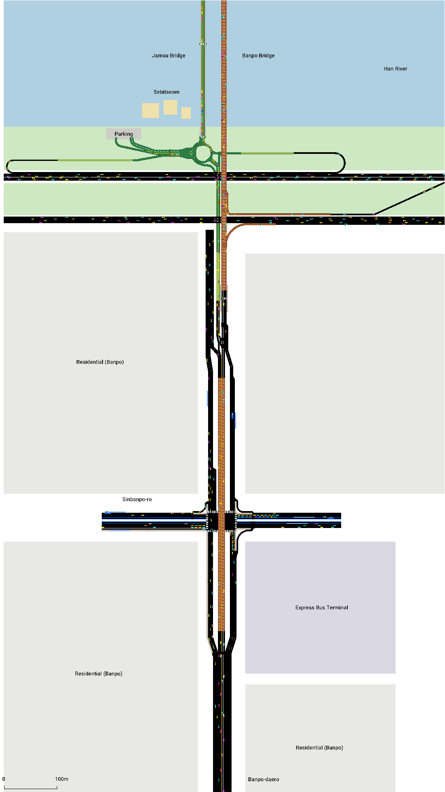
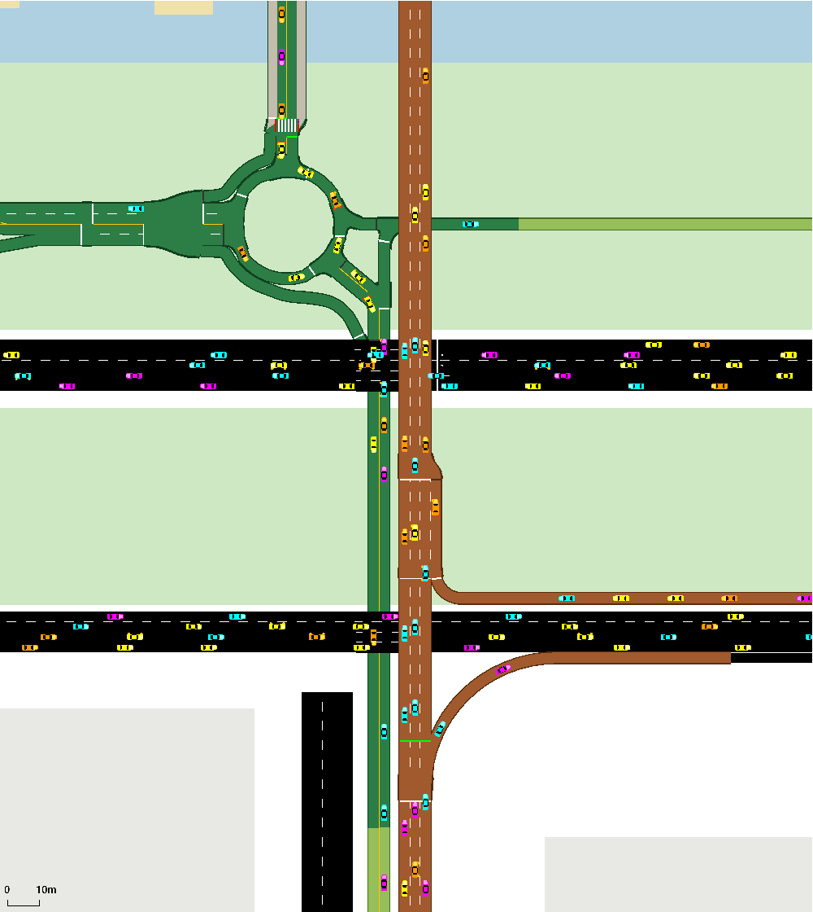

# 프로젝트 기록 — 12팀 반포대교 남단 · 잠수교 통제 전후 (SUMO)

> 무엇을 어떻게 만들었고, 무엇을 왜 정했으며, 어떤 문제를 어떻게 풀었는가 — 발표 자료의 원천.
> **기록 기준 (11/20)**: 도로 · 교통(실측)과 검증, 데이터 칼럼 제출, 컨설팅, AV 학습까지 끝났다. **최종 모델 = 차로 변경(B) 선생님 보정 PPO U5 26.2만** (`results/team_rl_1120_U5/model_261632.pt`, 11/20 확정 — 새 시드 세 묶음 3,000판 도착률 98.8% (2,957 / 2,994, 삽입 오류 6판 제외) · 충돌률 0.6%, 안 쓴 새 시드 1,000판 확정 평가도 도착 988 · 충돌 8로 같은 수준, §11 #88). 차로 유지(A) F2 33.6만은 대안. AV 삽입 실패도 고쳤다 (#89). 그 뒤 데이터 수집(26,000판 · 10,558,595행) · 주행 영상 · 프로젝트 페이지를 마쳤다 (저장소 `README.md`).
>
> 이 문서에 없는 것: 교통 실측 원자료 → `environment/road/measured/` · 실행 명령과 코드 위치 → `environment/road/README.md` · 수집 데이터 설명 → Hugging Face 데이터셋 카드

> 공개 저장소에는 최종 모델(`results/team_rl_1120_U5/`)과 이 기록, 교통 실측 원자료만 넣었다. 본문에 나오는 중간 모델 · 평가 폴더(`results/team_bc_*`, `evaluation/eval/team_*` 등), 실험 기록 · 발표 · 컨설팅 자료는 팀 저장소에만 있다. 본문의 PC 1~4는 학습 · 평가 · 수집을 나눠 돌린 팀원 컴퓨터 4대다.

**목차**: 1 한눈에 · 2 진행 경과 · 3 왜 이 도로인가 · 4 도로 · 5 시나리오와 AV 경로 · 6 교통 · 7 구현 구조 (7.1 데이터 칼럼) · 8 검증 (8.1 기준 지표 — 통제 전후) · 9 가정과 한계 · 10 주요 결정과 이유 · 11 문제와 해결 과정 · 12 AV 학습 · 13 다음 단계

---

## 1. 한눈에

| 항목 | 내용 |
|---|---|
| 지역 | 서울 서초구 반포동, 신반포사거리 ~ 반포대교 남단 접속부 (잠수교 남단 포함) |
| 주제 | 잠수교 차량 통제(2026-10-26, 보행전용교 공사) 전·후, 반포대로를 따라 올라와 다리로 강북에 건너가는 차량의 상호작용 |
| 도로망 | 차도 엣지 67 · 차로 171 · 도로 길이 10.4 km (차로 길이 합 30.1 km) · 교차점 56 (신호 5) · 보도 · 횡단보도 7곳. 고가 / 지상 / 한강 둔치 3층 입체 접속부 |
| 시나리오 | 보행화 전(잠수교 통행) / 후(잠수교 차량 통제) — **도로망 하나**에서 수요와 잠수교 통제만 바꿈 |
| AV 경로 | 3개, 모두 반포대로 북행 출발 → 강북 (약 1.45~1.52 km) |
| 교통 수요 | 통제 전 TOPIS 실측(2026년 9월 평일 11~15시) — 반포대교 2,736 · 잠수교 563 · 올림픽대로 6,937 / 5,131 대/시 등. 통제 후 t-data 실측 — 반포대교 2,858(+4%). 30분에 약 9,600대 |
| 버스 | 공식 자료(t-data 버스정보시스템) — 정류소 6곳을 지나는 **34개 노선(방향별 65개 flow)**, 공식 배차 · 정차. 740 · 405는 통제 전후 경로가 다름 |
| 신호 | **5곳 모두 C-ITS 실측** — 신반포사거리 · 반포대로 북행 횡단보도 · 반포대교남단 (주기 170 s 연동), 잠수교 2곳 (75 s, 통제 전에만) |
| 보행 | 보도 · 횡단보도 7곳 · 보행자 (보행량은 추정) |
| 데이터 | 수업 기본 칼럼 그대로 + 추가 4개 (`sim_time` · `ego_route` · `signal`(`signal_tls` · `signal_state` · `signal_remaining_s`) · `end_reason`, §7.1. 11/19 `scenario`는 `ego_route`로 정해져 뺌) |
| 검증 | 도로망 검사 · 수업 환경 검증 · 장시간 점검(4시간 × 시드 3 × 두 시나리오) 통과 — 배경 교통 순간이동 · 충돌 0. 측정 링크 실측 대비 −10% 이내, 반포대교 북행 속도 모델 49 vs 실측 47 km/h (§8) |
| 기준 지표 | SUMO 기본 운전자 150회 전부 도착. **통제 전후 주행 지표 차이 거의 없음** — 통제의 효과는 "잠수교 경로가 사라지는 것" (§8.1) |
| AV 학습 | 관측 39차원(수업 31 + 경로 6 + 신호 2) · 보상(차로 제한속도 기준 · 신호 위반 종료) · 안전장치 스위치 · 평가 도구 · BC → 병렬 PPO. BC: 안전장치 끔 도착 28% · 충돌 72%, 켬 도착 82% · 충돌 10% (§12) |
| 수집 | 에피소드 212 s → 11 s (TraCI 구독 + libsumo). 10^7 transition 약 33시간 · 약 119 GB (8 워커) |



---

## 2. 진행 경과

| 날짜 | 한 일 |
|---|---|
| 10/27 | 주제 결정 — 잠수교 보행화(차량 통제) 전후의 반포대교 남단 접속부 |
| 11/8~9 | 도로 조사(OSM 길이 · 로드뷰 차로 수) → 도로 확정안, `environment/road/` 도로 정의 · 생성 · 자동 검증 |
| 11/10 | **중간발표** |
| 11/11 | 수업 환경(`environment/env/`)에 반포 도로망 연결, AV 경로 3개, 보행화 전후를 도로망 하나로 (§11 #1~#6) |
| 11/12 | 화면 표시 · **도로 확정** → 실측 수요(TOPIS) · 신호 · 버스 → **교통 확정** → 데이터 칼럼 구현 · 수집 최적화(19배) · 기준 지표 → 장시간 점검으로 배경 교통 문제 4개 수정 (§11 #7~#29) |
| 11/12~13 | **"실측 그대로"** — 신호 5곳 C-ITS, 통제 후 수요 t-data, 버스 공식 34개 노선, 보행자 · 횡단보도 (§11 #30~#37) |
| 11/13~14 | 화면 · 형상 정리, 최종 검증 통과 (§11 #38~#48) |
| 11/15 | AV 학습 준비 — 관측 39차원 · 보상 · 안전장치 · 평가 도구 · 학습 코드, 기준 지표 재측정, 데이터 칼럼 제출물 (§11 #49~#62, §12) |
| 11/16 | 독립 검토로 관측 · 신호 위반 판정 결함 수정 → 시범 재수집 · BC 재학습 · 견고성 → 본 학습 전 재검토 (§11 #63~#64, §12). 컨설팅 자료 준비, 문서 정리 |
| 11/17 | 데이터 칼럼 · 컨설팅 자료 제출, 14:18 컨설팅 |
| 11/19 | **차로 변경 B 갈래** (브랜치 `lane-choice-b`): AV 경로 5개 확정 — 통제 전 잠수교행 `goga-jamsu` · `oly-jamsu`, 통제 후 반포대교행 `side-banpo` · `goga-banpo` · `sbr-banpo`. 무작위 출발 차로(`oly-jamsu`는 0~2번만 — 3 · 4번은 선생님도 16판 중 11 · 13판만 도착해 뺌) · 출발 속도(제한속도 × 0.8). 관측 49차원(§12.1), 잘못된 차로로 차로 끝 30 m 안에 들면 조기 종료(`off_route`, §12.2 — 낮에 끔, 아래), 선생님 규칙에 차로 변경 추가(무작위 출발 200판 중 195 도착 · 충돌 0). 드러난 문제 3개와 수집기 문제를 고침 (§11 #74~#77). BC (결정적, 5경로 × 30회): 시범 420판 g0 도착 76.7% · 충돌 6.7% → 흔들림 DAgger 420판 추가 g1 도착 88.7% · 충돌 1.3% (같은 조건 선생님 98.0%, §12.9). 수집기가 AV 삽입 실패로 두 번 죽어 보충 수집으로 채우고 수집기를 고침 (#77). 이어서 BC g2~g4(DAgger 2회차 · 가중치 · 오래 학습)와 PPO L1 · L2를 해 봤지만 도착 85~89%로 제자리 — PPO L1은 학습 중 무너졌고(#78), 남은 실패(경로 이탈 · 신호 위반)는 BC가 선생님의 감속을 덜 따라 한 것이라 BC · PPO 모두 못 고쳤다 (#79, §12.9). L2 100판(500판) 평가: 도착 89.0% · 충돌 0.8% (조기 종료 켬 기준). 경로 이탈 36판이 전부 잘못된 차로 조기 종료였고(실제로 다른 길로 빠진 판 0) 그 36판만 끄고 다시 돌리니 30판 도착 → **조기 종료를 끔** (#80). 합치면 L2 도착 474/499 (95.0%) · 충돌 0.8% — 36판만 다시 돌려 합친 값이고 500판 전체 재평가는 아직. 오후: 선생님 6 · 7차(행동이 한 스텝 사이에 확 바뀌는 곳을 부드럽게, 무작위 출발 200판 도착 198 · 충돌 0) → 7차로 시범 419판 새로 수집 (#79, §12.9). 다음은 BC h0부터 (§13.2) |
| 11/19 저녁~11/20 새벽 | 남은 실패(신호 위반 · 합류 · 회전교차로 충돌)가 전부 "선생님보다 덜 감속"임을 확인 (#82). 선생님 8차(황색 미리 대비, 200판 도착 198 · 충돌 0 · 정지 2) — 8차 시범만으로 한 BC i0는 150판 도착 128 · 신호 위반 10으로 나아지지 않음. 신반포-반포 2번 차로 출발 제외 (팀 결정, #81) · SUMO 운전자 기준 지표 무작위 출발 재측정 (§8.1). 평가에 경로 · 출발 차로 지정과 새 시드 확정 평가를 넣음 (§12.4). BC 감속 가중치(`--brake-weight` · `--brake-scope no-lane`) + 기존 데이터를 8차 정답으로 다시 매김(`relabel_with_rule.py`) → **BC r8b4n**: 새 시드 1,000판 도착 980 · 충돌 8 · 신호 위반 7 (§12.9). PPO P1 · P2 · Q · S · T5는 오래 돌릴수록 감속이 풀려 충돌이 늘었고(#84) 어느 저장 모델도 1,000판에서 r8b4n을 넘지 못함. 150판 선별이 새 시드에서 뒤집혀 선별 전용 시드 250판으로 바꿈 (#83). 선생님 보정 PPO(`--teacher-lr`) 추가 (§12.5). r8b4n에서 출발한 PPO T · U 줄 시작 — 결과는 아래 11/20 행 |
| 11/20 | r8b4n에서 출발한 PPO 결과 (새 시드 1,000판): 보정 없는 T1~T5(PC 1 · PC 3)는 최선이 r8b4n과 동률 수준(T1 23.7만 981 · T2 31.1만 980), 선생님 보정 U1~U4(PC 4) 도착 942~982 — 보정이 세면(1e-3) 서 버림. U5(U1 설정 60만, PC 3) **26.2만 985 / 4 / 4** — PPO를 거친 모델 중 처음으로 r8b4n(980 / 8 / 7)을 넘음. 두 번째 새 시드 묶음(판 400~599)으로 재확인: 2,000판 U5 1,969 / 10 / 10 · r8b4n 1,959 / 17 / 13 — 차이는 작고 같은 설정도 실행마다 967~985로 흔들림 (#86). S(g2b4n에서, PC 4)는 신호 위반은 고쳤으나 충돌이 늘고 오래 돌리면 섬. 150판 선별이 또 뒤집혀(S · T5) 후보 비교는 두 경로 집중 평가 · 확정은 안 쓴 새 묶음(판 600~)으로 (#85). U5 26.2만 실패 25판 진단 (#87). 선생님을 같은 시드로 처음부터 돌린 두 경로 800판: 선생님 도착 779 · U5 771 (차이 약 0.4%p, 충돌은 U5 9 대 선생님 12), U5 가중치 평균은 효과 없음 → 남은 개선 폭이 작아 모델 개선을 닫음. 선생님도 실패하는 판은 고치지 않고 한계로 공개. AV 삽입 실패 수정 (커밋 `05652f8`, #89). 안 쓴 새 시드 판 600~799 확정 평가 U5 26.2만 도착 988 · 충돌 8 · 신호 위반 0 → **최종 모델 확정**, 대표 수치는 세 묶음 3,000판 **도착률 98.8% (삽입 오류 6판 제외) · 충돌률 0.6%** (#88 — 선생님 비교 · 삽입 수정 · 확정 평가는 PC 3) |
| 11/28 | 최종발표 |

---

## 3. 왜 이 도로인가

1. **실제 정책 변화가 만든 실험**: 2026-10-26부터 잠수교 다리만 차량이 통제됐다 (2027-08 완공 목표, 740 · 405번 버스도 반포대교로 우회). 지하차도·회전교차로·루프·주차장은 그대로 통행한다 → **도로 모양은 거의 같고 수요가 바뀐다.** 같은 AV를 전·후 두 교통 상황에서 비교할 수 있다.
2. **위에서 보면 한 점, 실제로는 입체 접속부**: 고가·지상·지하가 겹쳐 있고, 반포대교 직전 약 300 m 안에 **합류 → 왼쪽 분기(①) → 차로 감소 → 오른쪽 분기(②) → 합류(③)**가 연달아 나온다.
3. **멀리 앞서 내려야 하는 결정**: 잠수교 지하차도(①)는 합류 직후 고가 쪽 왼쪽 차로에서만 갈라진다. 측도에서는 못 들어간다 → 잠수교로 가려면 **580 m 앞 고가·측도 분기에서 고가를, 그것도 왼쪽 차로를** 골라야 한다.
4. **수업이 요구한 구조 모듈이 거의 다 있다** (§4.2): 신호 사거리, 회전교차로, 합류, 분기, 차로 감소, 엮임, 다중 차선, 버스전용·버스 정류소.
5. **교통 · 신호 · 버스가 실측이다** (§6): 교통량은 통제 전 TOPIS · 통제 후 t-data, 신호 5곳은 C-ITS 신호 기록, 버스는 공식 노선 · 배차 · 정류소. 중간발표 교수 총평이 칭찬한 항목이 "실제 교통량 데이터 반영"이었다. 통제 후 반포대교 북행 실측은 +4%(2,736 → 2,858) — 잠수교 교통의 약 22%만 반포대교로 옮겨 왔다.

---

## 4. 도로

### 4.1 근거와 단순화 원칙

- **근거**: 구간 길이는 OpenStreetMap 좌표, 차로 수 · 차로 용도는 네이버 로드뷰(팀원 확인 — OSM 차로 수가 틀린 곳이 여러 곳), 분기 방향 · 입체 구조는 OSM + 지도 + 서울시 보도자료 사진.
- **모양은 단순하게, 길이는 실제대로**: 도로를 직선과 원호로 그리고 남북·동서로 정렬했다. 대신 구간 길이 · 램프 길이 · 차로 수는 실제 값을 지킨다 → 상호작용이 일어나는 거리(합류 구간 길이, 분기까지 남은 거리)가 실제와 같다.
- **범위**: 반포대로 북행을 축으로 신반포사거리 남쪽부터 반포대교 상층까지 + 올림픽대로 양방향 일부, 신반포로 양쪽 200 m, 잠수교 남단 회전교차로 · 루프 · 주차장 램프. 끝은 열린 도로(진입로 · 출구 200~400 m)라 차량이 생기고 사라진다.

### 4.2 도로 구조 모듈

| 모듈 | 위치 | 생기는 상호작용 |
|---|---|---|
| 분기 (멀리 앞선 차로 선택) | 고가·측도 분기 (반포대로 6차로 → 고가 2 · 측도 4) | 목적지에 맞는 길·차로를 580 m 앞에서 선택 |
| 신호 사거리 · 신호 | 신반포사거리 (강남터미널고가 밑, 신반포로와 교차, 중앙 버스전용) + 반포대로 북행 횡단보도 · 반포대교남단 신호(연동) + 잠수교 신호 2곳 | 신호 정지·진행, 직진 vs 좌회전, 버스, 보행자 |
| 합류 + 차로 감소 | 고가 2 + 측도 2 → 4 → 측도 쪽 바깥 차로 끝 → 3 | 합류 타이밍, 차로 끝 앞 양보 |
| 왼쪽 분기 | ① 잠수교 지하차도 (합류 직후 고가 쪽 왼쪽 차로가 둘로) | 분기 놓침 = 경로 이탈 |
| 오른쪽 분기 | ② 올림픽대로 하남 방향 진출 | ①·②로 반대 방향 차로 변경이 엇갈림 |
| 합류 | ③ 올림픽대로 김포 방향 → 반포대교 상층 (왼쪽 진출 램프가 상층 오른쪽 차로와 합쳐짐) | 램프 차량 vs 본선, 보행화 후 수요가 몰리는 곳 |
| 회전교차로 | 잠수교 남단 (반시계 1차로, 4방향, 서쪽 진입 2 → 1, 지하차도는 남동쪽에서 정면 진입) + 우회전 우회로 3개 | 회전 중 차량에 양보 후 진입 (보행화 전 진입 대기열), 우회로로 바로 빠지기 |
| 엮임 (weaving) | 올림픽대로 김포 방향 260 m (루프 합류 → 주차장 진출) | 엇갈리는 차로 변경 |
| 버스전용 · 정류소 | 신반포로 중앙 버스전용차로, 정류소 6곳 (중앙 · 측도 · 가로변, §6.2) | 버스만 통행, 정차 버스 피하기, 가로변 정류소로 빠지는 버스 |
| 우회전 도로 | 신반포사거리 우회전 3곳 (별도 도로, 신호 없이 양보 합류). 측도 북행은 사거리 50 m 앞에서 갈라짐 | 양보 합류, 우회전 차로 미리 타기 |
| 횡단보도 · 보행자 | 신반포사거리 4 · 반포대로 북행 1 · 잠수교 2 | 신호 횡단, 우회전 차량 보행자 양보 |




### 4.3 차로 규칙 (실제 도로 규칙을 그대로)

- **① 지하차도 진입**: 고가 쪽 왼쪽 차로만 ① 전용 차로로 이어진다. 그 옆 차로에서 ① 전용 차로로, ① 전용 차로에서 바깥으로의 차로 변경은 금지(긴급차만 허용) → 측도에서 온 차는 ①로 못 간다.
- **신반포사거리**: 진입마다 차로별 회전 방향을 로드뷰 확인값대로 연결 (예: 신반포로 서행은 좌회전 금지, 측도 남행은 좌회전 3차로). 측도 남행 좌회전 포켓에서 가장 오른쪽 차로는 우회전 도로 차로로만 이어진다 (§11 #21). 신호는 §6.3.
- **중앙 버스전용**: 신반포로 각 방향 가장 왼쪽 차로는 버스만.
- **U턴 없음** (SUMO가 도로 끝에 자동으로 만드는 U턴 연결을 끔).
- **지하차도 남행**은 반포대로 가운데로 올라와 강남터미널고가 남행 왼쪽 차로로 합류한다. 합류점에서는 **지하차도 남행이 우선** (§11 #15).
- **교차로 안 차로 변경 금지** (모든 지정 연결, §11 #32) · **사거리 출구 짧은 도로 차로 변경 금지** (`side_a8a` 22 m · `sbr_e1a` 28 m · `sbr_e2a` 33 m — 횡단보도 위, §11 #36). **AV도 측도 경로의 사거리 출구 22 m에서는 차로를 바꿀 수 없다.**
- **신반포사거리 동행 우회전**은 남측 횡단보도 보행 신호(점멸 포함) 동안 멈춘다 (도로교통법 우회전 일시정지, 실측 신호 구성).
- 보도는 netconvert가 0번 차로로 넣으므로 **보도가 있는 도로는 차량 차로 번호가 1씩 밀린다** (`ego_lane` 칼럼도 도로망 차로 번호). AV 관측에서 보도 · 버스 전용 차로는 "없는 차로"(−1)로 보이고, AV 차로 변경도 그 차로로는 하지 않는다.

### 4.4 화면 표시 (주행 영상용)

sumo-gui는 도로를 높이와 상관없이 평면으로 겹쳐 그려서, 지하차도가 고가 위에 보이는 등 입체 구조를 알아볼 수 없었다. 그래서 **지도의 높이별 색(낮을수록 초록, 높을수록 갈색)**으로 층을 구분하고, 아래층부터 차례로 다시 그려 위아래를 고정했다.

| 색 | 높이 | 도로 |
|---|---|---|
| 갈색 | 고가 +6 m | 강남터미널고가 · 반포대교 상층 · ③ 램프 |
| 검정 (SUMO 기본) | 지상 0 m | 반포대로 · 신반포로 · 올림픽대로 |
| 연두 | −3 ~ −8 m | 경사로 중간 (지하차도 진입부 · 루프 · 주차장 램프) |
| 진초록 | 한강 둔치 −10 m | 잠수교 지하차도 · 회전교차로 · 잠수교 · 주차장 |

- 그 밖에: 버스는 노선 유형 색(간선 파랑 · 지선 초록 · 광역 빨강) + 노선 번호, 차량 실제 모양, 보도 · 횡단보도 · 중앙선, 한강 · 반포한강공원 · 시가지 배경과 영어 지명 — 영상에서 장소가 바로 읽히게.
- 그리는 방법과 sumo-gui 동작에 맞춘 주의점은 `environment/road/README.md` "화면 표시".


---

## 5. 시나리오와 AV 경로

### 5.1 보행화 전·후

- **도로망은 하나**다. 전·후 도로망을 따로 만들면 "도로가 달라서 결과가 달라졌다"는 의심을 피할 수 없다. 실제로도 바뀐 것은 잠수교 다리 통행뿐이다.
- 바꾸는 것:
  1. **수요**: 시나리오별 수요 파일 (`banpo.before.rou.xml` / `banpo.after.rou.xml`, §6.1).
  2. **버스**: 740 · 405는 보행화 전 잠수교, 후 반포대교 · 측도 (§6.2).
  3. **잠수교 통제**: 보행화 후에는 잠수교 차로를 보행자 전용으로 바꾼다 — SUMO가 잠수교를 지나는 경로 자체를 거부한다. 잠수교 신호 2곳은 실제처럼 끈다(통제 후 점멸).
- 학습은 에피소드마다 시나리오를 무작위로(`mixed`), 전후 비교 평가는 시나리오를 지정해서 따로 한다.

### 5.2 AV 경로

프로젝트 목적("반포대로를 따라 올라와 다리로 강북에 건너가는 차량의 상호작용, 잠수교 통제 전후 변화")에 맞춰 **출발은 모두 반포대로 북행(신반포사거리 남쪽)**, 도착은 강북 방향이다.

| 경로 | 길 | 길이 | AV가 내릴 결정 | 시나리오 |
|---|---|---|---|---|
| `side-banpo` | 측도 → 신반포사거리(신호) → 반포대교남단 정류소 → 합류 → 북행 횡단보도 · 4032 신호 → ② 분기 → ③ 합류 → 반포대교 | 약 1,454 m | 신호 정지·진행, 정차 버스 피하기, 측도 차로 감소 합류, ②③ 구간 차로 유지 | 전·후 |
| `goga-banpo` | 고가 직진 → 합류 → 북행 횡단보도 · 4032 신호 → ② → ③ → 반포대교 | 약 1,522 m | 고가 오른쪽 차로 유지, ③ 합류 차량 대응 (보행화 후 수요가 몰리는 길) | 전·후 |
| `goga-jamsu` | 고가 왼쪽 차로 → ① 지하차도 → 회전교차로 → 잠수교 신호 2곳 → 잠수교 | 약 1,523 m | 580 m 앞 차로 선택, ① 진입, 회전교차로 양보 | 전만 |

- 중간발표 때는 경로가 둘(반포대교 · 잠수교)이었고, 반포대교 경로를 첫 분기에서 측도 / 고가로 나눠 셋이 됐다 — 만나는 상호작용이 완전히 다르다. 루프 · 주차장 · 올림픽대로 · 신반포로 · 남행은 **배경 교통**이 쓴다.

---

## 6. 교통 (수요 · 버스 · 신호)

현재 값만 적는다. 출처 · 산정 과정 · 원자료는 `environment/road/measured/README.md`, 설정 위치는 `environment/env/road_config.py`(수요 · 버스) · `environment/road/road_spec.py` `SIGNALS`(신호).

### 6.1 수요 — 평일 11~15시 평균, 통제 전 TOPIS · 통제 후 t-data 실측

| 진입점 | 통제 전 | 통제 후 | 근거 |
|---|---|---|---|
| 반포대교에서 내려오는 남행 | 2,211 | 2,384 | TOPIS C-11 · t-data **실측** |
| 잠수교 남행 | 461 | — | TOPIS C-12 **실측** |
| 반포대로 북행 | 2,181 | 2,233 | TOPIS D-37(서초역) **실측, 대용** · t-data 실측 |
| 올림픽대로 김포 방향 / 하남 방향 | 6,937 / 5,131 | 7,190 / 5,219 | TOPIS F-01 **실측, 대용** · t-data 실측 |
| 신반포로 동행 / 서행 | 1,230 / 987 | 같음 | **추정** — 측정 지점 없음. 실측 신호에서 포화도 0.9 이하가 되는 크기 |
| 반포한강공원 주차장 | 60 | 60 | 가정 (자료 없음) |

- **출구 비율**은 회전 교통량 실측이 없어 측정 링크가 실측과 맞도록 보정했다 (반포대교 북행 −2% · 통제 후 +0.4%, 잠수교 북행 −2.5%, 반포대로 남행 −7 / −8%). 직진 차는 고가 65 : 측도 35 (가정).
- **통제 후**: 반포대교 북행 실측 2,858 (+4%) — 잠수교 북행 563 중 약 22%만 반포대교로. 모델은 잠수교로 가던 출구 몫의 22%만 반포대교, 78%는 다른 출구에 원래 비율대로 나눈다.
- 평일 낮 평균, 실측 100% — 시간대별 수요 · 축소 없음 (이유 §10). 대형차는 차종 실측이 없어 넣지 않았다 (§9).

### 6.2 버스 — 공식 노선 34개

범위 안 정류소 6곳(반포대교남단 22381 · 22382, 고속터미널(중) 22019 · 22020, 신반포역 22021 · 22022)을 지나는 노선을 공식 자료로 모두 찾고, 범위 밖 앞뒤 정류소로 진입 → 진출 방향을 판정했다.

| 구분 | 노선 | 경로 · 정차 |
|---|---|---|
| 신반포로 직진 | 서행 26 · 동행 24 flow (148 · 360 · 361 · 452 · 540 · 640 · 643 · 0411 · 4212 · 4318 · 6411 · 8541 · 8641 · 345 · 3420 · 9408 · 9500 · 9501 · 9802 · 6020 · 6427 · 6428 · M6457 · M6458 · M6463 · M6427) | 중앙 버스 차로. 공식 정차 정류소대로 고속터미널(중) · 신반포역 정차 (신반포역은 가로변 — 끝 차로로 빠져 섬) |
| 반포대교 ↔ 고속터미널 | 143 · 401 (양방향), 9007 · 5104 (반포대교 → 고속터미널) | 사거리 회전, 반포대교남단 · 고속터미널(중) 동행 정차 |
| 반포대교 ↔ 신반포역 | 406 (양방향) | 사거리 회전, 반포대교남단 · 신반포역 정차 |
| 반포대로 남쪽 → 고속터미널 | 142 · 3420 · 345 | 측도 우회전 도로 |
| 740 · 405 | 정차 없이 지나감 | 통제 전 잠수교(740 양방향, 405 남행만) + 고가 → 통제 후 반포대교 + 측도 |

- 노선마다 공식 배차 간격 (예: 8641 5분 · 360 6분 · 9007 30분 · 6427 240분), 정차 20 s. 시간당 버스: 신반포로 서행 약 113 · 동행 약 103대, 회전 노선 · 740 · 405 약 75대.
- 뺀 노선 · 생략한 정차와 신반포역 정류소 위치는 근거 문서 §4.

### 6.3 신호 — C-ITS 실측 5곳

t-data 신호제어기 신호 기록(1초 간격)을 통제 전 10/21 · 후 11/11 평일 10~16시로 분석했다 (두 날 운영 같음). 기준 0 = 신반포사거리 동행 직진 녹색 시작.

| 신호 | 주기 | 차량 녹색 (시작 s – 길이 s) | 보행 |
|---|---|---|---|
| 신반포사거리 (4031) | 170 | 서행 직진 · 동행 버스 0–44 · 동행 직진 0–85 · 동행 좌회전 49–36 · 동행 우회전 44–41 (양보, 남측 보행 중 정지) · 측도 남행 90–40 · 측도 북행 134–32 | 4곳 (3 · 3 · 92 · 137 s부터 10~14 s) |
| 반포대로 북행 횡단보도 (24032) | 170 (연동) | 북행 54–143 | 33–13 |
| 반포대교남단 (4032) | 170 (연동) | 북행 직진 78–117 (남행 → 올림픽대로 하남 좌회전 28–74는 모델에 없어 북행 적색으로만) | — |
| 잠수교남단 (4616) · 잠수교 (24616) | 75 | 양방향 0–40 · 0–46 | 45–10 · 51–13 (통제 후 점멸 → 끔) |

- 실측 전에 서울시 운영 방식 + 실측 수요 + Webster로 계산한 추정도 주기 170 s를 맞혔다 (현시 구성 · 녹색은 달랐음 — 근거 문서 §3.3). 우회전 도로 3곳은 비신호.

---

## 7. 구현 구조

```
environment/road/road_spec.py  ── 도로 정의 단일 원천 (좌표 · 노드 · 엣지 · 차로 단위 연결 · 층 높이 · AV 경로 · 시나리오 · 실측 신호 · 보도 · 보행자)
      │
      ├─ environment/road/build_net.py  → XML → netconvert → 신호 프로그램 5곳 적용 → 도로망 (검증용, environment/road/build/)
      │      └─ environment/road/check_net.py  길이 · 경로표 · 차로 규칙 · 경로별 1대 주행 자동 검사
      │
      ├─ environment/road/calibrate.py  TOPIS · t-data 실측 → 측정 링크 교통량 비교 · 실측 신호 포화도 → 신반포로 진입량
      │
      └─ environment/env/road_builder.py → 수업 환경용 도로망 + 시나리오별 수요(배경차 · 버스 · 보행자 · 정류소) + 화면 표시(층 색 · 보도 · 버스 색 · 배경) (environment/env/sumo/banpo/)
             └─ environment/env/sumo_env.py (수업 Gym 환경) ← environment/road/check_env.py  AV 주행 · 배경 교통 검증
```

- 도로를 바꿀 때는 `road_spec.py` 한 파일만 고치고, 검사를 다시 통과시킨다. 수요·버스는 `environment/env/road_config.py`.
- **차로 단위 연결을 직접 지정**했다 (netconvert 자동 추정에 맡기지 않음). 어느 차로가 어느 차로로 이어지는지가 곧 "측도에서는 ①로 못 간다" 같은 실제 규칙이기 때문이다.
- **입체 교차는 노드를 공유하지 않는다**: 고가·반포대교·지하차도가 다른 도로 위아래를 지나는 곳에 교차로가 생기지 않는다 (SUMO가 평면 교차로로 만들어 버리는 것을 막음).
- **배경차**는 수업 코드의 4가지 차량 모델(Krauss · IDM · EIDM · ACC)을 섞어 쓴다. 출구별 경로는 차로 단위로 찾되, "출구|경유 도로"로 고가·측도를 나눠 지정할 수 있다.

### 7.1 데이터 칼럼 — 수업 기본 + 추가 4개

수집 코드 `data_collection/collect_pomdp_data.py`. 수업 기본 칼럼은 하나도 빼지 않고(수업 규칙), 기존 칼럼으로 계산되지 않는 것만 추가했다 (계산되는 값을 또 저장하면 감점 요인 — 강의 10/27, 상대속도 예시). 제출물은 칼럼설명 pptx와 예시 CSV다.

| 추가 칼럼 | 형태 | 기존 칼럼으로 계산되지 않는 이유 |
|---|---|---|
| `sim_time` (11/19 새로) | 관측 시점의 시뮬레이션 시각 (s) | 신호 5곳은 고정 주기라 이 값으로 **모든** 신호 상태를 계산할 수 있다 (`signal`은 AV 앞 신호 하나뿐). 스텝 번호 `t`로는 못 구한다 — 예열 180 s와 AV 투입 대기가 판마다 다르다 |
| `ego_route` | 0 `side-banpo` · 1 `goga-banpo` · 2 `goga-jamsu` · 3 `oly-jamsu` · 4 `sbr-banpo` (`ROUTE_CODES`, 3 · 4는 11/19 추가) | 같은 도로에서 출발하는 경로가 있어 분기 전까지는 state만으로 목적지를 알 수 없다. 목적지(다리)만으로는 측도 · 고가가 구분되지 않아 경로 이름으로 저장. **11/19부터 시나리오도 이것으로 정해진다** — 잠수교행(2 · 3) = 통제 전, 반포대교행(0 · 1 · 4) = 통제 후 |
| `signal` | AV가 다음에 만날 신호 {tls, state, remaining_s} (앞에 없으면 빈 값) | state · observation에 신호가 없다. 수업 요구: 신호를 쓰면 State에 신호 상태. 경로의 신호 5곳 중 AV 앞 신호라 세 경로 모두에서 충족. `remaining_s`는 AV(정책)가 모르는 privileged 값 — 신호 변화 예측 · 빨간불 대기 분석의 정답 |
| `end_reason` | 0 진행 중 · 1 arrived · 2 collided · 3 off_route · 4 stuck · 5 teleported · 6 timeout · 7 other · 8 red_light (`END_REASON_CODES`, 마지막 스텝만) | 충돌 · 도착 · 시간 초과는 기존 event · truncated로도 알 수 있지만, 비정상 정지 · 경로 이탈 · 순간이동 · 신호 위반은 모두 "terminated=True, 이벤트 없음"으로 같아 구분이 안 된다. 실패 원인별 평가(통과 기준)에 필요. **11/19 오전에는 `off_route`에 잘못된 차로 조기 종료도 들어갔다 — 11/19 낮에 껐다** (§12.2) |

- **11/19 `scenario` 칼럼 뺌**: 경로마다 시나리오가 하나뿐이라 `ego_route`로 정해진다 (계산되는 값은 저장 안 함). 필요하면 `collect_pomdp_data.route_scenario(ego_route)`로 구한다. 그 전에 모은 파일에는 `scenario`(통제 전 0 · 후 1, `SCENARIO_CODES`)가 있다.
- NPZ에도 코드값으로 저장한다 (`ROUTE_CODES` · `END_REASON_CODES`, `sim_time`, `signal_tls` · `signal_state` · `signal_remaining_s`).
- **11/19 수집기는 reset 실패(AV 삽입 실패 — 출발 차로 입구가 60스텝 넘게 막힘) 판을 건너뛴다.** 건너뛴 판은 기록에 없으므로 `episode` 번호가 중간에 빌 수 있다 (전에는 이 오류가 워커를 죽였다 — §11 #77). 11/20 AV 삽입 자체를 고쳐(커밋 `05652f8`, §11 #89) 알려진 삽입 실패 판도 이제 정상 진행된다.
- **출발 차로 범위 (11/19 저녁)**: 무작위 출발(`--depart-lane random`)은 `road_spec.AV_ROUTES`의 `depart_lanes`에서 뽑는다 — `oly-jamsu` 0~2번(3 · 4번 제외), `sbr-banpo` 0 · 1번(2번 제외, §11 #81), 나머지 경로는 전 차로. 출발 차로 범위는 팀이 정하는 항목이라 제외 사실과 이유를 발표와 데이터 설명에 밝힌다.
- **11/17 JSONL도 숫자로** (조교 공지 "String보다 숫자, 신호 칼럼은 차원을 쪼개서"): `scenario`(11/19 뺌) · `ego_route` · `end_reason`은 위 코드표 정수, `signal`은 `signal_tls`(코드, −1 없음) · `signal_state`(녹 1 · 황 0.5 · 적 0 · 꺼짐/없음 −1) · `signal_remaining_s`(s, 없으면 null) 세 칼럼으로 나눴다. NPZ `signal_state`도 같은 값(float). 칼럼 이름 · 의미는 위 표 그대로이고, 컨설팅 때 낸 칼럼설명 pptx는 옛 형식 — 최종 데이터 카드(10-8)에 새 형식을 적는다. `evaluation/metrics.py`는 두 형식 모두 읽는다.
- **넣지 않은 것**
  - 주변 차량 목적지 (중간발표 계획 `vehicles[].target`): 차량 id에 진입 · 출구가 들어 있어 `state.vehicles[].id`로 계산된다 — 배경차 `f_<진입>__<출구>[_via_<경유>]_<번호>.<n>`, 버스 `bus_<노선>__<진입>__<출구>.<n>`.
  - 차량 기준 차로 번호: 보도 있는 엣지에서 SUMO 차로 번호가 1씩 밀리지만 `lane_id` + 도로망으로 계산되므로 `evaluation/lanes.py`로 바꿔 쓴다.
- **관측은 49차원** (11/19, §12.1 — 11/17~18 기존 모델용은 43차원, 11/15~16은 39차원). 데이터 칼럼 양식에는 19-dim, 수업 원본 코드는 31차원 — 수업: "추가 State / Observation 항목은 자유롭게 확장 가능".
- **state는 도로 위 차량 전체**(약 450대)를 저장한다 → transition당 약 12 kB, 10^7개면 약 119 GB · 약 33시간(8 워커). 기본 칼럼이라 줄이지 않는다.
- 제출한 예시 CSV(20행, 측도 · 통제 전 · SUMO 기본 운전자)는 엑셀 한 칸 한도(32,767자) 때문에 state를 AV 반경 150 m 차량만 남겼다. 최종 데이터셋은 학습한 AV로 수집한다 (`data_collection/collect_pomdp_data.py --model`).

---

## 8. 검증

도로망 · 교통은 11/14 최종 도로망 기준 (그 뒤 변경 없음).

| 검사 | 내용 | 결과 |
|---|---|---|
| 길이 | 구간 14개를 확정안과 비교 | 전부 10% 이내 (반포대교 상층은 지도 끝까지 늘려 기준 300 → 400 m) |
| 경로표 | 진입점 8 × 출구 8 조합(보행화 후는 잠수교를 빼고 7 × 7)을 차로 단위로 탐색 | 주행 가능 보행화 전 32 · 후 25. ① 지하차도를 거쳐야 하는 측도·신반포로 출발 조합(전 7 · 후 5)은 차로 규칙상 불가 — 실제와 같은 동작 |
| 경로별 주행 | 가능한 경로마다 승용차 1대 | 전부 도착, 순간이동 0 |
| 기하 | 연결 끊김 · 같은 높이 겹침 · 급한 꺾임 · 경사 (11/12 자동 점검) | 0 · 0 · 0 · 최대 6%. 11/13~14 바꾼 형상(우회로 · 우회전 도로 · 지하차도 진입)은 sumo-gui로 확인 |
| 수요 배정 | 측정 링크에 배정된 교통량 vs 실측 | 반포대교 북행 −2% (통제 후 +0.4%), 잠수교 북행 −2.5%, 반포대로 남행 −7% (통제 후 −8%) |
| 신호 포화도 | 실측 신호의 이동류 그룹별 포화도 (`calibrate.py` 4절) | 신반포로 서행 직진 0.90 (진입량을 이 값에 맞춤) · 동행 0.28~0.54 · 측도 북행 0.73 · 남행 0.46 |
| AV 주행 | SUMO 기본 운전자로 경로마다 2회, 두 시나리오 (`check_env.py`) | 10회 전부 도착, 충돌·순간이동 0 (side-banpo 203~308 s · goga-banpo 115~126 s · goga-jamsu 212~213 s) |
| 배경 교통 | AV 없이 30분, 두 시나리오 | 전 9,600대 · 후 9,560대 투입, 순간이동 0 · 충돌 0 |
| 장시간 안정성 | 4시간 × 두 시나리오 × 시드 3개, 시뮬레이션 24시간 (`check_long.py`) | **충돌 0 · 순간이동 0**, 교착 없음. 주의 8건은 모두 원인 확인 (§11 남은 문제): 김포 방향 투입 −5 / −7%, 신반포로 서행 투입 −8 / −9%, 보행화 후 측도 · 반포대로 북행 대기열 (최장 대기 110~134 s, 한 주기 이내) |
| 측정 링크 재현 | 4시간 시뮬레이션(처음 10분 제외)의 시간당 통과량 vs 실측, 시드 3개 평균 | 반포대교 북행 2,701 / 2,736 (−1%) · 통제 후 2,882 / 2,858 (+1%), 잠수교 북행 515 / 563 (−9%), 올림픽대로 하남 방향 진입 5,123 · 5,228 (0%), 김포 방향 진입 6,601 (−5%) · 6,661 (−7%), 반포대로 남행 1,980 (−7%) · 1,796 (−9%) |
| 통행 속도 | 반포대교 북행 (4032 신호 뒤 ~ 다리 끝) 모델 vs 서울시 2025 차량통행속도 보고서 교량별 낮(12~14시) | 모델 49.1 / 49.3 km/h vs 실측 46.9 km/h (통제 첫날 상행 47 km/h). 북단 병목 없음 (`environment/road/measured/README.md` §6) |
| 데이터 수집 | `data_collection/collect_pomdp_data.py` — 11/12 칼럼 추가 뒤 SUMO 운전자 · keep-lane, 11/16 관측 39차원으로 시범 360회 (§12.6) | JSONL·NPZ 저장, 이벤트 · 추가 칼럼 · `end_reason` 기록 정상, 관측 39칸 · NaN 0 |
| 수집 최적화 | TraCI 구독 + libsumo 적용 뒤 같은 시드로 출력 비교 (11/12) | JSONL·NPZ 바이트 단위로 같음. 에피소드 212 s → 11 s, 8 워커 83 step/s (10^7개 약 33시간), transition당 약 12 kB |
| 기준 지표 | SUMO 기본 운전자, 통제 전 경로 3 · 후 경로 2 × 30회 (같은 시드 짝) | 150회 전부 도착, 실패 0. 통제 전후 차이 거의 없음 — §8.1 |

다시 돌리는 법: `python -X utf8 environment/road/build_net.py` → `environment/road/check_net.py`, `environment/road/calibrate.py`, `environment/road/check_env.py`, `environment/road/check_long.py` (출력은 `environment/road/build/`).

### 8.1 기준 지표 — 통제 전후 비교 (SUMO 기본 운전자, 11/15 측정)

학습한 AV의 비교 기준이자, 통제 전후 비교 결과다. 표 `evaluation/baseline_report.md`, 에피소드별 `evaluation/baseline_metrics.csv`. 다시 만들기: `python -X utf8 evaluation/baseline.py --episodes 30 --workers 7` (약 12분).

- 방법: AV를 SUMO 기본 운전자(가감속 2.6 / 4.5, 멈칫거림 없음)가 운전한다. 5조합(통제 전 경로 3 · 후 경로 2) × 30회. 같은 경로의 전 · 후는 같은 에피소드 번호 = 같은 SUMO 시드 (`--paired-seeds`). 지표는 수집 칼럼만으로 계산 (`evaluation/metrics.py`).
- **150회 전부 도착. 충돌 · 경로 이탈 · 비정상 정지 · 순간이동 0.**

| 경로 | 통제 전 | 통제 후 | 11/12 (참고) |
|---|---|---|---|
| side-banpo (측도 → 반포대교) | 255.1 ± 35.6 s (중앙 272) | 245.1 ± 37.6 s (중앙 243) | 185 / 186 s |
| goga-banpo (고가 → 반포대교) | 121.7 ± 6.0 s (중앙 120) | 123.4 ± 5.7 s (중앙 124) | 97 / 96 s |
| goga-jamsu (고가 → 잠수교) | 226.9 ± 30.7 s (중앙 220) | (통제로 없음) | 162 s |

- 11/12보다 길어진 이유: 경로에 신호가 늘었다 (측도: 신반포사거리 → 횡단보도 → 반포대교남단, 고가: 횡단보도 → 반포대교남단). 측도 경로 정지 약 100 s 중 빨간불 대기 약 68 s.
- 통제 전 → 후 (같은 시드 짝 비교, 30쌍이면 |t| ≥ 2.05일 때 p < 0.05): **유의한 차이가 거의 없다.**

| 지표 | side-banpo | goga-banpo |
|---|---|---|
| 주행 시간 | 255.1 → 245.1 s (t −1.1) | 121.7 → 123.4 s (t 1.3) |
| 정지 시간 · 빨간불 대기 | 101.2 → 96.3 s · 68.3 → 68.1 s (t −0.8 · 0.0) | 0.6 → 0.1 s (t −1.8) |
| 차로 변경 | 2.8 → 3.1회 (t 0.9) | 1.1 → 1.1회 (t 0.0) |
| ③ 합류 구간 통과 | 2.7 → 3.0 s (t 0.5) | 2.1 → 2.2 s (t 0.8) |
| 반포대교 진입부 저속 차량 (평균) | 5.9 → 6.1대 (t 0.6) | 7.1 → 7.5대 (t 0.8) |
| 앞차 최소 간격 | 7.5 → 6.5 m (**t −2.2**) | 7.5 → 7.6 m (t 0.2) |

- 해석
  - **11/12의 "통제 후 반포대교 진입부 정체 증가(유의)"는 재현되지 않는다.** 11/12는 통제 후 수요를 "잠수교 교통 전부"(+21%)로 추정했고 실측은 +4%였다 (§6.1) — 추정으로 낸 결론은 실측으로 다시 확인해야 한다는 사례 (§11 #59).
  - "반포대교 진입부 저속 차량"(m3 · m4a · m4 · m5 · r3)은 지금 대부분 **신호 대기열**이다 — goga-banpo 통제 전 7.1대 중 m3 3.4 · m4a 2.2대(반포대교남단 · 횡단보도 신호 앞). 지표를 정한 11/12 오전에는 이 두 신호가 없었다. 합류 ③ 구간(m5 · r3)만 보면 0.5 → 0.54 · 0.55 → 0.63대(고가)로 작다. 발표에서는 "진입부 저속 차량은 대부분 신호 대기, 합류 구간은 한산"으로 설명한다.
  - 측도 앞차 최소 간격 감소(−1.0 m, t −2.2)는 12개 비교 중 하나만 경계선에서 유의 — 우연일 수 있다.
  - **통제의 효과는 "같은 경로가 더 막힌다"보다 "잠수교 경로가 사라진다"(경로 구성 변화)에 있다.** 서울시 교통영향분석 "통행속도 소폭 감소, 서비스 수준 동일"과 같은 방향.
- **발표 방향** (11/16 팀 결정): "서울시 예측이 맞았다"가 아니라 **"실측 수요를 넣은 모델이 현실을 재현했다"**로 말한다. 통제 후 실측 수요를 입력으로 넣었으므로 결과가 현실과 같은 것은 일부 예정된 것이고, 서울시 예측이 맞았다는 근거는 실측 통행속도(TOPIS 47 km/h)다.
- 한계: 주행 지표는 AV 한 대의 경험이다. 배경 교통 전체의 통행 속도가 아니다.
- **11/19 B 갈래 재측정**: 새 경로 5개 · 무작위 출발 차로로 다시 재서 `evaluation/baseline_metrics_random.csv`에 둠 (PC 1, 커밋 `24cb81c` · `4730de7`). `sbr-banpo`만 0 · 1번 차로 설정(§11 #81)으로 다시 재서 교체 (100판 모두 도착). 5경로 × 100판 = 500판 전체로는 499 도착 · 오류 1 (`oly-jamsu` ego 삽입 실패 1판). 모델 평가 보고서의 기준 줄은 출발 옵션이 무작위면 이 파일을 쓴다 (`baseline.py --base-metrics`, §12.4). 위 표 · 통제 전후 비교는 11/15 경로 3개 · 경로 차로 출발 기준 그대로다.

---

## 9. 가정과 한계

- **도로**: 실제 값을 못 찾아 정한 값(측도 바깥 차로 끝 위치, ③ 합류 구간 길이, 측도 우회전 도로 분기 위치 등)과 단순화(직선 · 원호 형상, 올림픽대로 하남 방향 터널을 지상으로, 회전교차로 동쪽 진입로 없음, 높이는 화면용).
- **교통**: 반포대교 · 잠수교는 직접 실측, 반포대로 · 올림픽대로는 같은 도로의 가까운 지점 값(대용). 통제 후는 t-data 실측. 신반포로 진입량 · 출구 비율 · 고가/측도 비율 · 주차장 수요는 추정·가정. **시간대는 평일 낮(11~15시) 평균 하나** — 출근 첨두는 다루지 않는다 (§10).
- **신호**: 5곳 모두 C-ITS 실측 (통제 전 10/21 · 후 11/11 하루씩, 두 날 운영 같음). 하루 중 시간대별 신호 계획(TOD) 차이는 10~16시 안에서만 확인했다. 잠수교 두 신호 사이 시차는 기록이 부족해 0.
- **버스**: 공식 노선 · 배차 · 정차. 배차는 대표값 하나(시간대별 배차 · 몰려다님 없음). 회전 노선 일부의 고속터미널(중) 정차와 740의 세빛섬 정차는 생략. 신반포역 정류소 위치는 실제보다 사거리 쪽(범위 끝)으로 당겨 둠.
- **보행자**: 보행량 실측이 없어 추정 (사거리 횡단보도마다 시간당 양방향 200명, 북행 횡단보도 100, 잠수교 각 100, 보행화 후 잠수교 보행 400).
- **대형차 없음**: 차종 구성 실측을 찾지 못해 화물차 · 관광버스는 넣지 않았다 (TOPIS · 서울시 교량 통계 · 서울시설공단 자료 모두 차종 구분 없음). 배경 교통은 승용차 + 노선버스.
- **차로 변경 표현**: SUMO 기본 차로 변경은 한 스텝(0.5 s)에 옆 차로로 옮겨 간다 → 화면에서 평행 이동처럼 보인다. 연속 차로 변경(실측 평균 4.6 s)은 합류부 측면 충돌이 생겨 쓰지 않았다 (§10, §11 #46).
- **AV 행동 제약**: 측도 경로의 사거리 출구 22 m(`side_a8a`)와 교차로 안에서는 차로를 바꿀 수 없다 (배경차와 같은 실제 규칙 — 횡단보도 · 교차로 안 차로 변경 금지).
- **재현 오차**: 측정 링크 통과량은 실측 대비 반포대교 북행 ±1%, 반포대로 남행 −7 / −9% (출구 비율 추정 — 배정 단계부터), 잠수교 북행 −9% (회전교차로 · 잠수교 신호 대기), 올림픽대로 김포 방향 진입 −5 / −7% (진입 지점 투입 용량, 처음 약 20분은 수요를 다 받아 에피소드(최대 약 11분)에는 영향 없음), 신반포로 서행 진입 −8 / −9% (가로변 정류소 버스의 차로 이동 지체).
- **배경차 추돌**: 장시간 점검(시뮬레이션 24시간)에서 0건. 평가에서는 AV가 관련된 충돌만 센다.
- **AV(선생님 포함)가 실패하는 판 (11/20, 고치지 않음)**: 측도-반포 출발 차로 3 · 4에서 좌회전 전용 차로에 갇히는 판, 올림픽-잠수 회전교차로 진입(링이 꽉 참) · 회전교차로 안 경합(상대가 이미 교차로 안) · 주차장 램프 앞 오른쪽 틈을 못 만드는 판. 선생님(규칙 정책)이 운전해도 같이 실패한다 — 고치려면 선생님 규칙 · 출발 조건을 바꿔 재학습 · 재평가해야 하고, 효과(약 0.35%p)가 실행 간 흔들림보다 작아 그대로 두고 한계로 밝힌다 (§11 #88).
- **회전교차로 양보**: 배경차의 `impatience`를 0.5로 둬서, 양보 진입에서 오래 기다리면 회전 차량 사이로 과감하게 들어간다 (SUMO 기본 0은 틈이 날 때까지 무한히 양보해 교착). 서울 회전교차로 진입 행태에 가까운 쪽으로 정한 값이다.

---

## 10. 주요 결정과 이유

| 결정 | 이유 | 대안과 버린 이유 |
|---|---|---|
| 보행화 전후를 **도로망 하나**에서 전환 | 도로 차이 없이 수요·통제만 비교 → 공정한 비교. 실제로도 다리 통행만 바뀜 | 도로망 두 개 — 도로 차이와 수요 차이가 섞임 |
| AV 출발을 모두 **반포대로 북행** (경로 3개) | 주제("반포대로 → 다리 → 강북")와 직접 연결 | 경로 5개(올림픽대로·신반포로 출발) — 주제와 무관 |
| 수요는 **평일 낮 평균** (피크 아님, 시간대별 수요도 넣지 않음) | ① 평균만으로도 신호·회전교차로 대기열, 올림픽대로 용량 근접 등 상호작용이 충분 ② 피크면 정체로 AV가 120 s 넘게 멈추는 "비정상 정지" 실패가 늘어 AV 실력과 무관하게 통과 기준(충돌 < 5%, 완주)이 흐려짐 ③ 검산 근거(교통량 11~15시 · 통행 속도 12~14시)가 낮 시간에 맞물림 — 통제 후 첨두 속도 실측은 아직 없음 ④ 에피소드가 약 11분이라 에피소드 안 시간대 변화는 의미가 없음 (11/14 재확인) | 출근 피크(8시) 또는 시간대별 시나리오 — 시나리오가 2 → 4개로 늘고 검증 근거가 약함. 필요하면 학습 뒤 기준 운전자로 민감도만 |
| 수요를 **줄이지 않음** (실측 100%) | ① 100%로도 순간이동 0, AV 전부 도착 ② "실측과 맞는다"(−10% 이내)가 강점 — 50%면 반포대교 약 1,370대/시로 한산해 "충분한 일반 차량" 기준이 약해짐 ③ 혼잡할수록 통제 전후 차이가 드러남 ④ 수집이 느린 주원인은 수요가 아니라 state 저장 방식 | 50% 등 축소 — 근거 없이 줄이면 설명이 어려움. 줄인 비율은 학습 초반 커리큘럼에만 쓰려 했으나 11/16 뺌 (BC가 100% 수요 시범으로 학습됨) — 학습 · 평가 · 수집 · 영상 모두 1.0 |
| **현실 값을 구할 수 없으면 근거 있는 추정으로 확정**하고 근거를 설명 (신반포로 진입량 · 출구 비율 · 고가/측도 비율 · 보행량 등). 실측이 생기면 바꾼다 | 시뮬레이션은 어차피 현실을 그대로 옮길 수 없다. 중요한 것은 값마다 출처나 계산 근거가 있어 설명할 수 있는 것. 실제로 신호 · 통제 후 수요는 11/12 추정으로 확정했다가 t-data 실측을 찾아 11/13 바꿨다 | 근거 없이 비우거나 임의 값 |
| 신호는 **C-ITS 실측** (11/13, 5곳) | t-data 파일 10384(신호제어기 1초 기록)로 실제 주기 · 녹색을 구할 수 있었다. 추정(Webster)은 주기 170 s만 맞고 현시 구성 · 녹색이 달랐다 | 11/12 추정값 유지 — 실측이 있는데 쓸 이유 없음 (추정은 `SIGNAL_PLAN`에 기록용으로 남김) |
| 신반포로 진입량은 **교차로 용량 기준** | 측정 지점이 없고, 인근 도로 값을 그대로 쓰면 신호로 처리할 수 없는 양. 11/13 실측 신호로 다시 계산해 넘치는 서행만 1,160 → 987로 줄임 (늘리지는 않음) | 사평대로 값 그대로 — 상시 과포화로 사거리 마비 |
| 통제 후 수요 = **t-data 실측** (11/13) | 통제 후 반포대교 북행 실측 2,858(+4%) — 잠수교 교통의 약 22%만 반포대교로. 11/12의 "전부 반포대교로"(3,299) 추정은 실측보다 컸다 | 추정 유지 — 실측이 있음 |
| 버스는 **범위 안 정류소 경유 전 노선** (공식 자료, 34개 노선) + 실제 정류소 · 공식 배차 · 정차 | 우회 노선만 넣으면 반포대교·신반포로의 실제 버스 교통이 빠짐. 정차 버스가 측도 AV에게 실제 상호작용이 됨. 11/13 비공식 출처(23개 노선)를 공식 자료로 교체 | 우회 노선만 · 노선 수로 추정 — 실제보다 적거나 많음 |
| 추가 칼럼은 **기존 칼럼으로 계산되지 않는 4개만** | 기존 칼럼으로 간단히 계산되는 값을 또 저장하면 감점 요인 (강의 10/27). `end_reason`은 충돌·도착·시간 초과가 기존 칼럼과 겹치지만, 비정상 정지·경로 이탈·순간이동은 구분되지 않아 유지 | 주변 차량 목적지 칼럼(중간발표 계획 `vehicles[].target`) — 차량 id(`f_<진입>__<출구>_…`, `bus_<노선>__<진입>__<출구>`)로 계산되므로 뺌 |
| AV 경로 이름 **`<진입 도로>-<건너는 다리>`** (side-banpo · goga-banpo · goga-jamsu) | 이름만 보고 어느 길로 어느 다리를 건너는지 안다 | side · goga · jamsu — 목적지(다리)가 이름에 없음 |
| 지금 데이터는 **SUMO 기본 운전자**로, 최종 데이터셋은 **학습한 AV**로 | 아직 학습 전이라 예시·기준값은 SUMO 운전자로 냄. 수업 흐름은 "AV 학습 → 평가 → 데이터 수집" | 수집 정책을 행마다 기록 — 최종 데이터는 정책 하나라 같은 값 반복. 데이터 설명(README)에 한 줄로 적음 |
| 제출물은 **양식 그대로만** 채움 | 요구하지 않은 내용을 덧붙이지 않음. 설명할 것은 §7.1에 두고 말로 | 설명 슬라이드·주석 추가 — 양식 밖 내용 |
| 화면은 **높이별 색(초록 → 갈색)**, 지상은 SUMO 기본 검정 | 누구나 아는 지도 색 관례로 입체 구조를 바로 읽게 | 겹치는 곳만 색 — 같은 높이 도로끼리 색이 달라 헷갈림 |
| 신반포역 정류소는 **가로변**, 서행 투입 −8~9%는 **그대로** (11/14 팀 결정) | 정류소 이름에 중앙차로 표시 "(중)"이 없음. 직진 버스가 중앙 ↔ 끝 차로를 오가는 지체가 실제 현상 | 정류소를 모델에서 빼기 — 수치는 돌아오지만 가로변 정차가 사라짐 |
| 차로 변경 시간은 **SUMO 기본(순간)** 유지 (11/14 팀 결정) | 실측 평균 4.6 s 연속 차로 변경은 반포대교 ③ 합류에서 측면 충돌 약 30건(4시간 × 3시드). sublane 모델은 충돌 · 순간이동 36건 · 4배 느림 | 연속 차로 변경 — 화면은 자연스럽지만 배경 교통이 불안정 |
| 반포대교 **북단 병목은 넣지 않음** (11/14) | 서울시 2025 통행속도 보고서: 반포대교 남→북 낮 46.9 km/h (정체 아님, 정체는 북→남 저녁), 통제 첫날 상행 47 km/h. 모델 49 km/h로 약 5% 차이 | 하류 속도 제한 · 차로 축소로 정체 재현 — 근거 없음 |
| **대형차는 보류** (11/14 팀 결정) | 차종 구성 실측을 찾지 못함. 등록 대수 화물 비중(약 9.6%)은 대부분 1톤이고 통행 비율과 달라 근거가 약함 | 2~3% 추정으로 넣기 — 근거 없이 보정이 흔들릴 수 있음 |
| 지하차도는 회전교차로 **남동쪽에 정면 진입** (11/14 팀 결정) | 동쪽에서 휘어 들어오던 진입이 회전 방향과 반대(U턴 모양)라 진입 교차로 충돌이 잦고 AV goga-jamsu가 180° 꺾었음. 남동쪽 연결점을 새로 두면 바뀌는 도로가 가장 적음 | 남쪽 직선 갈래 + 중앙녹지 밑에서 꺾기(바뀌는 도로 많음) · S자로 남쪽 진입(19 m 안에 급한 S자) |
| 최종 AV = **차로 변경(B) 선생님 보정 PPO U5 26.2만** (11/20 팀 결정, `results/team_rl_1120_U5/model_261632.pt`) | 차로 선택("580 m 앞에서 고가 · 왼쪽 차로")을 AV가 직접 한다 — 이 도로의 핵심 과제. 새 시드 세 묶음 3,000판 도착률 98.8% (삽입 오류 6판 제외) · 충돌률 0.6%, 안 쓴 새 시드 1,000판 확정 평가도 도착 988 · 충돌 8로 같은 수준. 선생님과 같은 시드로 비교하면 차이 약 0.4%p라 모델 개선을 여기서 닫음 (§11 #88) | 차로 유지(A) F2 33.6만 — 경로 차로에서 출발해 차로를 한 번도 안 바꿈. 처방 후보(보정 감속 가중치 ↑ 등) · 가중치 평균 — 남은 폭이 실행 간 흔들림보다 작음 |
| 선생님도 실패하는 판은 **고치지 않고 한계로 공개** (11/20) | 선생님 규칙 · 출발 조건을 바꾸면 재학습 · 재평가가 필요한데, 없앨 수 있는 것이 1,000판당 3~4판으로 실행 간 흔들림(5판 안팎)보다 작음 (§9, §11 #88) | 측도-반포 3 · 4번 출발 차로 제외 — 신반포-반포 2번(#81)에 이은 두 번째 제외 |

---

## 11. 문제와 해결 과정

**도로 구축 · 환경 연결 (11/11)**

| # | 발견한 문제 | 원인 | 해결 |
|---|---|---|---|
| 1 | ③ 합류부가 올림픽대로 김포 방향 차로 위에 겹쳐 그려짐 | 그림을 만들 때 올림픽대로 두 방향 간격(실제 약 65 m)을 5 m로 압축 | 실제 65 m로 복원, 지하차도·루프 길이가 실측과 맞도록 회전교차로 위치를 다시 잡음 (지하차도 351 m / 실측 약 340, 루프 490 / 약 500) |
| 2 | AV가 신반포사거리에서 120초 넘게 멈춤 | 신호 없는 사거리에서 좌회전 차와 직진 차가 서로 양보하며 교착 | 신호 교차로로 |
| 3 | 차선 유지만 하는 AV가 14초 만에 "도착" | SUMO는 충돌로 제거된 차도 도착 목록에 넣음 | 도착 = 충돌 아님 + 경로 마지막 도로에서 사라짐. 충돌·경로 이탈·순간이동·비정상 정지(120 s)를 따로 판정 |
| 4 | 교차로 안 충돌이 잡히지 않음 | SUMO 기본값이 교차로 내부 충돌 검사 꺼짐 | 켬 |
| 5 | 보행화 전·후를 도로망 두 개로 비교하면 공정하지 않음 | 도로 차이와 수요 차이가 섞임 | 도로망 하나 + 수요 파일 + 잠수교 차로 통제로 전환 |
| 6 | AV 경로 5개가 목적과 맞지 않음 | 올림픽대로·신반포로 출발 경로는 "반포대로 → 강북" 주제와 무관 | 반포대로 북행 출발 3개로 정리, 나머지는 배경 교통으로 |

**화면 표시 · 도로 확정 (11/11 밤 ~ 11/12 새벽)**

| # | 발견한 문제 | 원인 | 해결 |
|---|---|---|---|
| 7 | 화면에서 지하차도가 고가 위에 보이는 등 입체 구조를 못 알아봄 | sumo-gui는 높이와 상관없이 평면으로 그림 | 층 높이(z) + 높이별 색 + 아래층부터 다시 그리기 + 범례 |
| 8 | 지하차도 내려가는 길과 옆 남행 도로가 붙어 한 도로처럼 보임 | 두 도로 사이 간격 0 | 측도 남행을 서쪽으로 옮겨 중앙분리 4.8 m |
| 9 | 지하차도 남행이 중간에 끊겨 보임 | 범위 밖 출구로 중앙분리대에서 끝나게 만들었음 | 실제처럼 강남터미널고가 남행으로 합류 (배경 교통 출구도 반포대로 남행으로) |
| 10 | 루프 끝부분 등 일부 도로가 화면에서 사라짐 | sumo-gui가 시작점이 투명한(지하) 차로를 통째로 건너뜀 | 그런 차로의 지상 구간을 직접 그림 |
| 11 | 고가 북행·남행의 색 바뀌는 지점이 다름 | 높이 설정 기준점이 20 m 달랐고, 색을 점 단위로 나눔 | 같은 지점에서 오르내리게, 높이 경계를 지나는 정확한 지점에서 색 전환 |
| 12 | (최종 점검) 경사가 13%로 튀는 곳, 주차장 도로 78° 꺾임 | 긴 교차로 안에서 SUMO가 높이를 한 값으로 고정 / 한 점에서 꺾음 | 교차로 구간을 평평하게, 꺾이는 곳을 곡선으로 |

**실측 교통 · 신호 (11/12 새벽)**

| # | 발견한 문제 | 원인 | 해결 |
|---|---|---|---|
| 13 | 실측 교통량을 넣자 올림픽대로 하남 방향이 3,760대/시만 들어옴 | SUMO flow 하나는 초당 1대(3,600대/시)가 한계 | 큰 수요를 900대/시 이하 flow 여러 개로 나눔 |
| 14 | 신반포로에 인근 도로 실측(2,300대/시)을 그대로 넣으면 사거리가 처리 불가 (임계 y 합 1.15) | 신반포로는 일반 직진 2차로 + 4현시 신호 | 신반포로 진입량을 교차로 용량(주기 160 s, 포화도 0.9) 기준으로 정함 (1,230 / 1,160) |
| 15 | 보행화 전 잠수교 남행 → 회전교차로 → 올림픽대로까지 막힘 (순간이동) | 지하차도 남행이 고가 남행 진입로(1,000대/시)에 양보하느라 못 들어감. 지퍼 합류는 오히려 측도 남행까지 막음 | 지하차도 남행을 합류 우선으로 |
| 16 | 보행화 후 반포대로 북행 정체 | 늘어난 반포대교 수요를 측도(신호)로도 보냄 | 잠수교로 가던 차는 원래 고가를 타던 차 → 고가로 반포대교 |
| 17 | 경로 탐색이 반포대로 차를 전부 고가로 보내 측도 교통이 0 | 차로 단위 최단 경로만 씀 | 출구별로 경유 도로를 지정할 수 있게 ("출구\|경유"), 고가 65 : 측도 35 |
| 18 | 신호 주기를 처음 계산하자 신반포로 현시가 포화도 1 이상 | 보행 최소 녹색을 먼저 떼어 주고 남은 시간만 나눔 / 주기와 녹색을 따로 정함 | Webster 비율 배분 + 최소 녹색 보장, 모든 현시 포화도 0.9 이하가 되는 가장 짧은 주기를 찾음 |

**버스 (11/12 새벽)**

| # | 발견한 문제 | 원인 | 해결 |
|---|---|---|---|
| 19 | 버스가 우회 노선(740 · 405)뿐이고 405 북행은 아예 없었음 | 우회 노선만 먼저 넣음 | 범위 안 정류소 경유 노선을 전부 조사 → 반포대교 노선 6개(전후 경로 구분) + 신반포로 직진 17개 노선 + 정류소 6곳 |
| 20 | 실측 수요 정체 속 배경차끼리 추돌 (70분에 1~2건) | 뒤따르는 Krauss 차가 앞의 ACC · EIDM 차의 감속 능력을 선언값(4 m/s²)으로 가정하는데, 이 모델들은 정지-출발에서 더 세게 섬 | ACC · EIDM의 apparentDecel을 9 m/s²로 → 뒤차가 급정거에 대비한 간격 유지 |
| 21 | 측도 남행 좌회전 포켓 앞에서 406번 버스와 승용차가 교차로 안에서 충돌 | 한 차로가 두 차로로 갈라지는 연결에서 12 m 버스가 옆 차로로 휘어 들어감 | 가장 오른쪽 차로는 우회전 도로 차로로만 이어지게 |

**데이터 칼럼 · 수집 최적화 (11/12 아침)**

| # | 문제 | 원인 | 해결 |
|---|---|---|---|
| 22 | 주변 차량 목적지 칼럼(중간발표 계획)이 기존 칼럼과 중복 | 배경차 id `f_<진입>__<출구>_…`에 목적지가 이미 있음 (버스 id에는 없었음) | 칼럼을 빼고 버스 id도 `bus_<노선>__<진입>__<출구>`로 → 모든 차량 목적지를 id로 계산 (중복 저장 = 감점 요인) |
| 23 | 수집이 초당 약 1~2 스텝 — 10^7개에 수십 일 | 프로파일: 시간의 89%가 state 조회. 스텝마다 차량 450대 × 값 7개를 하나씩 소켓으로 물어봄 (에피소드당 약 100만 번 왕복) | ① TraCI 구독(차량마다 처음 한 번 걸고 매 스텝 결과를 한 번에 받음) ② libsumo(SUMO를 파이썬 안에서 직접 호출 — 소켓·해석 비용 제거). 에피소드 212 s → 11 s (약 19배), 8 워커 83 step/s → 10^7개 약 33시간. 같은 시드에서 출력이 **바이트 단위로 같음**을 확인 (기본 칼럼 내용 불변). 별도 점검: 구독 값과 직접 조회 값을 차량마다 비교 (libsumo 73,350건 · TraCI 18,514건, reset 뒤 포함) → 불일치 0 |
| 24 | `--policy sumo` 데이터에서 에피소드 마지막 스텝의 `action_raw`가 [0, 0] (도착 직전 16 m/s로 달리는 중에도) | 도착·순간이동으로 AV가 사라진 스텝은 속도를 읽을 수 없어 역산을 건너뜀 → 정책 출력 0이 그대로 남음 | 마지막 스텝은 직전 스텝의 가감속을 유지하고 차로 변경은 0 (`environment/env/sumo_env.py`). 기준 지표 데이터(이미 수집)는 행동을 쓰지 않아 영향 없음. BC 시범으로 쓸 데이터는 고친 뒤 수집 |
| 25 | 차로 변경 지표 "분기 앞 / 합류부"가 실제 원인과 맞지 않음 | 엣지 기준 구간 집계라 측도 A8 3 → 2 차로 감소, ① · ② 분기 피하기, 바깥 차로 끝까지 섞임 | 이름을 "합류 전 구간 / 합류 뒤 구간"으로 바꾸고 구간별 집계임을 명시. 리포트에 짝 n · 짝지은 t 추가, `signal` 칼럼이 없는 데이터는 빨간불 대기를 빈 값으로 (`evaluation/`) |

**배경 교통 장시간 안정성 (11/12 오후)** — 70분 검증에서는 안 보이고 몇 시간 돌려야 드러난 문제. `environment/road/check_long.py`(4시간 × 시드 3 × 두 시나리오)로 찾고 같은 점검으로 해결을 확인

| # | 발견한 문제 | 원인 | 해결 |
|---|---|---|---|
| 26 | 보행화 전, 2~3시간 뒤 올림픽대로 김포 방향 ↔ 회전교차로 고리에서 차들이 갇힘 (교착 → 순간이동, 반포대로 · 고가까지 번짐). 잠수교 북행 통과 369대/시(실측 563의 −34%) | 회전교차로 서쪽 진입부(주차장 램프에서 옴)가 잠수교 남행 흐름에 계속 양보해 빠지지 못함(SUMO 양보 기본값: 기다려도 과감해지지 않음) → 주차장 램프 대기열이 분당 1대 미만씩 자라 약 1.5시간 뒤 램프(479 m)가 참 → 엮임 구간 오른쪽 차로를 막음 → 루프 램프가 합류 못 함 → 회전교차로가 막혀 진입부가 더 못 들어가는 닫힌 고리 | 배경차 `impatience` 0.5 (기다릴수록 회전 차량 사이로 과감히 진입). 교착 0, 잠수교 북행 549대/시(−2.5%) |
| 27 | 올림픽대로 김포 방향 투입 −15~25% (투입 대기가 계속 쌓임) | 배경차를 아무 빈 차로("free")에 투입 → ③ 램프 전용인 맨 왼쪽 차로에 들어간 직진 차와, 그 차로로 가야 하는 차가 400 m 진입 도로에서 엇갈림 | 투입 차로를 "best"(경로를 차로 변경 없이 가장 멀리 갈 수 있는 차로)로 — 실제 차는 범위 밖에서 이미 갈 차로에 서 있다. −2~5%로 (남은 부족분은 투입 용량, 본선 정체 없음) |
| 28 | 신반포로 동행 진입 대기열이 몇 시간에 걸쳐 자람 (정지 26 → 49대). 우회전 전용 차로 수요는 123대/시인데 매 주기 막힘 | #27과 같음 — 직진 차가 우회전 전용 차로에 투입된 뒤 정지선 앞에서 차로를 바꾸느라 막음. 신호 계산(포화교통류율 1,800)은 문제가 아니었다 (SUMO 실측: 포화 주기 직진 차로 1,450~1,880대/시) | #27과 같은 수정으로 해결 |
| 29 | 보행화 후 측도 남행 A5 좌회전 포켓 시작점에서 배경차 충돌 (4시간에 약 1건) | 3차로 → 6차로 연결이 짧은 교차점(8.9 m) 안에서 옆으로 3.2 m 꺾이고, 한 차로가 여러 차로로 부채꼴로 갈라짐 → 앞뒤 차가 갈라지는 순간 SUMO 안에서 옆면 충돌 (#21의 남은 부분) | 연결을 일직선 1:1로 (sb_1의 3개 차로 → 포켓 구간의 1 · 2 · 3번 차로, 원래 형상에서 이미 일직선). 오른쪽 우회전 차로와 왼쪽 좌회전 차로 2개는 포켓 구간에서 새로 생겨 차로 변경으로 들어간다. 충돌 0. (처음엔 sb_1을 3.2 m 옮겨 0 · 1번만 일직선으로 했는데, 검토에서 2 → 3 연결이 사선이 되고 직진 차가 한 차로로 몰려 통제 후 대기열이 자라는 것이 드러나 이 방식으로 다시 고침) |

**"실측 그대로" 반영 · 전체 검증 (11/12 저녁 ~ 11/13)** — 신호 · 통제 후 수요 · 버스 · 보행자를 바꾼 뒤 `check_net` · `check_env` · `check_long`으로 찾은 것

| # | 발견한 문제 | 원인 | 해결 |
|---|---|---|---|
| 30 | `check_net` "신반포로 서행은 직진만" 검사 실패 | 보도를 붙이면 netconvert가 보도를 0번 차로로 넣어 차량 차로 번호가 1씩 밀림 — 검사 코드가 번호를 그대로 씀 | `road_spec.net_lane()`으로 차량 차로 번호 → 도로망 번호 변환 (연결 · 정류소 · 신호 이동류도 같은 방식) |
| 31 | 버스 노선별 flow로 바꾸자 버스가 5대만 들어옴 | SUMO는 수요 파일을 시간순으로 읽어(route-steps) 출발 시각 순서가 깨진 뒤 항목을 버림 | `road_builder`가 버스 flow를 배경차 · 보행자 뒤에 출발 순으로 씀 |
| 32 | 신반포사거리 안 측면 충돌 (시간당 0.5~1건) | 출구가 막혀 사거리 안에 갇힌 측도 북행 차가 **교차로 내부 차로 사이에서 차로를 바꾼** 순간, 그 차를 기다리던 서행 직진 차가 출발 (traci 추적으로 확인) | 모든 지정 연결에 `changeLeft/changeRight="emergency authority"` — 교차로 안 차로 변경 금지 |
| 33 | 잠수교 보행자 ↔ 차량 충돌 (30분 3건) | 횡단보도 ~ 회전교차로 도로가 4 m뿐이라 SUMO 보행 경로가 횡단보도 대신 회전교차로의 보행 구역(차도와 겹침)으로 돌아감 | 출발 · 도착 보도가 한 노드에 붙은 보행 flow는 `<walk edges="출발 도착"/>`으로 경로를 못박음 |
| 34 | 신반포로 서행 투입 −10% | 신반포로 진입량 1,160은 옛 추정 신호로 정한 값 — 실측 신호의 서행 직진 녹색은 44 s뿐(용량 약 850~930 < 수요 986) | 실측 신호 기준 이동류 그룹별 포화도로 다시 계산(`calibrate.py` 4절) → 넘치는 서행만 987 |
| 35 | 측도 남행 좌회전 포켓에서 버스 ↔ 승용차, 406 ↔ 740 버스 충돌 | 한 차로가 둘로 부채꼴로 갈라짐(#21 · #29와 같은 형태) / 우회전 도로가 갈라지는 교차점이 8 m로 짧아 꺾이는 버스 모서리가 정차 버스에 닿음 | 포켓 구간 `sb_2`를 5차로로 두고 5 → 5 일직선 / 우회전 도로 `slip_a5`를 1.6 m 바깥으로 |
| 36 | 북측 횡단보도 보행자 ↔ 차량 충돌 | 사거리를 빠져나가자마자 횡단보도 위(출구 첫 22 m)에서 차로를 바꿈 — SUMO는 원래 차로의 보행자만 확인 | 사거리 출구 짧은 도로 3곳 차로 변경 금지 (`NO_LC`, AV 포함 — §4.3) |
| 37 | 잠수교 남행 진입 직후 추돌 | 진입 도로가 16 m뿐이고 끝에 잠수교 신호(주기 75 s) → 신호 대기열 속 출발하는 차 바로 뒤 2.9 m에 새 차가 투입 | 잠수교 남행 진입점을 100 m 북쪽으로 (116 m) |

**화면 · 형상 정리 (11/13 ~ 11/14, 팀 스크린샷 검토)**

| # | 발견한 문제 | 원인 | 해결 |
|---|---|---|---|
| 38 | 회전교차로 · 갈래 교차로에 덩어리 · 가시 모양, 보행자가 차도를 걷는 것처럼 보임 | 차도가 보행 허용(기본값)이라 netconvert가 교차로마다 차도와 겹치는 보행 구역을 52개 만들었고, 이를 차로처럼 폭 4 m로 그림. 보도가 차도와 같은 색 | netconvert `--default.disallow pedestrian` (보행 구역 52 → 10), 보행 구역 · 횡단보도를 따로 그림, 보도 회베이지 · 횡단보도 줄무늬 · 중앙선, 테두리를 면 밑 띠로 |
| 39 | ② 램프가 보도에서 갈라져 나오는 것처럼 보임 | 반포대로 북행 보도가 ② 분기까지 이어짐 | 그 구간 보도를 빼고 횡단보도 양쪽에 25 m 보행자 전용 보도만 |
| 40 | 사거리 우회전 도로 3곳에서 차와 보행자가 같은 자리를 지남 | 보도를 붙이자 보도가 바깥으로 밀려 우회전 도로 자리를 덮음 | 우회전 도로를 보도 바깥 0.3 m로 (보도 = 교통섬 쪽 보도) |
| 41 | 회전교차로 우회전 우회로가 멀리 돌아 따로 노는 길로 보임 | 우회로를 회전교차로와 떨어뜨려 그림 | 회전차로 바깥 0.8 m에 나란히 (팀 의견: "회전교차로가 2차로처럼 보일 만큼") |
| 42 | 둔치 도로(초록)가 올림픽대로 위로 보이고 지하차도 정지선이 올림픽대로 위에 그려짐 | 지하차도 북행 갈래와 남행 합류를 한 교차로에 둬 netconvert가 교차로를 올림픽대로 밑까지 30 m로 늘림. 덧칠 판정에 교차로 모양이 없었음 | 남행 합류를 별도 노드(`und_m`)로 나눔, 덧칠 판정에 아래층 교차로 포함 (합류를 회전교차로 출구 직후로 옮기는 시도는 그 사이 3 m라 진입 충돌 5건 → 버림) |
| 43 | 잠수교 횡단보도 신호 색이 안 보임 → 고친 뒤 다리 한가운데 검은 막대 | sumo-gui는 투명 차로의 신호 막대를 안 그림 / 북행 다리가 지도 끝보다 100 m 먼저 끝나(화면에서만 이어 그림) 막다른 끝 막대가 보임 | 둔치 층 차로를 불투명으로(면은 다각형이 덮음) / 반포대교 · 잠수교 북행을 지도 끝까지 실제로 늘림 (AV 경로 +100 m) |
| 44 | 신반포역 정류소가 중앙 차로에 있음 → 가로변으로 옮기자 서행 투입 −18% · 충돌 2건 | 실제는 가로변 정류소 / 정류소가 사거리에 가까워(출구 60 m · 진입 80 m 앞) 버스가 중앙 ↔ 끝 차로를 오갈 거리가 모자람 | 가로변(끝 차로)으로, 위치는 사거리에서 떨어뜨림 → 충돌 0, 서행 −8 / −9%는 실제 현상으로 보고 남김 |
| 45 | 측도 우회전 도로가 처음부터 갈라진 길로 보임 | 고가 분기(사거리 230 m 앞)에서부터 따로 가고 사이에 보도 | 측도를 4차로로 두고 사거리 50 m 앞에서 우회전 도로가 갈라짐 (보도는 그 50 m의 교통섬 쪽만) |
| 46 | 정류소를 떠난 버스가 여러 차로를 평행 이동 | SUMO 기본 차로 변경은 한 스텝에 옆 차로로 이동 | 연속 차로 변경(4.6 s) · sublane 모델 시험 → 합류부 측면 충돌 30~35건이라 **기본 유지** (화면 표현 한계로 기록) |
| 47 | 지하차도가 회전교차로에 U턴 모양으로 진입 (진입 교차로 충돌이 근처를 조금만 바꿔도 1~5건) | 지하차도가 동쪽에서 휘어 들어와 회전 방향과 반대로 진입 | 회전차로 남동쪽(320°)에 연결점을 새로 두고 중심을 향해 정면 진입, 루프 쪽 출구를 10° 올림. 처음 형상은 꺾이는 곡선 구간에서 netconvert가 북행 차로를 3 m 어긋나게 잘라 남행과 겹침 → 갈래를 꺾이는 점에 두고 곧은 왕복 도로로 |
| 48 | 에피소드마다 시작이 34 s씩 걸리고 sumo-gui가 0.9 GB를 씀 (11/14 도로 점검에서 발견) | 보행자 flow 끝이 1,000,000 s — SUMO는 보행자 flow를 시작할 때 한꺼번에 펼쳐 보행자 30만 명을 만든다 (차량 flow는 필요할 때 만듦). 환경은 reset마다 SUMO를 새로 띄워 매번 다시 만든다 | 보행자 flow를 6시간에서 끝냄 (`road_builder.PED_END_S`) → 시작 1.3 s, 도로망 · 수요 결과는 그대로 |
| 49 | 데이터 칼럼 `signal`이 신반포사거리만 기록 — 고가 두 경로는 그 사거리를 지나지 않고, 측도 경로도 사거리 뒤 신호 2곳이 빠짐. `remaining_s`는 시각표 구간 경계까지라 AV 방향 녹색 끝과 다름 (11/15 점검) | 신호가 사거리 1곳이던 11/12 아침 설계. 11/12 저녁~11/13 신호가 C-ITS 5곳으로 늘 때 칼럼을 함께 바꾸지 않음 | 칼럼 이름은 그대로, 내용을 **AV가 다음에 만날 신호** `{tls, state, remaining_s}`로 교체 (`getNextTLS` + 현시 목록으로 그 색이 실제로 바뀔 때까지). NPZ `signal_tls` · `signal_state` · `signal_remaining_s`. privileged state — 정책 입력 아님. `metrics.stop_red_s`는 신호 5곳 모두(정지선 150 m 안 · 적/황색). 관측에 넣을지는 컨설팅 질문 |
| 50 | 보행화 후 처리(잠수교 차로 통제 · 신호 끔)가 환경과 `check_long`에 따로 구현 | 장시간 점검을 만들 때 복사 | `environment/env/sumo_env.py` `after_closure_targets` · `apply_after_closure` 하나로, `check_long`이 그대로 부름. `check_env`가 reset 직후 막힌 차량 차로 7/7 · 꺼진 신호 2/2(전에는 0)를 확인. `check_net`의 after는 "build_net 정적 도로망"으로 이름 표시 |
| 51 | 차로 번호(`ego_lane` · `lane` · `event.lane_*`)가 보도 있는 엣지에서 1씩 밀림 | netconvert가 보도를 0번 차로로 넣음 | 기존 칼럼(`lane_id`) + 도로망으로 계산되므로 칼럼 추가 없이 `evaluation/lanes.py` `veh_lane()`로 변환 (추가 칼럼 규칙: 계산되는 값은 저장 안 함) |
| 52 | 확정 전 전체 검토 (11/15) — 관측의 차로 밀도에서 보도 · 버스전용 차로가 "빈 차로"(0)로 나옴, `check_env` 배경 교통 30분이 스텝 1 s · 보행화 후 통제 없이 돌던 것, `--route goga-jamsu`만 주면 보행화 후 에피소드에서 멈춤, 신호 끄기 옵션(`tls`)이 횡단보도까지 빼 보행자 경로가 끊김 | 11/12 보도 · 버스 차로 규칙을 연결성 · 차로 변경에만 넣음 / 검사 스크립트가 환경 옵션을 따라가지 않음 / 쓰지 않는 옵션이 남음 | 밀도도 "없는 차로" = 1.0 (연결성 · 차로 변경과 같게), `check_env` 배경 교통을 환경과 같은 스텝 0.5 s + `apply_after_closure`로, `--route goga-jamsu`면 before로 고정, `tls` 옵션 · `--no-tls` · `_notls` 삭제. 그 밖에 죽은 코드(`SCENARIO_CONNECTIONS` · `SIGNAL_PLAN["tls"]` · calibrate 중복 계산 · 버스 vType 색 등)와 낡은 주석 정리, 수업 저장소 파일 `environment/env/sumo/highway.*`(직선 도로 재생성본) 원래대로. 도로망 · 수요 파일은 버스 vType 색 한 줄 말고 그대로 |

- 그 밖에: 잠수교 남단 횡단보도를 회전교차로에서 10 → 20 m (우회로가 갈라질 자리), 버스를 노선 유형 색 + 노선 번호 라벨로.

**AV 학습 준비 (11/15 ~ 11/16)** — 관측 · 보상 · 평가 도구 · 학습 코드를 만들고 세 갈래 독립 검토로 찾은 것

| # | 발견한 문제 | 원인 | 해결 |
|---|---|---|---|
| 53 | 고가 경로 AV가 측도 차로에 있으면 분기 앞 차로 끝에서 멈춤 — 같은 관측에 정답(가야 할 차로)이 경로마다 다름 | 경로는 SUMO가 정하지만 차로는 정책만 바꾸는데, 수업 관측 31차원에 경로 정보가 없음 | 관측에 차로별 "이 차로로 경로를 계속 갈 수 있는 거리" 5 + 다음 분기까지 거리 1 (내비게이션 안내와 같은 정보). 관측만 보는 규칙 정책이 5조합 전부 도착 → 풀 수 있는 문제임을 확인 |
| 54 | AV가 빨간불을 지나침 | 수업 원본은 `setSpeedMode(0)`(신호 무시)이고 관측에 신호가 없음. SUMO가 대신 서게 하면 "판단은 신경망" 원칙에 어긋남 | 관측에 앞 신호색 · 정지선 거리 2, 적색 통과 = 종료(`red_light`) + 감점 → 평가에서 신호 준수율이 바로 나옴 |
| 55 | 과속할수록 보상이 큼 | 속도 보상 · 상한이 올림픽대로 80 km/h(`vmax`) 기준 — AV 경로는 50~60, 지하차도 · 회전교차로 30 km/h | 상한 · 보상 · 막힘 판정을 "지금 차로 제한속도" 기준으로 |
| 56 | 신호 대기열에 바르게 서도 리턴 −1.6 (전부 도착하는 규칙 정책인데) | 대기열 정지 중에도 근접 감점(간격 < 6 m) · 막힘 감점이 매 스텝 붙음 — 평가 도구로 규칙 정책을 돌려 보다 발견 | 근접 감점은 5 m/s 이상일 때만, 앞 신호가 적 · 황색이면 막힘 감점 없음 → 리턴 +17.4 |
| 57 | 학습 중 다른 스크립트(영상 · 점검)를 띄우면 실행 중인 워커가 바뀌는 환경 파일을 읽을 수 있음 | 실행할 때마다 `environment/env/sumo/banpo/`를 다시 쓰고 netconvert를 돌림 | 임시 폴더에 다 만든 뒤 내용이 다른 파일만 원자적 교체(`os.replace`), 도로망 입력 지문이 같으면 netconvert 생략 |
| 58 | 수업 `test.py`로는 왜 실패했는지 알 수 없음 | 충돌 외 실패(경로 이탈 · 비정상 정지 · 신호 위반)를 모두 "시간초과"로 셈 | 평가 도구: `end_reason`별 집계 + 에피소드 번호 시드로 기준 지표 · 모델 · 안전장치 켬/끔이 같은 교통 조건끼리 짝 (워커 수와 무관하게 결과 동일 확인) |
| 59 | 11/12 기준 지표의 "통제 후 반포대교 진입부 정체 증가"가 11/15 재측정에서 재현 안 됨 (12개 지표 중 측도 앞차 최소 간격만 유의) | 11/12 통제 후 수요는 추정(잠수교 교통 전부 반포대교로, +21%) — 실측은 +4%(잠수교 교통의 22%만). 진입부 저속 차량 지표도 지금은 대부분 신호 대기열 | 결론을 "통제 효과 = 잠수교 경로가 사라짐, 같은 경로 교통 차이는 작다"로 바꾸고 컨설팅에서 방향 확인. **추정으로 낸 결론은 실측으로 다시 확인해야 한다**는 사례 |
| 60 | 병렬 학습이 워커 7개인데 60 스텝/초 | 모든 워커가 스텝을 맞춰 진행 → 한 워커가 SUMO를 다시 띄우는(수 초) 동안 나머지가 대기 | 워커마다 정책 사본을 두고 각자 rollout → 115~150 스텝/초 (순차의 4~5배, 100만 스텝 약 2~2.5시간) |
| 61 | BC가 "차로 유지"로 쏠릴 위험, BC → RL 첫 업데이트에서 배운 행동이 망가질 위험 | 시범의 차로 변경이 0.46%뿐 / 수업 `train_bc.py`는 구조가 PPO와 달라 이어 쓸 수 없고 critic이 무작위 | PPO 정책 자체를 지도학습 — 차로 변경 가중치 20, 가치(critic)도 할인 리턴으로 함께 학습. BC 단독은 안전장치 끔 충돌 72%(시범 따라 하기의 누적 오차 — RL이 고칠 부분), 켜면 도착 82% (11/16 다시 학습 · 각 50회. 11/15 예비는 80% · 85%) |
| 62 | 수업 PPO의 시간초과 처리가 가치를 두 번 더함 | 잘린 스텝에 γV(s′)를 더하면서 done = 종료만(잘림 0)으로 저장 → GAE가 다음 에피소드 첫 상태 가치까지 이어 더함 | 수업 코드는 그대로 두고 팀 학습 코드(`training/train_team.py`)는 done = 종료 또는 잘림 |
| 63 | (11/16 검토) 정지선 앞에서 차로만 바꿔도 신호 위반으로 종료 | 차로마다 신호 연결 번호가 달라 "앞 신호가 바뀌었고 그 연결이 적색"이면 위반으로 봄 — 정지선을 실제로 넘었는지는 안 봄 | 접근 도로를 실제로 벗어났을 때만 위반. 검증 함정도 발견: 신호를 못 보게 한 정책이 위반 0이었는데 앞차가 대신 막아 준 것 → 앞을 비워 다시 확인(위반 5/8) |
| 64 | (11/16 검토) 경로 관측이 한 도로 위에서 변하지 않음 (296 m 도로 끝 16 m에서도 "약 300 m 남음") | SUMO `getBestLanes` 길이는 "차로 시작점부터" — 지금 위치를 빼지 않음. 경로 끝 판정은 교차로 내부 길이 포함 여부가 달라 어긋남 | 지금 위치를 빼고, 남은 경로 도로 길이 합(같은 잣대)과 비교해 끝까지 이어지는 차로는 1. 저장된 시범 · BC는 11/16 다시 수집 · 학습 (§12.6) |
| 65 | (11/17) BC 끔 충돌이 전부 신호 대기 줄 추돌 (11/16 BC 도착 26%) | SUMO 운전자 시범이 정지 스텝의 96.5%에서 앞차 뒤 정확히 2.50 m(= 충돌 판정 경계 minGap)에 선다 — BC의 작은 오차가 바로 충돌. 또 SUMO 운전자는 관측에 없는 정보로 운전해 BC가 정확히 따라 할 수 없다(가감속 오차 0.0108) | 시범을 관측만 보는 규칙 정책(IDM)으로 교체 → 가감속 오차 0.0029, 같은 420회 BC 도착 96% · 충돌 1.3% (§12.9) |
| 66 | (11/17) DAgger 1회(r1)가 오히려 신호 위반을 늘림 (4 → 10) | 선생님이 신호 앞에서 늦게 시작해 마지막 40 m를 최대 제동(−1)으로 서고, 황색에서 "설 수 있나" 경계에 정답이 −1 ↔ +0.2로 뒤집힘. BC는 최대 제동을 약하게(−0.5) 따라 하고, DAgger는 BC가 머뭇거린 경계 상황의 정답을 더 많이 넣었다 | 선생님 신호 정지를 일찍 · 여유 있게(필요 감속의 1.3배) · 적색 향해 가속 금지 · 황색은 정지 쪽으로 (§12.9) |
| 67 | (11/17) 회전교차로 진입에서 BC가 가속하다 충돌 | 선생님이 경합 차량 관측 [35..38]을 보지 않아 양보해야 할 때도 가속(+0.38) | 선생님에 양보 추가 — AV 양보(−1)이거나 대등 합류에서 상대가 먼저 오면 경합 지점 3 m 앞에 섬. s0 충돌 2 → 0 |
| 68 | (11/17) RL 시험에서 충돌 50% (같은 BC의 결정적 평가는 1.3%) | RL 탐험 흔들림(σ 0.2). 선생님(IDM)은 정지 중 정답이 0 근처 → BC도 0 근처 → 흔들림의 감속 쪽은 속도 0이라 무효, 가속 쪽만 차를 밀어 신호 대기 60~100 s 동안 앞차를 박음. σ 0.05로 줄여도 측도 경로 90% 충돌 | 선생님에 정지 유지 — 서 있고 출발할 이유가 없으면 3.0 m/s² 브레이크(정답 −0.56). 1.5 m/s²로는 흔들림을 못 이김 (확률적 평가 도착 38% → 58%) |
| 69 | (11/17) 조교 FAQ "어떤 차선으로 가야 하는지 같은 세밀한 정보는 관측에 주면 안 됨" | 관측 [31..35] 차로별 경로 계속 거리(`getBestLanes`)가 사실상 차선 지시 | 다음 분기 방향(좌/직/우) 한 칸으로 교체, 47 → 43차원 (§12.1) |
| 70 | (11/18) PPO 1차 네 갈래가 모두 출발점 f1보다 나빠짐 (도착 96% → 50~89%) | 학습 코드는 정상, **보상이 평가와 반대 방향** — 옛 보상으로 D1(88.7%) 리턴 17.79 > f1(96%) 17.34. 도착한 판 리턴 약 18에 실패 벌점 5 · 3이라 실패를 조금 늘리는 쪽이 이득, C1의 비정상 정지는 도착보다 리턴이 높았다 | 실패 벌점 5 · 5 · 3 → 20 · 20 · 20. 1차 평가를 새 벌점으로 다시 계산해 순위가 평가(도착 · 충돌)와 같아지는지 먼저 확인 (§12.2, 차로 유지 모델(A) PPO 실험 기록 1차 진단) |
| 71 | (11/18) RL 충돌이 모두 대기 줄 · 정체 꼬리의 저속 추돌 | 실패 에피소드를 같은 시드로 재현해 보니 0.1~2 m/s로 앞차에 조금씩 다가가 충돌 경계 0.1 m 앞에 섰다가 다시 밀었다. 근접 감점은 5 m/s 이상에서만 켜져(#56) 이 구간이 비었고 움직일 때마다 속도 보상만 받음. 막힘 감점은 녹색 직후 아직 서 있는 줄에서 붙어 앞차를 미는 쪽으로 작용 | 속도와 상관없는 **접근 감점**(충돌까지 남은 시간 TTC < 2초면 −0.2) — 같은 30회에서 선생님 0.01% · f1 0.05% · B1 3%로 출발점은 거의 안 걸린다. 막힘 감점 0 |
| 72 | (11/18) 학습률 3e-4 갈래(C1)가 차로를 마구 바꾸다 경로 차로를 놓침 | 차로 head 엔트로피 보너스(0.01)가 차로 변경을 계속 밀었다 — f1은 차로를 안 바꾸고 96% 도착 | 보너스 0. 보상을 바꾸면 BC의 가치가 어긋나므로 PPO 전에 정책을 고정하고 가치만 맞추는 `--critic-warmup` 추가 (§12.5) |
| 73 | (11/18) RL 2차 모델이 도착률은 99%인데 적색에 정지선 50~80 m 앞에서 일찍 서고, 같은 설정의 다른 시드는 바짝 붙어 달리다(E2) · 대기 줄에 밀고 들어가다(F1) 무너짐 | 신호 위반 벌점 20을 "멀리서 미리 서기"로 피했고 다가갈 이득이 없었다. 근접 감점은 6 m 고정이라 고속에서 느슨, 접근 감점은 TTC와 무관하게 고정 | **보상 3차**: 근접을 차간 시간 1.0초로, 접근 감점을 TTC에 비례, 적색 앞 먼 정지에 스텝당 −0.02 (양보 대기는 제외). 7개 정책 150회 스텝별 측정으로 기준값을 정함 — 차로 유지 모델(A) PPO 실험 기록 "2차 주행 측정 · 보상 3차" |
| 74 | (11/19) 선생님이 측도 합류부(m2 → m3a)에서 우선권 있는 상대와 서로 기다리다 비정상 정지 | 합류 경합 지점이 도로 끝 2.8 m 뒤라 3 m 앞 양보 정지가 교차로 안에 들어가 섰다. 그러면 상대가 AV를 앞차로 보고 바로 앞에 서서 둘 다 움직이지 않음 | 양보 정지 위치를 지점 6 m 앞으로(`check_env.YIELD_MARGIN` 3 → 6), 내가 이미 지점 3 m 안이면 서 있는 상대에게 양보하지 않음 |
| 75 | (11/19) 나란히 달리는 옆 차로 차가 관측에 없음 — 차로 변경 판단을 할 수 없다 | 수업 원본 관측은 AV와 겹친(간격이 음수인) 옆 차를 앞 · 뒤 어디에도 넣지 않음 | 49차원 관측에서는 옆 차로 앞 거리 0 · 뒤 거리 0으로 양쪽에 넣는다 (옆 차로는 `getNeighbors`와 차로 직접 스캔 중 가까운 쪽, `sumo_env._neighbor_seen`). 43차원은 그대로 |
| 76 | (11/19) 잘못된 차로 판정이 짧은 엣지 너머를 못 봄 (예: 고가 0번 차로 → 6 m짜리 m1은 이어지지만 그다음 지하차도로는 못 감) | 다음 엣지까지만 이어지는지 봤다 | 40 m 미만 엣지(`SHORT_EDGE`)는 차로를 바꿀 수 없는 구간으로 보고 건너뛰어, 처음 만나는 긴 엣지까지 이어지는지로 판정 (`sumo_env._lane_continues`) |
| 77 | (11/19) 시범 · DAgger 수집에서 워커가 두 번 죽어 그 워커의 데이터를 잃음 | AV 삽입 실패(출발 차로 입구가 60스텝 넘게 막힘) 예외가 워커를 끝냄 | 보충 수집(seed 500 · 600)으로 420판씩 채움. 수집기는 그 판만 건너뛰도록 고침 (`episode` 번호가 빌 수 있음, §7.1, 커밋 `eb3f430`). 고친 뒤 DAgger 2회차 420판에서는 건너뛴 판 0 |
| 78 | (11/19) B 갈래 PPO L1(g1에서 출발)이 학습할수록 무너짐 — 학습 중(샘플링 행동) 최근 100판 도착률 92% → 47%, 마지막에 충돌 24% · 시간초과 17% | (추정) 업데이트 한 번(2,044 transition)에 5~8판뿐이라 실패 판 하나에 정책이 크게 흔들린다. 같은 설정(E1)은 출발점 f1의 실패가 드물어 괜찮았다 | 업데이트당 표본 4배(`--n-steps 8176`)로 L2(g2에서 출발) — 학습 중 도착률 79~97%에서 유지, 무너지지 않음 |
| 79 | (11/19) B 갈래 BC g1~g4 · PPO L2 모두 경로 이탈 10~14판 · 신호 위반 4~6판이 남음 (선생님은 경로 이탈 3 · 신호 위반 0). 같은 판(측도-반포 12 · 20 · 27번 등)이 모델마다 되풀이 | 같은 판을 추적: ① 옮길 차로에 틈이 없으면 선생님은 감속해 틈을 만든 뒤 옮기는데(측도-반포 12번 판에서 선생님도 종료 기준 약 3스텝 전에 겨우 옮김), 모델은 그 감속을 덜 따라 해 제때 못 옮긴다 — 대부분 출발 후 30초 안. ② 정지선 약 70 m 앞 · 12.6 m/s에서 황색이 되면 선생님은 바로 감속하지만 모델은 가속을 유지하다 적색에 못 선다 (측도-반포 8번 판, L2). (추정) 선생님 행동이 조건에 따라 한 스텝 사이에 가속 ↔ 감속으로 바뀌어 신경망이 평균을 낸다 — 200 에포크에도 학습 데이터의 가감속 MSE가 약 0.0125에서 멈춤. g2 모델의 오차를 나눠 보니(시범 + DAgger 466,936 스텝, 가감속 MSE 0.0142) 경합 차량이 보이는 스텝은 22.3%인데 오차의 52.2%, 차로를 옮겨야 하는 스텝은 6.8%인데 오차의 14.1% (그중 선생님이 감속하는 스텝에서 선생님 평균 −0.36 · 모델 −0.19) | 차로를 옮겨야 하는 상태 가중치(g3 `--must-change-weight 10`) · 오래 학습(g4 200 에포크 + `--lr-decay`) · PPO(L2) 모두 효과 없음 (§12.9). 그래서 선생님(`check_env.rule_policy`)의 갑자기 바뀌는 곳을 부드럽게 고쳤다. **6차**: 신호 감속을 필요 감속(a_req) 0.4~0.8 사이에서 서서히 켬 · 양보를 여유 1초 전부터 비율로 섞음 · 틈 만들기를 "분기까지 12초 남는 속도 상한에 맞추기"로(감속은 2.0까지). **7차**: 서 있을 때 정답을 −A_HOLD 하나로 (전에는 앞차 1 m 안이면 −1.0, 아니면 −0.56으로 갈림). 무작위 출발 200판(조기 종료 끔)은 6 · 7차 모두 도착 198 · 충돌 0 · 비정상 정지 2 (신반포-반포 2번 차로 출발 7 · 16번 판). 선생님 행동 급변율(한 스텝에 가감속이 0.3 넘게 바뀐 스텝 비율, 시범 기준): 전체 5차 4.84% → 6차 4.25% → 7차 3.84%, 차로를 옮겨야 할 때 13.6% → 3.7%(6차), 경합 차량이 보일 때 10.1% → 10.3%(6차, 효과 없음) → 8.6%(7차). 6차의 양보 수정이 안 먹힌 이유: 경합 구간 급변 3,731개 중 양보 조건이 켜지거나 꺼지는 순간은 약 4%뿐이고 절반쯤이 서 있는 전후였다 → 7차. 7차로 시범을 다시 모았다 (`data/bc_demo_b/h7_demo.npz`, §12.9). 이것으로 BC가 나아지는지는 아직 모른다 (§13.2) |
| 80 | (11/19) L2 500판의 경로 이탈 36판 중 실제로 다른 길로 빠진 판이 0 — 전부 "잘못된 차로 조기 종료"(§12.2) | 모델은 분기 직전 30 m 안에서 차로를 옮기는데, 규칙이 그 전에(차로 끝 30 m 안에 드는 순간) 판을 끝냈다. 그 36판만 조기 종료를 끄고 같은 시드로 다시 돌리니 도착 30 · 비정상 정지 5(모두 신반포-반포 2번 차로 출발) · 시간초과 1 | 조기 종료를 끔 (`SIMULATION["wrong_lane_end_m"]` 30 → 0, 커밋 `005c08f`) — 평가 · 수집 · 학습 모두. 이제 잘못된 차로에 들면 차로 끝에 서서 120초 뒤 비정상 정지로 끝난다. 합친 L2: 도착 474/499 (95.0%) · 충돌 4 (0.8%) · 신호 위반 13 · 비정상 정지 7 · 시간초과 1 · SUMO 오류 1 — **36판만 다시 돌려 합친 값이고 500판 전체 재평가는 아직**. 출발 차로도 다시 봤지만 뺀 것 없음 (§12.9) |
| 81 | (11/19 저녁) 신반포-반포 2번(가장 왼쪽) 차로 출발에서만 비정상 정지가 남음 — 선생님도 | 짧은 거리 안에 오른쪽으로 두 번 옮겨 우회전해야 하는 출발 조건. L2 500판(조기 종료 끔)의 비정상 정지 7판이 전부 이 차로 출발이고, 선생님도 차로별 16판에서 0번 16 · 1번 16 · 2번 15 도착, 8차 200판의 정지 2판도 둘 다 이 차로 출발 | 신반포-반포 출발 차로를 0 · 1번만 (`road_spec` `depart_lanes=[0, 1]`, 커밋 `c32f26b`, 팀 결정). 출발 차로 범위는 팀이 정하는 항목이라 발표 · 데이터 설명에 제외 사실과 이유를 밝힌다. 지금 출발 차로: `oly-jamsu` 0~2 · `sbr-banpo` 0 · 1 · 나머지 경로 전 차로 (§7.1). SUMO 운전자 기준 지표도 이 설정으로 다시 잼 (§8.1) |
| 82 | (11/19 저녁) 선생님을 6 · 7 · 8차로 고쳐도 BC 주행이 그대로 — 남은 실패(신호 위반, 합류 · 회전교차로 충돌)는 전부 "선생님보다 덜 감속" | 선생님 6~8차로 BC 오차는 40% 줄었지만 주행은 그대로였다 (8차 시범만으로 한 i0: 150판 도착 128 · 신호 위반 10 — 같은 150판 h0 131 · g0 126 · g2 141). 감속이 필요한 스텝이 드물다 — 학습 데이터 안에서도 황색 · 달리는 중 · 감속 스텝은 전체의 0.15%이고, 거기서 선생님 평균 −0.38 · g2 −0.17 | 선생님이 아니라 BC 손실을 고침: 달리는 중(속도 > 2 m/s) 선생님이 감속하는 스텝의 가감속 손실 가중치 `--brake-weight`(커밋 `2c42ea5`), 차로를 옮겨야 하는 상태는 빼는 `--brake-scope no-lane`(`192157a` — 전체 범위 g2b4는 측도-반포 분기 앞 잘못된 차로에 서 버려 시간초과), 기존 데이터를 8차 정답으로 다시 매김(`relabel_with_rule.py`, `0460a85`, 재수집 없이). 신호 경로 3개 × 50판 신호 위반: g2 18 → g2b4 9 → g2b4n 5 → **r8b4n 2**. 새 시드 1,000판 r8b4n 도착 980 · 충돌 8 · 신호 위반 7 (§12.9) |
| 83 | (11/20 새벽) 150판 선별이 새 시드에서 뒤집힘 — Q 14.7만은 150판(판 0~29)에서 충돌 0 · 신호 위반 0인데 새 시드 1,000판(판 100~299)에서 충돌 10 · 신호 위반 30 | (추정) 실패가 드물어 150판으로는 모델 차이가 우연과 구분되지 않는데, 중간 저장 여러 개를 같은 150판으로 고르면 그 판에 운 좋은 모델이 뽑힌다 | 선별은 선별 전용 시드(판 300~349, 5경로 × 50 = 250판)로, 확정은 새 시드 1,000판(`--episode-start 100 --episodes 200`). 순위: 충돌 → 신호 위반 → 정지 + 시간초과 → 도착 → 스텝 작은 순 (§12.4) |
| 84 | (11/20 새벽) PPO를 오래 돌리면 신호 위반은 줄지만 충돌이 는다 (P1 · P2) | 감속이 더 풀린다 — P1 후반 충돌은 회전교차로 대기 줄 저속 추돌(차로 변경 판당 15~30회), P2 후반은 적색 대기 줄에 고속으로 접근하다 추돌. 남은 실패의 원인(덜 감속, #82)을 PPO가 고치지 못하고 키운다 | PPO는 초반 저장 모델이 최선. g2b4에서 출발한 PPO(Q)도 이득 없음 (1,000판 신호 위반 33 → 24~30, 충돌 4 → 10~15). PPO가 감속을 푸는 것을 선생님이 붙잡도록 **선생님 보정 PPO** `--teacher-lr`(커밋 `4e0d0d1`, §12.5) — 효과는 U 줄 결과가 첫 측정 → #86 |
| 85 | (11/20) 150판 선별이 또 뒤집힘 — S 3개는 150판 충돌 0 · 신호 위반 0인데 새 시드 1,000판 충돌 11~16, T5 11.4만 · T1 60.5만은 150판 전부 도착인데 1,000판 충돌 14 · 10 | (추정) 남은 실패가 1~2%뿐이라 판 수가 적은 선별로는 모델 차이가 우연과 구분되지 않는다 (#83과 같은 원인). 실패는 `oly-jamsu` · `side-banpo` 두 경로에 몰린다 | 후보 비교는 두 경로 집중 평가로, 마지막 확정은 아직 안 쓴 새 시드 묶음(판 600~)으로 한다 (판 100~299 · 400~599는 이미 비교에 써서 확정용으로 쓰지 않음). U 줄 선별은 선별 전용 시드 250판(판 300~349)을 썼다 |
| 86 | (11/20) r8b4n에서 출발한 PPO가 BC를 넘는지 — 보정 없는 PPO T1~T5는 최선이 r8b4n과 동률 수준(T1 23.7만 981 / 10 / 5, T2 31.1만 980 / 8 / 8 — r8b4n 980 / 8 / 7), 선생님 보정 U1~U4는 942~982 | 보정 없는 PPO는 여전히 감속을 푼다 (T5 lr 1e-4는 충돌 14). 보정이 세면(U2 `--teacher-lr 1e-3`) 충돌은 적지만 서 버린다 (정지 10~22). 같은 설정이라도 실행 · 저장 시점마다 1,000판 도착 967~985로 흔들린다 (U1과 U5는 워커 수만 다른데 26만 저장이 972 대 985) | U1 설정(2e-4)을 60만까지 돌린 U5(PC 3)의 26.2만이 985 / 4 / 4로 PPO를 거친 모델 중 처음 r8b4n을 넘음. 두 번째 새 시드 묶음(판 400~599)에서도 984 대 979 — 2,000판 U5 1,969 / 10 / 10 / 2 / 3, r8b4n 1,959 / 17 / 13 / 4 / 1. 차이는 작지만(도착 +0.5%p) U5 26.2만(`results/team_rl_1120_U5/model_261632.pt`)을 후보로 두고, 선생님 같은 시드 비교 · 안 쓴 새 묶음 확정 평가 뒤 최종 모델로 확정 (#88). U5도 40만 스텝 이후 다시 나빠지지만(충돌 1~4 · 신호 위반 최대 6, 250판) 보정 없는 T5처럼 무너지지 않음 — 좋은 구간 20만~30만 |
| 87 | (11/20) U5 26.2만의 남은 실패 25판 (2,000판 중, error 제외) | 같은 시드로 전부 재현하고 실패 직전 행동을 선생님 정답과 비교: ① 녹색 끝 무렵 선생님보다 덜 감속 11판 — 신호 위반 10판 전부(측도-반포 9 · 고가-잠수 1) + 올림픽-잠수 충돌 1. 녹색 남은 시간 약 4초 이하 · 정지선 30~100 m에서 선생님은 미리 줄이는데 모델은 약하게 가속 (실패 30스텝 전부터 선생님이 운전하면 전부 도착). ② 불필요한 오른쪽 차로 변경 5판 — 올림픽-잠수, 선생님은 유지인데 모델이 오른쪽 변경을 계속 명령해 `wb_b` → `wb_c` 경계에서 실행되는 순간 합류 차와 측면 충돌 (차로만 선생님 것으로 바꿔도 전부 도착). ③ 선생님이 운전해도 실패 7판 — 올림픽-잠수 회전교차로 안 충돌 2 · 올림픽-잠수 정지 2 · 측도-반포 정지선에서 녹색인데 못 움직이는 시간초과 3 (원인 미확인). ④ 기타 2판 — 재출발 실패 후 충돌 1(올림픽-잠수) · 차로 변경 중 측면 충돌 1(고가-반포) | 모델로 고칠 수 있는 것은 ① · ②의 18판쯤 (다 고치면 도착 약 99.3%). 처방 후보: 선생님 보정의 감속 가중치 4 → 8(`--teacher-brake-weight`), 차로 손실 비중 ↑, 두 경로(`oly-jamsu` · `side-banpo`) 더 자주 뽑기. → 선생님을 같은 시드로 처음부터 돌려 보니 이 18판은 과대 추정이었다 — 처방은 실행하지 않고 모델 개선을 닫음, ③의 원인도 확인 (#88) |
| 88 | (11/20) #87의 "모델로 고칠 수 있는 18판"이 실제 개선 폭인지 — 선생님(규칙 정책)을 같은 시드로 처음부터 운전시켜 두 경로(`oly-jamsu` · `side-banpo`) × 판 100~299 + 400~599 = 800판 (운전자마다 6판은 삽입 실패 error라 합 794): 선생님 도착 779 · 충돌 12 · 신호 위반 0 · 정지 1 · 시간초과 2, U5 26.2만 771 · 9 · 9 · 2 · 3, U5 가중치 평균 avg5(16.4만~36.0만) 764 · 16 · 6 · 3 · 5, avg3(21.3만 · 26.2만 · 31.1만) 763 · 14 · 12 · 2 · 3 | 18판은 실패 직전에 선생님에게 넘기는 실험 기준이었다 — 처음부터 돌리면 선생님도 15판 실패. U5는 이미 선생님 수준에 가깝고(차이 8판 ≈ 전체 기준 0.4%p) 충돌은 더 적다. 선생님도 실패하는 판의 원인(진단만): 측도-반포 판 195 · 221 · 466 시간초과 = 출발 차로 3 · 4에서 좌회전 전용 차로 `side_a4_3`에 갇힘 (다음 도로 `side_a8a`로 안 이어지고 2번 차로는 대기열, 신호 관측은 경로 직진 링크 기준이라 녹색으로 보임 — #87 ③), 올림픽-잠수 154 정지 = 회전교차로 `rb_w` 진입에서 링이 꽉 참, 555 정지 = `wb_c_1`이 `park_ramp`로 안 이어지는데 오른쪽 틈을 못 만듦, 137 · 536 충돌 = 회전교차로 `:rb_se_2`에서 AV가 우선권이 있으나 상대가 이미 교차로 안 (선생님 규칙이 우선권 있으면(prio > 0.5) 경합 차량을 무시) | **최종 모델 = U5 26.2만** (`results/team_rl_1120_U5/model_261632.pt`, 11/20 팀 결정, 모델 개선은 여기서 닫음). 가중치 평균은 효과 없어 버림. 확정 평가(안 쓴 새 시드 판 600~799, 5경로 × 200, 삽입 수정 후, `evaluation/eval/final_U5_261632`): 도착 988 · 충돌 8 · 신호 위반 0 · 정지 2 · 시간초과 2 · error 0 · 순간이동 0 — 실패는 올림픽-잠수 11(충돌 8 · 정지 2 · 시간초과 1) · 측도-반포 1(시간초과, 출발 차로 3). 세 묶음 3,000판(대표 수치) 도착 2,957 · 충돌 18 · 신호 위반 10 · 정지 4 · 시간초과 5 → 도착률 98.8% (2,957 / 2,994, 삽입 오류 6판 제외) · 충돌률 0.6%. 확정 평가의 신호 위반 0은 시드 차이 (앞 두 묶음의 신호 위반 10판은 삽입 수정 후에도 그대로). 선생님도 실패하는 판은 고치지 않고 발표에서 한계로 공개 — 선생님 규칙 · 출발 조건을 바꾸면 재학습 · 재평가가 필요하고, 직접 없앨 수 있는 것은 U5 실패 25판 중 선생님도 실패한 7판(1,000판당 3~4판, 약 0.35%p)으로 실행 간 흔들림(1,000판당 5판 안팎)보다 작다. 측도-반포 3 · 4번 차로 제외는 신반포-반포(#81)에 이은 두 번째 제외라 하지 않음 |
| 89 | (11/20) AV 삽입 실패 — 새 시드 판 100~299에서 4판, 400~599에서 2판이 모델과 무관하게 error (전부 `oly-jamsu`: 판 102 · 113 · 166 · 244 · 477 · 530) | 올림픽대로 입구 `wb_a`에 배경 차량 삽입 대기열이 69~93대 쌓여 빈자리를 먼저 차지하고, AV는 제한속도 기준 출발 속도로 60스텝 안에 틈을 못 찾음 | `environment/env/sumo_env.py` reset의 ego 삽입 보증 루프 뒤에 약 38줄 (커밋 `05652f8`): 기존 방식으로 못 들어간 판에서만 작동 — 입구 50 m 안 차량의 최저 속도에 맞춘 출발 속도로 다시 넣고, 그래도 안 되면 `departSpeed="max"`로 대기 한도 4배. 정상 삽입 판 동작은 그대로, 배경 교통은 안 건드림. 검증: 문제의 6판 모두 도착(`evaluation/eval/fix_ins_ep<번호>`), 회귀 `fix_ins_reg_100`(판 100~149)에서 102 · 113 외 48판 end_reason · steps 동일. 팀원 PC는 수집 전에 `git pull`로 이 커밋을 받아야 한다 |
| 90 | (11/21) 최종 수집 두 PC 26,000판에서 같은 교통 판이 반복될 수 있음 | SUMO 시드를 매번 `randint(0, 100000)`으로 추첨해 서로 다른 판 번호도 같은 시드가 될 수 있음 | `reset(options={"sumo_seed": 정수})`를 추가하고 수집 `--paired-seeds`에서 `episode_seed(seed, ep) % 2**31`을 직접 전달한다. 명시 시드를 써도 기존 난수 추첨은 한 번 소비해 이후 무작위 출발 차로 순서를 유지한다. 옵션 없는 평가·학습 동작과 `evaluation/baseline.py`는 유지한다. 검증: 수정 전·후 판 600~601 × 5경로의 `metrics.csv`가 바이트 단위 동일, 워커 2개·1개로 같은 4판 수집한 `observation` 1,854행이 `np.array_equal`, `check_env.py` 통과. main `ae38617`의 차로 번호 옵션을 병합한 뒤에도 같은 4판의 NPZ 17개 필드가 모두 동일하다. 계획한 26,000판의 명시 SUMO 시드는 26,000개 모두 고유하다. 수집과 기존 평가는 같은 판 번호여도 교통 시드가 다르므로 데이터 카드에 새 시드 방식과 코드 커밋을 기록한다 |

**남은 문제**

| 문제 | 원인 | 대응 |
|---|---|---|
| 올림픽대로 김포 방향 투입 −5 / −7% (4시간 돌리면 투입 대기 1,400~2,100대) | 진입 지점 투입 용량 (5차로 약 7,000대/시, 본선에는 정체 없음) | 처음 약 20분은 수요를 다 받아 에피소드(최대 약 11분)에는 영향 없음. 실측 대비 −10% 이내라 그대로 둠 |
| 신반포로 서행 투입 −8 / −9% | 가로변 신반포역 정류소로 직진 버스 약 113대/시가 3개 차로를 건너는 지체가 사거리까지 번짐 | 실제로도 생기는 현상 — 그대로 (11/14 팀 결정) |
| 보행화 후 측도 북행 · 반포대로 북행 · 측도 남행 대기열 (4시간 동안 자람, 최장 대기 110~134 s) | 통제 후 측도 북행 수요 ≈ SUMO 처리량 — 경로를 멀리 보는 SUMO 차가 왼쪽 차로에 몰림 / 측도 남행은 직진·우회전 공용 차로 | 한 주기(170 s) 이내라 에피소드에는 영향 작음. 실제로도 통제 후 정체 증가 보도 |
| 잠수교 북행 −9% | 회전교차로 · 잠수교 신호(주기 75 s) 대기 | 그대로 |
| 대형차 · 시간대별 수요 · 연속 차로 변경 없음 | 차종 실측 없음 / 낮 평균 하나로 결정 / 충돌 | §9 · §10 |
| 데이터 용량 transition당 약 12 kB → 10^7개 약 119 GB | state에 도로 위 차량 전체(약 450대) — 기본 칼럼이라 줄이지 않음 | 수집 PC 디스크 여유를 확인. 더 줄이려면 zstd 압축(−30%, 더 빠름, 파일 형식 변경) 검토 |

---

## 12. AV 학습 — 관측 · 보상 · 안전장치 · 평가 · BC (11/15~16)

수업 원본 환경 그대로는 학습이 실패할 구조적 이유가 둘 있었다: **AV가 경로를 모르고**(관측에 경로가 없어 분기 앞에서 어느 차로로 가야 할지 알 수 없음, §11 #53) **신호를 무시한다**(`setSpeedMode(0)` + 관측에 신호 없음, #54). 그래서 관측 · 보상 · 평가 도구를 먼저 만들고, SUMO 운전자 시범으로 BC까지 돌린 결과를 컨설팅에 가져간다. 수업은 "관측 · 보상은 자유롭게 확장"이라 팀 설계 범위이고, 수업 자료로 답이 안 나온 두 가지(안전장치 · 관측에 신호 남은 시간)만 컨설팅에서 묻는다.

### 12.1 관측 — 49차원 (11/19, 수업 31 + 경로 4 + 내 차로 진행 방향 4 + 신호 3 + 경합 차량 4 + 차로 제한속도 3)

레이아웃 원본은 `environment/env/mdp_config.py` 주석, 계산은 `environment/env/sumo_env.py`. 칸 이름 → 번호 표는 `sumo_env.obs_index` (코드는 번호 대신 이 표로 읽는다). 11/19 B 갈래에서 `OBSERVATION["lane_dir_obs"]`를 켜 49차원이 되었고, 끄면(환경변수 `SUMO_LANE_DIR_OBS=0`) 11/17~18의 43차원과 값이 완전히 같다 — 기존 모델(F2 등) 평가용.

| 칸 | 이름 | 내용 | 왜 |
|---|---|---|---|
| [0] | — | 내 속도 / vmax | 수업 원본 |
| [1..20] | — | 5개 차로(좌2 · 좌1 · 현재 · 우1 · 우2) × (앞차 거리 / 50 m, 앞차 상대속도, 뒤차 거리 / 50 m(음수), 뒤차 상대속도). 차가 없으면 앞 (1, 1) · 뒤 (−1, −1). **11/19 49차원만: 나란히 달리는 옆 차로 차는 앞 거리 0 · 뒤 거리 0으로 양쪽에 다 들어간다** | 수업 원본. 나란한 차는 원본에서 빠져 차로 변경 판단을 할 수 없었다 (#75) |
| [21..25] | — | 5개 차로 연결성: 없는 차로 −1 · 50 m 안에서 계속 1 · 끝나면 남은 거리 / 50 m | 수업 원본 |
| [26..30] | — | 5개 차로 앞 차량 밀도 0~1 (없는 차로 1) | 수업 원본 |
| [31] · [32] | `route_dir1` · `route_dist1` | 첫 분기에서 경로가 가는 방향(맨 왼쪽 길 +1 · 맨 오른쪽 길 −1 · 그 사이 0) · 그 분기까지 거리 / 600 m (없으면 방향 0 · 거리 1) | 경로는 SUMO가 정하지만 차로는 정책만 바꾼다. 경로 정보가 없으면 같은 관측에 정답이 경로마다 달라 학습이 안 된다(#53). 내비게이션의 "300 m 앞 우회전"과 같은 지도 수준 정보 |
| [33] · [34] | `route_dir2` · `route_dist2` | 둘째 분기의 방향 · 거리 (정의는 같음) | 연달아 나오는 분기에 미리 차로를 준비 |
| [35] · [36] | `reach1_left` · `reach1_right` | 지금 차로를 차로 변경 없이 따라가면 첫 분기에서 왼쪽 길 / 오른쪽 길로 나갈 수 있나 1 / 0 (분기가 안 보이면 둘 다 1, 가운데 길로 갈 수 있으면 둘 다 1) | 노면 화살표에 해당 (수업 자료 5 §6.1 허용). 경로와 무관하게 "이 차로가 어디로 가는가"만 — 어느 차로로 가라는 정보는 아님 |
| [37] · [38] | `reach2_left` · `reach2_right` | 둘째 분기에서 같은 것 | 〃 |
| [39] | `sig_color` | 앞 신호의 AV 방향 색: 녹 1 · 황 0 · 적 −1 (신호 없음 · 꺼짐 1) | 신호 판단은 신경망이 한다 (SUMO가 대신 세우지 않음) |
| [40] | `sig_dist` | 정지선까지 거리 / 150 m (없으면 1) | 〃 |
| [41] | `sig_time` | 앞 신호 색이 바뀔 때까지 남은 시간 / 170 s (C-ITS 기준, 데이터 칼럼 `signal_remaining_s`와 같은 정의 — `sumo_env._tls_remaining`. 없음 · 꺼짐 · 안 바뀜 1) | 컨설팅 질문 2 답 (11/17) |
| [42..45] | `conf_av_dist` · `conf_foe_dist` · `conf_foe_speed` · `conf_prio` | 경합 차량: AV → 경합 지점 거리 / 100 m · 상대 → 같은 지점 거리 / 100 m · 상대 속도 / vmax · 우선권(AV 우선 +1 · 양보 −1 · 대등 · 없음 0) | §12.7 |
| [46..48] | `lim_now` · `lim_next` · `lim_next_dist` | 지금 차로 제한속도 / vmax · 경로상 다음 제한속도 / vmax · 거기까지 거리 / 300 m | §12.7 |

- 교차로 안(내부 차로)에서는 [31..38]이 직전 값을 유지한다.
- 분기 방향은 SUMO 연결 표시(l · s · r)가 아니라 갈라지는 길들의 실제 좌우 순서다 — 램프처럼 비스듬히 갈라져 양쪽 다 직진(s)으로 표시되는 곳도 구분된다. AV 경로 위 분기는 모두 두 갈래라 ±1만 나온다.
- **43차원 배치** (11/17~18, `lane_dir_obs` 끔): [31] 분기 방향(SUMO 연결 방향, 300 m 안에 없으면 0) · [32] 분기 거리 / 300 m · [33] 신호 색 · [34] 정지선 거리 · [35..38] 경합 차량 · [39..41] 제한속도 · [42] 신호 남은 시간. 나란한 옆 차는 원본처럼 빠진다.

- **11/17 차로별 경로 관측 제거**: 11/15~17의 [31..35] "차로마다 이 차로로 경로를 계속 갈 수 있는 거리"(`getBestLanes`)는 사실상 "어느 차로로 가라"는 정보다. 11/17 조교 공지(1차 컨설팅 FAQ) "라우팅은 큰 틀의 지도 수준만 가능, 어떤 차선으로 주행해야 하는지 같은 세밀한 정보는 안 됨" → 빼고 다음 분기 방향 [31] 한 칸으로 바꿨다 (47 → 43차원). 어느 차로가 그 방향으로 이어지는지는 정책이 경로 이탈 종료로 배운다.

- **신호 남은 시간**: 11/16까지는 넣지 않음(사람 운전자 기준). 컨설팅 질문 2에서 C-ITS 기준으로 넣어도 된다는 답 → **넣기로 함 (11/17)**, 관측 맨 뒤 [42] 한 칸(11/19 49차원에서는 [41]) · 정의는 칼럼 `signal.remaining_s`와 같게 · `/170` 정규화 · 스위치. 데이터 칼럼 `signal`의 남은 시간은 privileged state로 별개.
- 보도 · 버스 전용 차로는 관측에서 "없는 차로"(연결성 −1 · 밀도 1.0)로 보이고, AV 차로 변경도 그 차로로는 하지 않는다.
- **충분함 확인**: 관측만 보는 규칙 정책(IDM + 적 · 황색이면 정지선 앞 정지)이 5조합 **전부 도착, 신호 위반 0** (11/16 `check_env --policy rule` 28회, 11/17 5조합 × 30회 99.3%). 규칙 정책은 차로를 바꾸지 않는다 (출발 차로 = 경로 차로). **11/19 49차원**: 규칙 정책에 차로 변경을 넣어(관측만 보고) 무작위 출발 차로 200판 중 195 도착 · 충돌 0 (§12.9). 선생님 6 · 7차(조기 종료 끔)는 200판 중 198 도착 · 충돌 0 (§11 #79). 8차(11/19 저녁, 황색 미리 대비)도 도착 198 · 충돌 0 · 정지 2 (§12.9).
- 계산 비용: 스텝 시간의 약 2%.
- 11/16 수정 (#64, 11/17 제거된 차로별 경로 관측): 처음 구현은 지금 위치를 빼지 않아 한 도로 위에서 값이 변하지 않았다 (296 m 도로 끝 16 m에서도 0.99) → 고친 뒤 측도 진입 차로 0.65 → 0.12, 분기 거리 0.99 → 0.01로 줄고 경로 차로는 끝까지 1.

### 12.2 보상 · 종료

| 항목 | 지금 값 | 이유 |
|---|---|---|
| 속도 | 속도 명령 상한 = 지금 차로 제한속도(`lane.getMaxSpeed`), 보상 = `speed_weight · min(v / 차로 제한속도, 1)`, 막힘 판정도 같은 기준. 관측 [0]의 정규화(vmax)는 그대로 | 수업 원본은 올림픽대로 80 km/h 기준이라 50~60 km/h 도로에서 과속할수록 보상이 컸다 (#55) |
| 신호 위반 | 적색에 정지선을 넘어 **접근 도로를 벗어나면**(교차로 안 · 다음 도로) 종료 `end_reason="red_light"` + `red_light_penalty` 5.0 (충돌과 같게) → **11/18 20** (#70). 황색 진입은 위반 아님 | 평가에서 신호 준수율이 바로 나온다. 정지선 앞 차로 변경은 위반 아님 (11/16 수정, #63) |
| 근접 · 막힘 감점 | 근접 감점은 5 m/s 이상일 때만(`close_gap_min_speed`), 앞 신호(150 m 안)가 적 · 황색이면 막힘 감점 없음. **11/18 막힘 감점 0** (#71) | 신호 대기열에 바르게 서도 감점이 붙어 전부 도착하는 규칙 정책 리턴이 −1.6이었다 → +17.4 (#56) |
| 비정상 정지 | 120 s 정지면 종료(`stuck`), **`stuck_penalty` 3.0** (11/16, 0 → 3) → **11/18 20** (#70). 빨간불 대기는 정지 시간에서 뺀다 | 0이면 경로 차로를 놓쳐 서도 120 s 동안 0을 받다 0으로 끝나 학습 신호가 없었다. 도착 보너스 2보다 크고 충돌 · 신호 위반 5보다 작게 |
| 접근 감점 (11/18 새로) | `ttc_penalty` 0.2 · `ttc_threshold` 2.0: 같은 차로 앞차와 충돌까지 남은 시간(충돌 경계까지 간격 / 접근 속도) < 2초면 스텝당 −0.2, 속도 무관. 충돌 벌점(`collision_penalty`)도 5 → 20 | RL 1차 충돌이 모두 저속 추돌이었다 (#71). 선생님 · f1은 거의 안 걸림 |
| 보상 3차 (11/18 오후) | 근접 감점 `close_gap_headway` 1.0초 · `close_gap_min_speed` 3 · 0.2 / 접근 감점 `ttc_max_scale` 5 (0.2 × clip(2 / TTC, 1, 5)) / `red_far_stop_penalty` 0.02 · `red_far_stop_gap` 15 m (적색 150 m 안 · 1 m/s 미만 · 정지선과 앞차 모두 15 m 넘게 · 정지선 앞 경합 대기 아님) | 2차 모델 주행 측정 (#73). 값이 0이면 2차와 같다 |
| 잘못된 차로 (11/19 새로, RL 모드만) — **11/19 낮 끔** | `wrong_lane_end_m` **0 (끔, 커밋 `005c08f`)**. 켜면(오전 값 30): 지금 차로로는 차로 변경 없이 경로의 다음 긴 엣지까지 못 가고(40 m 미만 엣지는 건너뜀, #76) 차로 끝까지 30 m 안이면 종료 `end_reason="off_route"` + `off_route_penalty` 20 (`training/train.py`, 충돌 · 신호 위반 · 비정상 정지와 같게). 끈 지금은 잘못된 차로에 들면 차로 끝에 서서 120 s 뒤 `stuck`으로 끝난다 | 켠 이유: 수업 자료 5 §7이 예로 든 "잘못된 차선 진입 · 경로 이탈 감점". 끈 이유: L2 500판의 경로 이탈 36판이 전부 이 조기 종료였고, 끄고 다시 돌리니 30판이 분기 직전 30 m 안에서 차로를 옮겨 도착했다 (#80) |
| 충돌 정의 | SUMO 기본: 앞차 minGap 2.5 m 안으로 들어가면 충돌 (수업 원본 설정) | 바꾸지 않고 평가 보고서 머리말에 명시. BC 끔 충돌 상당수는 신호 대기 줄에서 0.1~2 m/s로 다가가다 2.5 m 안으로 들어간 것 |

- `END_REASON_CODES`: 기존 값 그대로 두고 `red_light = 8` 추가. 종료 원인은 arrived · collided · off_route · stuck · red_light · teleported · timeout · other.

### 12.3 안전장치 — `ACTION["safety_brake"]` (기본 끔, RL 모드만)

- 정책의 속도 명령이 **같은 차로 앞차 뒤에 최대 감속 5.4 m/s²로 2 m 남기고 설 수 있는 속도**(Krauss 안전 속도식)를 넘으면 그 속도로 낮춘다. 한 스텝 감속은 물리 한계(`v − decel·Δt`) 아래로 내리지 않는다. 가감속 · 차로 · 신호 판단은 그대로 신경망. info `safety_brake`(이번 스텝) · `safety_interventions`(누적).
- 왜 묻는가: 수업 원본도 차로 변경은 안전 게이트(`lane_change_safety`, 기본 켬)로 막지만, 주석에 "종방향(추돌) 위험은 그대로 남겨서" 학습 신호를 유지한다고 적혀 있다 — 이 장치는 원본이 열어 둔 그 칸을 막는다. 근거: 수업 자료 `2_Road_Environment_Construction.md`의 `speedMode` "함께 작동할 수 있는 제약", 기본 칼럼 `action.lane_change_applied`.
- 방침: ~~켬/끔 둘 다 평가 · 공개~~ → **컨설팅(11/17) 답: 허용 안 됨. 끈 채로 학습 · 평가 · 공개한다.** 코드는 기본 끔 그대로 남긴다 (11/16 BC 수치의 근거).

### 12.4 평가 도구 — `evaluation/baseline.py`

- 기준 지표: `python -X utf8 evaluation/baseline.py --episodes 30 --workers 7` (SUMO 운전자 5조합 × 30, 약 12분) → `evaluation/baseline_report.md` · `baseline_metrics.csv` · `data/baseline/`.
- 모델 평가: `--model <model.pt>`(PPO · BC 자동 판별) · `--policy rule|sumo --eval` · `--safety off|on|both`(기본 both) · `--episodes`(평가 기본 100) · `--stochastic`(행동 샘플링, 에피소드마다 torch 시드 고정) · `--name` → `evaluation/eval/<모델 폴더>[_<파일명>]/metrics.csv` · `report.md`.
- 보고서: 도착률 · 충돌률 95% 구간 · 실패 원인별 수(`end_reason`) · 개입/에피소드 · 리턴, 조합별 종료 원인, 주행 지표를 기준 지표와 나란히. 수집 파일 없이 워커 안에서 주행하고 `metrics.episode_metrics`로 바로 계산한다 (1,000회 JSONL 약 5 GB를 안 씀).
- **시드 짝**: 에피소드 번호로 시드를 정한다(`collect_pomdp_data.episode_seed`, `--paired-seeds`) → 기준 지표 · 모델 · 안전장치 켬/끔이 같은 교통 조건끼리 비교된다. 워커 수와 무관하게 결과 파일이 바이트까지 같다.
- 견고성: 작업은 에피소드 하나씩, 예외는 그 에피소드의 `error` 행(도착률 · 충돌률 분모에서 뺌), 워커 프로세스가 죽으면 그 에피소드만 다시 (`ProcessPoolExecutor`).
- 수업 `test.py`(11/16 지움) · `training/utils/evaluator.py`는 충돌 외 실패(경로 이탈 · 비정상 정지 · 신호 위반)를 모두 "시간초과"로 세서 보고에 쓰지 않는다 (#58, 수업 원본은 고치지 않음).
- 시간: 5조합 × 100회 × 켬/끔 = 1,000회 약 1.5시간 (급하면 `--episodes 50`).
- **B 갈래 평가 (11/19 저녁~, 커밋 `24cb81c` · `31c1207`)**: `--route <경로>`(그 경로만) · `--depart-lane best|random|<번호>`(번호면 그 차로 고정) · `--episode-start N`(시작 판 번호 = 시드) · `--base-metrics <CSV>`(보고서 기준 줄, 기본: 무작위 출발이면 `baseline_metrics_random.csv` — §8.1), `metrics.csv`에 `depart_lane` 칼럼. 모델 선별은 판 0~29(5경로 × 30 = 150판), 확정은 새 시드 1,000판(`--episode-start 100 --episodes 200` → 판 100~299). 순위 규칙: 충돌 적은 순 → 신호 위반 적은 순 → 정지 + 시간초과 적은 순 → 도착 많은 순 → 스텝 작은 순. **11/20 새벽부터 선별은 선별 전용 시드(판 300~349, 250판)로** — 150판 선별이 새 시드에서 뒤집혔다 (§11 #83). 새 시드 1,000판에서는 모델과 무관하게 같은 4판(`oly-jamsu` 판 102 · 113 · 166 · 244)이 AV 삽입 실패 `error`로 끝난다. **11/20 낮**: 재확인용 두 번째 새 시드 묶음은 판 400~599(`--episode-start 400 --episodes 200`, error 2판). 150판 선별이 또 뒤집혀(§11 #85) 후보 비교는 두 경로(`oly-jamsu` · `side-banpo`, `--route`) 집중 평가, 마지막 확정은 안 쓴 새 묶음 판 600~799(`--episode-start 600 --episodes 200`)로 했다 (§11 #88). AV 삽입 실패는 11/20 고쳤다 (커밋 `05652f8`, §11 #89) — 판 600~799 확정 평가는 고친 뒤라 error 0.

### 12.5 학습 코드 — `training/train_team.py` (BC → 병렬 PPO)

수업 원본 `training/train.py` · `training/algorithms/ppo.py`는 그대로 두고, 보상 · HPARAMS는 원본에서 읽어 쓴다 (쓰지 않는 수업 `train_bc.py` · `test.py`는 11/16 지움).

- **`bc`**: PPO 정책(`HybridActorCritic`) 자체를 시범으로 지도학습 — 가감속 MSE + 차로 교차 엔트로피(드문 차로 변경에 가중치, 상한 `--lane-weight-cap`) + 가치 ↔ 할인 리턴. 결과가 PPO 형식이라 `rl --init`으로 이어 쓴다 (수업 `BCPolicy`는 구조가 달라 PPO로 못 옮김, critic도 무작위 — #61). **11/19** `--must-change-weight W`(차로를 옮겨야 하는 상태 — 관측 [31..38]로 판정 — 의 표본 가중치, 49차원 전용) · `--lr-decay`(학습률 코사인 감소, 끝 = lr × 0.02) 추가. 둘 다 기본 끔이고 B 갈래 g3 · g4에서 효과가 없었다 (#79, §12.9). **11/19 저녁~11/20** `--brake-weight K`(달리는 중 — 속도 > 2 m/s — 선생님 정답이 `--brake-thr`(기본 −0.2)보다 작은 감속 스텝의 가감속 손실 가중치, `2c42ea5`) · `--brake-scope all|no-lane`(no-lane = 차로를 옮겨야 하는 상태는 가중치에서 제외, `192157a`) · `--arrived-only <파일>`(그 파일에서는 선생님이 도착한 판만, `3dc298d`) · `--hold-weight W`(차로를 옮겨야 하는데 선생님이 참는 스텝의 차로 손실 가중치, `0b652b3`) 추가. 모두 기본 = 안 씀. 채택은 `--brake-weight 4 --brake-scope no-lane` (r8b4n, #82 · §12.9).
- **`rl`**: 워커 7개가 각자 SUMO + 정책 사본으로 rollout(서로 기다리지 않음) → 워커별 GAE → 수업 `PPO.update`. 115~150 스텝/초(순차 약 30) → 100만 스텝 약 2~2.5시간 (#60). 시간초과는 done = 종료 또는 잘림으로 처리 (수업 코드는 가치를 두 번 더함 — #62). 업데이트당 `T = n_steps // 워커 수`. 학습 중 end_reason 비율을 TensorBoard · CSV로. **11/18** `--critic-warmup N`: PPO 전에 N번은 정책을 출발점에 묶어 두고(가감속 평균 · 차로 분포 차이를 손실에 더함, `--anchor-coef` 10) 가치만 지금 보상에 맞춘다 — 보상을 바꾼 뒤 BC 가치(옛 보상)로 바로 시작하면 advantage가 어긋난다 (#72). 이 스텝은 `--timesteps`에 세지 않는다. `--n-steps`로 업데이트당 수집량을 갈래마다. **11/20 새벽 선생님 보정** `--teacher-lr`(0 = 안 씀) · `--teacher-epochs`(기본 1) · `--teacher-brake-weight`(기본 4, 커밋 `4e0d0d1`): 수업 `PPO.update` 직후 그 rollout 관측에 규칙 정책 정답을 매겨 BC를 한 번 더 한다 (가감속 MSE + 0.5 × 차로 CE, 감속 가중치는 BC `--brake-weight` · `no-lane`과 같은 조건, 가치 · log σ는 안 건드림). 수업 원본 `training/algorithms/ppo.py`는 고치지 않았다. 목적은 PPO가 감속을 푸는 것(#84)을 선생님이 붙잡게 하는 것. 수업 조건 판단(팀): 최종 AV는 신경망뿐이고 규칙 정책은 학습 때 정답으로만 쓰이므로 허용 범위로 본다 — 발표에서 "PPO + 모방 보정"임을 밝힌다. 동작 시험만 했다 (업데이트 1회에 선생님과의 가감속 차이 0.089 → 0.072). 성능 효과는 U 줄 결과가 첫 측정 — **11/20 결과**: `--teacher-lr 2e-4`로 60만 돌린 U5의 26.2만 저장이 새 시드 2,000판에서 r8b4n을 근소하게 넘음 → 최종 모델로 확정 (§11 #88), 1e-3은 서 버림 (§11 #86).
- **보조 스크립트 (11/19)**: `data_collection/relabel_with_rule.py` — 기존 NPZ의 정답(`action_raw`)을 지금 선생님으로 다시 매긴다 (관측만으로 계산, SUMO를 띄우지 않음 — 46만 스텝 42초, 가감속 정답 약 4% · 차로 정답 0% 바뀜, 커밋 `0460a85`). `data/bc_demo_b/r8/` = g 계열 14개를 8차 정답으로 다시 매긴 것. `training/run_b_line.ps1` — DAgger 2회 → BC → PPO → 평가 한 줄 실행 (구문만 확인, 아직 안 돌림, 커밋 `24cb81c`).
- **견고성**: 워커 step · reset 오류는 그 에피소드의 이번 rollout 부분만 버리고 SUMO 재시작(연속 5번이면 환경 새로, 10번이면 부모에 알림), 부모는 죽은 워커를 새 시드로 다시 띄워 rollout 재요청(업데이트당 3번), `ROLLOUT_TIMEOUT_S` 900 s 무응답이면 멈춘 것으로 보고 재기동, 끝날 때 모델 · 로그 먼저 저장, 체크포인트마다 `training_log.csv` 중간 저장.
- **환경 파일 보호**: `environment/env/road_builder._build_network`가 임시 폴더에 다 만든 뒤 내용이 다른 파일만 `os.replace`로 교체, 도로망 입력 지문(`banpo.net.stamp`)이 같으면 netconvert 생략 (#57). 학습 중에는 도로 폴더에 `.in_use_<PID>` 표시 → 다른 설정의 build는 막힌다 (죽은 PID 표시는 무시 · 삭제). SUMO 버전을 바꾸면 `banpo.net.stamp`를 지우고 빌드.
- **시범 운전자**(`--policy sumo`): AV 차종 `ego_sumo` (SUMO 승용차 기본 accel 2.6 · decel 4.5, 멈칫거림 sigma 0). RL 모드는 `ego_type`(5.4 / 5.4). `accel_raw` 칼럼은 RL 행동 공간과 같은 5.4로 정규화.
- 수요는 학습 · 평가 · 수집 · 영상 모두 실측 100% (학습 초반 `demand_scale` 커리큘럼은 11/16 뺌 — BC가 이미 100% 수요 시범으로 학습됨).

### 12.6 시범 데이터와 BC 결과 (11/16)

- **시범**: `data/baseline/*.npz`(기준 지표 150회) + `data/bc_demo/sumo_mixed_210.npz`(210회) = 360 에피소드 · 138,840 transition, 39차원. 11/16 고친 경로 관측으로 같은 명령 재수집 — 기준 지표 CSV는 11/15와 바이트까지 같고 관측은 [31..35]만 바뀜. 시범의 차로 변경은 스텝의 0.46%.
- **`results/team_bc_1116/`** (상한 20, 컨설팅 수치): 검증 가감속 MSE 0.012, 차로 변경 재현율 0.40 · 잘못된 변경 1.3%.
- 평가 (5조합 × 10회 × 켬/끔, `evaluation/eval/<이름>/report.md`):

| 평가 | 끔 도착 / 충돌 | 켬 도착 / 충돌 / 신호 위반 | 실행된 차로 변경/에피소드 |
|---|---|---|---|
| 상한 20 결정적 (`team_bc_1116`, **컨설팅 수치**) | 28% / 72% | 82% / 10% / 4 | 0.9~1.1 |
| 상한 20 확률적 (`team_bc_1116_stochastic`) | 20% / 80% | 72% / 16% / 6 | 3.2~4.1 |
| 상한 5 결정적 (`team_bc_1116_cap5`) | 26% / 74% | 94% / 0% / 3 | 0.0~0.1 |
| **상한 5 확률적** (`team_bc_1116_cap5_stochastic`) | 26% / 72% | 80% / 14% / 2 (+ 정지 1) | 2.3~2.8 (SUMO 운전자 약 1.8) |

- 충돌 유형 (`team_bc_1116`, 같은 시드로 재현해 기록): 끔 충돌 36건은 **전부 AV가 앞차를 박은 추돌**(차로 위 26 · 교차로 안 10), 대부분 신호 대기 줄에서 0.1~2 m/s로 밀고 나가다. 켬 충돌 5건은 **앞차 추돌 0** — 측도 · 고가 합류부 옆 충돌 4 · 횡단보도 보행자 1 (끔에서는 측도 20회 중 18회가 신반포사거리 앞에서 먼저 끝나 그 지점에 닿지 못함). 개입은 전체 스텝의 22.1%이고 그중 80%가 멈춘 앞차 뒤 · 76%가 적 · 황색 대기 중, 움직이는 교통에서의 개입은 스텝의 4.4%.
- 해석: 끔 충돌은 시범 따라 하기의 누적 오차 — RL이 고칠 부분. 충돌률 5% 미만은 BC만으로 넘지 못한다 → PPO.
- **11/17 원인 확인 → 시범 교체** (자세한 과정 §12.9): SUMO 운전자 시범은 정지 스텝의 96.5%에서 앞차 뒤 정확히 2.50 m(= 충돌 판정 경계, minGap)에 선다 — BC 끔 충돌이 신호 대기 줄 추돌로 몰린 원인. 관측만 보는 규칙 정책(`check_env.rule_policy`)은 5조합 × 30회 끔 도착 99.3% · 충돌 0.7% · 신호 위반 0 · 앞차 최소 간격 약 12 m(`evaluation/eval/rule_1117_test`, 커밋 안 함). 43차원부터 시범 = 규칙 정책(`collect_pomdp_data.py --policy rule`), 누적 오차는 DAgger(`--model <BC> --label-policy rule`)로 줄인다. 규칙 정책은 차로를 바꾸지 않아(출발 차로 = 경로 차로) 차로 변경은 RL에서 배운다.
- (11/16 기준, 11/17 시범 교체로 해당 없음) **RL 출발점은 상한 5**: 상한 20은 샘플링할 때 변경 확률 3.17%/스텝(시범의 약 7배)이라, 샘플링으로 움직이는 RL 출발점으로는 상한 5(1.27%)가 낫다 (결정적으로는 거의 안 바꿈 — 재현율 0.11).

### 12.7 선택 관측 — 11/17 켬 (11/16 팀 결정: 넣되 컨설팅 답을 받은 뒤 켬)

`environment/env/mdp_config.py` `OBSERVATION["conflict_obs"]` · `["speed_limit_obs"]`. 켜면 관측 맨 뒤에 붙는다. 아래 칸 번호는 11/16 기준(39차원 뒤) — 11/17 차로별 경로 관측을 빼서 43차원에서는 경합 [35..38] · 제한속도 [39..41] · 신호 남은 시간 [42], 11/19 49차원에서는 신호 남은 시간 [41] · 경합 [42..45] · 제한속도 [46..48] (§12.1).

- **경합 차량 [39..42]** (`_conflict_obs`): `getJunctionFoes(ego, 100 m)` 중 이미 지나간 차를 빼고 경합 지점 도착 시각이 AV와 가장 가까운 차 — AV · 상대의 지점까지 거리 / 100 m, 상대 속도 / vmax, 우선권(AV 우선 +1 · 양보 −1 · 대등 0). 회전교차로 진입 · 합류부에서 끼어드는 차는 같은 차로 · 옆 차로 관측에 안 보였다 (안전장치 켬 충돌 대부분이 이 유형).
- **차로 제한속도 [43..45]** (`_speed_limit_obs`): 지금 차로 제한속도 / vmax, 경로상 다음에 바뀌는 제한속도 / vmax, 거기까지 거리 / 300 m (속도 보상 기준인데 관측에 없었다).
- 확인: 끔이면 관측 · 보상이 제출 데이터와 같음. 켬이면 5조합 SUMO 운전자 주행에서 46차원 · 범위 이상 0, 수집 → BC → RL 1 업데이트 → 평가 끝까지 동작, 계산 비용 스텝의 약 0.6%.
- 지금 `results/team_bc_1116*`는 39차원이라 켠 환경에서는 못 읽는다 (PPO.load 크기 오류) → 켜면 시범 · BC부터 다시 (§13).

### 12.8 하지 않기로 한 것 · 남긴 한계

- **state에 보행자 추가 안 함** (11/15): AV 경로에서 보행자와 만나는 곳은 신호 횡단보도뿐이고 보행자가 건널 때 AV 쪽은 적색이라, 신호를 지키면 얽히지 않는다. 위반은 `red_light` 종료가 잡는다.
- PPO 조기 종료(target_kl) 없음 (수업 코드 그대로).
- 11/15 예비 결과(옛 경로 관측 BC: 끔 도착 15% · 충돌 80%, 켬 85% — 파일은 정리함)와 RL 3 업데이트 시험(출력 지움)은 발표 수치로 쓰지 않는다.


### 12.9 BC 재구성 — 규칙 정책(IDM) 선생님 + DAgger (11/17)

컨설팅 피드백 "BC를 제대로 한 뒤 PPO"에 따라 BC를 다시 만들었다. 모두 관측 43차원 · 안전장치 끔. 평가는 `evaluation/baseline.py`(5조합 × 30회, 에피소드 번호로 시드를 정해 모델끼리 같은 교통 조건), "흔들림"은 `--stochastic`(RL 탐험과 같은 σ 0.2 샘플링).

**선생님(BC 시범 · DAgger 정답)**: `environment/road/check_env.py` `rule_policy` — 관측만 보고 운전하는 IDM 규칙 정책. 데이터 수집 `collect_pomdp_data.py --policy rule`, DAgger `--model <BC> --label-policy rule`(BC가 운전, `action_raw`에 선생님 행동).
- 근거: 7주차 Imitation Learning (1) "IDM 컨트롤러를 Expert 모델로 사용해 Observation-Action 데이터를 수집하고 그 행동을 재현하는 policy를 학습하는 게 모방학습", (3) "DAgger를 해보고 싶으면 룰 베이스 IDM 컨트롤러로 해볼 수 있다". **조교 Q&A 답 (11/17)**: IDM 규칙 정책을 BC 전문가로 — "네, IDM으로 데이터셋 생성해도 됩니다.", DAgger 전문가로 — "네, 가능합니다."
- 최종 AV는 신경망만으로 주행한다 (규칙은 학습 데이터의 정답만 만든다 — 조교 FAQ "규칙 기반으로 AV에 도움 X"와 무관).
- 차로는 바꾸지 않는다 (출발 차로 = 경로 차로). 차로 변경은 RL에서 배운다.

**과정** (실패 장면을 BC 운전 기록에서 뽑아 원인을 찾고 선생님을 고침 — §11 #65~#68):

| 회차 | 선생님 | 데이터 | 결정적 평가 (도착 / 충돌 / 신호 위반) | 흔들림 평가 | 찾은 문제 |
|---|---|---|---|---|---|
| 11/16 BC | SUMO 운전자 | 360회 (39차원) | 26% / 72% / — (10회) | — | 앞차 뒤 2.5 m(충돌 경계)에 서는 시범 (#65) |
| r0 | 규칙 정책 (IDM, 신호 앞 정지) | 420회 | 96% / 2 / 4 | 38% / 62% | 신호 앞 늦은 최대 제동, 황색 정답 뒤집힘 (#66) |
| r1 | 〃 | r0 + DAgger 280회 | 92% / 2 / 10 | — | DAgger가 오히려 악화 (#66) |
| s0 | + 부드러운 신호 정지 · 남은 시간 황색 판단 · 양보 | 420회 | 96.7% / **0** / 5 | 41% / 58% | 정지 중 정답 0 → 흔들림에 밀림 (#68), 황색 판단이 BC 감속 부족에 뒤집힘 · 적색 향해 가속 (s0 진단 140회 위반 9건) |
| 시험 | + 정지 유지 1.5 m/s² | 140회 | 88% / 3 / 3 (10회) | 58% / 42% (10회) | 유지 브레이크가 흔들림보다 약함 |
| f0 (최종 선생님) | + 정지 유지 3.0 m/s² · 적색 향해 가속 금지 · 필요 감속 1.3배 여유 · 황색은 정지 쪽 | 420회 (`final_a/b/c`, 시드 7 · 8 · 9) | 94% / 2 / 7 | 82% / 13% | 흔들림 충돌이 측도 대기 줄에 남음 · 신호 위반 — BC가 선생님보다 덜 감속해 생긴 낯선 상태 |
| **f1 (출발점)** | 〃 | f0 시범 + **흔들림 DAgger** 420회 (`fdagger1_a/b/c`, f0가 `--stochastic`으로 운전, 시드 17 · 18 · 19) | **96% / 0 / 6** | **96% / 0** (신호 위반 6) | 남은 것은 신호 위반 4% — RL 신호 위반 감점이 줄일 부분 |

- 최종 선생님 혼자 (`evaluation/eval/rule_final_test`, 커밋 안 함): **도착 100% · 충돌 0 · 신호 위반 0 · 비정상 정지 0**, 주행 · 정지 시간은 SUMO 운전자 기준 지표와 비슷. 정지 중 정답 평균 −0.52, 신호 접근 중 최대 제동 정답 0.9% (처음 2.1%).
- 가감속 정답이 관측만으로 정해져 BC 오차가 작다 (60 에포크 검증 MSE: SUMO 시범 0.0108 → 규칙 정책 0.0029). 학습은 420회에 약 1분이라 회차 시간은 거의 수집(PC 3대 분담 약 15분).
- 남긴 한계: 교차로 안 합류 지점에서 바로 앞차가 관측에서 사라지는 경우(약 290회 중 1건)는 관측 한계라 선생님으로 못 고친다 — RL의 충돌 감점에 맡긴다.
- **출발점 = f1** (`results/team_bc_1117_f1/model.pt` · `evaluation/eval/team_bc_1117_f1_30{,_sto}/`, main 커밋). 흔들림을 넣고 모은 DAgger가 RL 시작 상태(σ 0.2 샘플링)의 충돌을 13% → 0으로 없앴다 — 결정적으로 모은 r1(옛 선생님)은 오히려 나빠졌던 것과 대비.
- 결과 폴더: `results/team_bc_1117_{r0,r1,s0,f0}` · `evaluation/eval/team_bc_1117_*`는 각 PC에만 (커밋 안 함), 이전 시범은 각 PC `data/bc_old/`.
- **11/19 B 갈래 (차로 변경, 49차원)**: 선생님에 차로 변경을 넣고(뒤차 · 앞차 거부, 분기 직전 미루기, 틈 만들기) 합류 교착을 고친 뒤(#74) 같은 방식으로 BC를 다시 만들었다. 선생님 버전 · 데이터 · BC 모델 정리는 B 갈래 BC 실험 기록(팀 저장소). 평가는 5경로 × 30회, 출발 차로 무작위 · 출발 속도 제한속도 × 0.8 (`evaluation/eval/team_bc_1119_*`, `team_rule_1119_30_ref`):

| 회차 | 데이터 | 결정적 평가 (도착 / 충돌 / 신호 위반) | 흔들림 평가 (도착 / 충돌) | 남은 실패 |
|---|---|---|---|---|
| 선생님 혼자 | — | 98.0% / 0 / 0 | — | 경로 이탈 3 |
| g0 | 시범 420판 (`data/bc_demo_b/.g_demo.*` + 보충 `g_demo_extra`) | 76.7% / 10 (6.7%) / 7 | 68.7% / 15.3% | 경로 이탈 18 · 충돌 10 |
| **g1 (PPO L1 출발점)** | g0 시범 + 흔들림 DAgger 420판 (`.g_dagger1.*` + 보충 `g_dagger1_extra`) | **88.7% / 2 (1.3%) / 4** | 89.3% / 2.0% | 경로 이탈 10 · 신호 위반 4 · 시간초과 1 |
| g2 (PPO L2 출발점) | g1 데이터 + DAgger 2회차 420판 (`g_dagger2`, 시드 27 — 건너뛴 판 0) | 87.3% / 0 / 5 | — | 경로 이탈 14 · 신호 위반 5 |
| g3 | g2 데이터, `--must-change-weight 10` (차로를 옮겨야 하는 상태 가중치) | 88.0% / 1 (0.7%) / 6 | — | 경로 이탈 11 · 신호 위반 6 |
| g4 | g2 데이터, 200 에포크 + `--lr-decay` | 85.3% / 2 (1.3%) / 6 | — | 경로 이탈 14 · 신호 위반 6 |

- 흔들림 DAgger가 이번에도 충돌을 크게 줄였다 (결정적 10 → 2, 흔들림 15.3% → 2.0%). 남은 실패는 대부분 경로 이탈(잘못된 차로 조기 종료 포함)이다. 위 표의 평가는 모두 조기 종료를 켠 상태다 (낮에 끔, #80).
- **g2~g4는 g1보다 나아지지 않았다** (도착 128~133판 / 150, 차이는 몇 판 — 30회 평가로 구분 안 됨). 경로 이탈 · 신호 위반은 BC가 선생님의 틈 만들기 감속 · 황색 감속을 덜 따라 해서 생기는데, DAgger 2회차 · 가중치 · 오래 학습 모두 고치지 못했다 (§11 #79). g4는 200 에포크에도 학습 데이터의 가감속 MSE가 약 0.0125(검증 0.0147)에서 멈췄다.
- **PPO** (보상 2차 + 경로 이탈 벌점 20): L1(g1에서, 업데이트당 2,044)은 학습 중 무너져(도착 92% → 47%, §11 #78) 평가하지 않았다. L2(g2에서, `--n-steps 8176`)는 무너지지 않았지만 결정적 평가가 **89.3% / 0 / 6** (경로 이탈 10) — g1 · g2와 같은 수준이다. 학습 중 도착률이 가장 높던 228,928스텝 중간 저장도 87.3% / 0 / 6 (경로 이탈 13). L2 조합당 100판(500판) 평가: 도착 444 (89.0%) · 충돌 4 (0.8%) · 경로 이탈 36 · 신호 위반 13 · 비정상 정지 2 · SUMO 오류 1. 경로별 도착 — 고가-반포 98, 올림픽-잠수 95, 신반포-반포 89, 고가-잠수 87, 측도-반포 75 (`evaluation/eval/team_rl_1119_L2_100`). 이 89.0%는 조기 종료를 켠 기준이다 — 경로 이탈 36판은 전부 잘못된 차로 조기 종료였고 실제로 다른 길로 빠진 판은 0. 그 36판만 조기 종료를 끄고 같은 시드로 다시 돌리니 도착 30 · 비정상 정지 5(모두 신반포-반포 2번 차로 출발) · 시간초과 1 — 모델이 분기 직전 30 m 안에서 차로를 옮기는데 규칙이 그 전에 끝냈던 것. 합치면 L2 **도착 474/499 (95.0%) · 충돌 4 (0.8%)** · 신호 위반 13 · 비정상 정지 7 · 시간초과 1 · SUMO 오류 1. **단 36판만 다시 돌려 합친 값이고 500판 전체 재평가는 아직 안 했다.** 그래서 조기 종료를 껐다 (§11 #80).
- **출발 차로 검토 (조기 종료 끔 뒤, 뺀 것 없음)**: 측도-반포 5번은 조기 종료 켬 14판 중 4 도착 → 끔 13 도착이라 뺄 이유 없음. 측도-반포 1번은 18판 중 13 도착(신호 위반 4 · 충돌 1) — 차로 구조 탓이 아니라 빼지 않음. 신반포-반포 2번은 L2 39판 중 31 도착(비정상 정지 7 · 충돌 1)이지만, 선생님은 조기 종료 끈 상태 차로별 16판씩에서 0번 16 · 1번 16 · 2번 15 도착(비정상 정지 1) → 올림픽-잠수 3 · 4번을 뺀 기준(16판 중 14 이하)에 안 걸려 빼지 않음. **→ 11/19 저녁 신반포-반포 2번은 팀 결정으로 뺐다** (선생님 8차의 정지 2판도 둘 다 이 차로, §11 #81).
- **BC 오차 분석 (g2 모델, 시범 + DAgger 466,936 스텝)**: 가감속 MSE 0.0142. 경합 차량이 보이는 스텝이 22.3%인데 오차의 52.2%, 차로를 옮겨야 하는 스텝 6.8%가 오차의 14.1% (그중 선생님이 감속하는 스텝에서 선생님 평균 −0.36 · 모델 −0.19) → 선생님 6 · 7차 (§11 #79).
- **선생님 6 · 7차 시범**: `data/bc_demo_b/h7_demo.npz` (7차, seed 7, 419판 · 170,421 transition — 1판은 AV 삽입 실패로 건너뜀. 도착 415 · 비정상 정지 3 · 시간초과 1 · 충돌 0). 6차 시범 `h_demo.npz`는 쓰지 않는다. 옛 `g_` 데이터는 옛 선생님 정답이라 섞지 않는다.
- **선생님 8차 (11/19 저녁, 커밋 `df67637`)**: 황색 미리 대비 — 신호가 녹색이어도 남은 시간 ≤ 6초(`SIG_ANT_S`)이고, 지금 속도로 그 시간 안에 정지선을 못 지나며(d_stop > v · t_rem), 필요한 감속 a_req ≤ 3.5면 녹색일 때부터 감속. 200판: 도착 198 · 충돌 0 · 정지 2 (둘 다 신반포-반포 2번 차로 출발 → 그 차로를 뺌, §11 #81). 8차 시범만으로 한 BC **i0** (150판): 도착 128 · 신호 위반 10 (같은 150판 h0 131 · g0 126 · g2 141) — 선생님만 고쳐서는 BC 주행이 나아지지 않았다 (§11 #82).
- **BC 감속 가중치 · 8차 정답 다시 매기기 (11/19 저녁~11/20 새벽)**: 남은 실패는 전부 "선생님보다 덜 감속"이고 그런 스텝이 드물다 (황색 · 달리는 중 · 감속 스텝 0.15%, 선생님 평균 −0.38 · g2 −0.17, §11 #82). BC 옵션은 §12.5. 평가는 신호 경로 3개 × 50판과 새 시드 1,000판(판 100~299, 5경로 × 200, 무작위 출발, §12.4):

| 회차 | 데이터 · 바꾼 것 | 신호 경로 3개 × 50판 신호 위반 | 새 시드 1,000판 (도착 / 충돌 / 신호 위반 / 정지 / 시간초과) |
|---|---|---|---|
| g2 | g2 데이터 (위 표) | 18 | 945 / 10 / 36 / 5 / 0 |
| g2b4 | `--brake-weight 4` | 9 (시간초과 2) | 952 / 4 / 33 / 5 / 2 |
| g2b4n | + `--brake-scope no-lane` | 5 | 951 / 7 / 23 / 9 / 6 |
| **r8b4n (채택)** | `data/bc_demo_b/r8/`(g 계열 14개를 8차 정답으로 다시 매김) + `--brake-weight 4 --brake-scope no-lane --lane-weight-cap 5`, 60 에포크 (`results/team_bc_1119_r8b4n`) | 2 | **980 / 8 / 7 / 0 / 1** |
| r8b4n3 | r8b4n + DAgger 3회차 | 2 (시간초과 2) | — |

- 1,000판의 error 4판은 모든 모델 공통 (AV 삽입 실패, §12.4). r8b4n 경로별 도착: 고가-반포 200, 신반포-반포 200, 고가-잠수 199, 측도-반포 194 (신호 4 · 충돌 1 · 시간초과 1), 올림픽-잠수 187. 충돌 8판 중 7판이 올림픽대로에서 선생님이 참는 순간의 차로 변경.
- **효과가 없어 채택하지 않은 것**: 선생님 6 · 7 · 8차 단독 (BC 오차는 40% 줄었으나 주행 그대로), `--must-change-weight`(g3), `--lr-decay`(g4), 신호 남은 시간 눈금 10초 (코드 되돌림), `--brake-weight 10`, DAgger 3회차 (r8b4n3, 시간초과 재발), `--hold-weight` 5 · 2 (올림픽-잠수 200판: h5 도착 181 · 충돌 3 · 신호 위반 3 · 정지 8 / h2 도착 184 · 충돌 3 · 신호 위반 6 · 정지 2 — 충돌은 줄지만 정지 · 신호 위반이 늘어 r8b4n의 187보다 못함).
- **PPO와 비교**: PPO를 거친 모델(L2 · P1 · P2 · Q)은 새 시드 1,000판에서 아직 r8b4n을 넘지 못했다 — 가장 나은 P1 22.9만 도착 966 · 충돌 6 · 신호 위반 24, L2 965 · 9 · 19 (B 갈래 PPO 실험 기록(팀 저장소) "새 시드 1,000판 비교"). L2의 옛 시드 500판 전체 재평가 (2번 차로 제외, PC 4): 도착 482/499 · 충돌 3 · 신호 위반 13 · 시간초과 1. 수업 기준 충돌률 < 5%는 통과 (r8b4n 0.8%, L2 0.9%) — 신호 위반은 수업 기준 항목이 아니라 팀이 둔 종료 조건이다.
- **11/20 r8b4n에서 출발한 PPO**: 보정 없는 T1~T5는 최선이 r8b4n과 동률 수준, 선생님 보정 PPO U5 26.2만이 처음으로 r8b4n을 넘음 — 새 시드 2,000판(판 100~299 · 400~599) U5 1,969 / 10 / 10 / 2 / 3, r8b4n 1,959 / 17 / 13 / 4 / 1 (도착 / 충돌 / 신호 위반 / 정지 / 시간초과). 차이는 작다 (§11 #86). 실패 25판 진단은 §11 #87, 경로별 상호작용 지표(차로 변경 · 정지 횟수)는 PPO 기록 "상호작용 지표".
- **최종 모델 (11/20 확정)**: U5 26.2만 (`results/team_rl_1120_U5/model_261632.pt`) — r8b4n에서 선생님 보정 PPO(`--teacher-lr 2e-4`). 고른 이유: PPO를 거친 모델 중 새 시드 2,000판에서 가장 낫고, 선생님과 같은 시드로 비교해도 도착 차이 약 0.4%p · 충돌은 더 적다. 대표 수치(새 시드 세 묶음 3,000판, 판 100~299 · 400~599 · 600~799): **도착 2,957 · 충돌 18 · 신호 위반 10 · 정지 4 · 시간초과 5 → 도착률 98.8% (2,957 / 2,994, 삽입 오류 6판 제외) · 충돌률 0.6%** — 수업 기준 충돌률 < 5% 통과. 확정 평가(안 쓴 새 시드 판 600~799, 5경로 × 200, 삽입 수정 후)에서도 같은 수준: 도착 988 · 충돌 8 (0.8%) · 신호 위반 0 · 정지 2 · 시간초과 2 · error 0 (§11 #88, B 갈래 PPO 실험 기록(팀 저장소) "최종 확정 평가").

---

## 13. 다음 단계 (11/17 컨설팅 반영)

### 13.1 컨설팅(11/17) 답 반영

| 질문 | 답 | 반영 |
|---|---|---|
| 안전장치(앞차 추돌만 최소 제동)를 둬도 되는가 | 허용 안 됨 | 끈 채로 학습 · 평가 · 공개. 평가 기본값 `--safety off` |
| AV 관측에 신호 남은 시간까지 넣어도 되는가 | C-ITS 기준으로 가능 | 넣는다 — 관측 한 칸 추가 → 시범 · BC부터 다시 |
| (기타 피드백) 데이터가 보정 전 행동을 저장하는가 | — | RL 모드는 보정 전 저장 확인. 칼럼 설명에 명시 |
| (기타 피드백) BC를 제대로 한 뒤 PPO | — | 데이터 수 · 시범 라벨 확인 → BC 끔 도착률을 올린 뒤 PPO |


### 13.2 본 학습 순서

1. 컨설팅 답 반영: 신호 남은 시간 관측 칸 추가(스위치) + 선택 관측 두 스위치 켜기 (§12.7) + `evaluation/baseline.py` 기본 `--safety off`.
2. **시범 재수집** (관측이 바뀌므로) — 11/17 **규칙 정책(최종 선생님) 시범 420회**(PC 3대 분담) + BC(f0) → 필요하면 DAgger 1회. 과정 · 결과 §12.9 (아래 SUMO 운전자 명령은 11/16까지의 방식):
   `python -X utf8 evaluation/baseline.py --episodes 30 --workers 7` (기준 지표 CSV는 관측과 무관해 그대로 나와야 함) +
   `python -X utf8 data_collection/collect_pomdp_data.py --policy sumo --episodes 420 --workers 7 --seed 7 --paired-seeds --out-dir data/bc_demo --name sumo_mixed_420` (옛 `sumo_mixed_210.npz`는 먼저 지운다 — BC가 폴더의 npz를 전부 읽어 차원이 섞인다).
   지금 39차원 시범(`data/baseline/` · `data/bc_demo/`)은 새로 모은 것으로 바꾼다 (39차원 BC `results/team_bc_1116*`는 컨설팅 수치 근거라 남긴다).
3. **BC (11/17 완료 — 출발점 f1, §12.9)**: `python -X utf8 training/train_team.py bc --data data/bc_demo/*.npz --epochs 60 --name team_bc_<날짜>_f0` → 결정적 · 흔들림(`--stochastic`) 평가 각 30회. **출발점 기준: 결정적 충돌 < 5%이고 흔들림 평가에서 대기 줄 충돌이 없을 것** (흔들림 평가가 RL 시작 상태 — §11 #68). 흔들림에서 충돌이 남으면 RL 시작 탐험 폭을 줄인다 (BC `--log-std`, 기본 −1.6 = σ 0.2).
4. **RL**: `python -X utf8 training/train_team.py rl --init results/<새 BC>/model.pt --timesteps 1000000 --name team_rl_<날짜>` (안전장치 없이, 약 2~2.5시간).
   - **11/17 밤 1차 (PC 1)**: f1에서 학습 두 개씩 동시에 — A1(lr 1e-4) · B1(5e-5) → C1(3e-4) · D1(1e-4, 시드 1), 각 50만 스텝. 비교 기준 f1 (도착 96% · 충돌 0 · 신호 위반 6).
   - **1차 결과 (11/18)**: 네 갈래 모두 f1보다 나쁨 (도착 50~89%) — 원인은 보상 (§11 #70~#72, 차로 유지 모델(A) PPO 실험 기록 1차 진단). 보상 2차로 바꿈 (§12.2).
   - **11/18 2차 (PC 1)**: 보상 2차 + `--critic-warmup` — E1 · E2(lr 5e-5, 시드 0 · 1) → F1 · F2(업데이트당 8192, lr 5e-5 · 1e-4), 중간 저장마다 평가. **결과**: E1 마지막 · G1 마지막 · F2 33.6만 중간 저장이 150회 도착 99.3% (충돌 0~1 · 신호 위반 0~1) — f1 96%보다 나음. 같은 설정 시드 1(E2)은 88%로 흔들림이 커 중간 저장 평가로 고른다. 남은 실패는 약한 제동 (차로 유지 모델(A) PPO 실험 기록 2차 결과).
   - **11/18 저녁 3차 (PC 1)**: 보상 3차(#73)로 E1 · G1에서 이어서(J1 · J2 · J3) + f1에서 처음부터(K1). 그 전에 2차-b: E1 · G1에서 보상 그대로 이어 학습(H1 · H2) + 4개 모델 조합당 200회 평가.
   - **11/19 B 갈래 (차로 변경, 브랜치 `lane-choice-b`)**: 경로 5개 · 관측 49차원 · 무작위 출발에서 BC g1 · g2(§12.9)를 출발점으로 PPO (보상 2차 + 경로 이탈 벌점 20, 출발 옵션 `--depart-lane random --depart-speed limit`, lr 5e-5, 워커 7). **결과**: L1(g1에서, 업데이트당 2,044 · 가치 맞추기 20회, 50만 스텝)은 학습 중 무너짐 (§11 #78). L2(g2에서, `--n-steps 8176` · 가치 맞추기 8회, 40만 스텝)는 무너지지 않았지만 150판 도착 89.3% · 충돌 0 · 신호 위반 6 · 경로 이탈 10으로 BC와 같은 수준 (선생님 98.0%). 남은 실패는 BC가 선생님 감속을 덜 따라 한 것이라 선생님을 고쳐 다시 수집했다 — 선생님 6 · 7차 → 7차 시범 419판 `data/bc_demo_b/h7_demo.npz` (§11 #79, §12.9). L2 100판(500판) 평가: 도착 89.0% · 충돌 0.8% (조기 종료 켬 기준). 경로 이탈 36판이 전부 잘못된 차로 조기 종료라 조기 종료를 끄고(§11 #80) 그 36판만 다시 돌려 합치면 도착 474/499 (95.0%) · 충돌 0.8% — 500판 전체 재평가는 아직. **다음 (예정, 아직 안 함)**: g0 · g2를 조기 종료 끈 상태로 재평가 → 선생님이 도착 못 한 판을 뺀 BC h0 → 좋아지면 DAgger 2회 → PPO → 500판 평가, 차이가 없으면 L2로 확정. 후보로만: 황색을 미리 대비하는 선생님 8차. SUMO 운전자 기준 지표의 새 경로 · 무작위 출발 재측정은 PC 1에서 진행 중 (`evaluation/eval/sumo_random_100` 예정). 모델 확정 시한 11/20 낮 (B 마감 11/22, 제출용 수집 약 33시간). 브랜치는 origin에 올렸다 (main 병합 · PR 아님). → 11/20 최종 모델 확정 뒤 main에 병합했다 (PR 없이, main이 그동안 바뀌지 않아 그대로 앞으로 옮김 — 병합 전 main은 태그 `A-final-F2`).
   - **11/19 저녁 ~ 11/20 새벽 (B 갈래 결과)**: 선생님 8차 · 8차 시범 BC i0는 나아지지 않았고(§11 #82), 신반포-반포 2번 차로를 뺐다(#81). BC 감속 가중치 + 8차 정답 다시 매기기로 **r8b4n** — 새 시드 1,000판 도착 980 · 충돌 8 · 신호 위반 7 (§12.9). PPO는 P1(L2에서 lr 5e-5, PC 4) · P2(g2에서 lr 1e-4, PC 1) · Q(g2b4에서 lr 5e-5, PC 4) · S(g2b4n에서, PC 4 — 끝까지 돌았고 새 시드 1,000판 최선은 51.5만 도착 975 · 충돌 11) · T5(r8b4n에서 lr 1e-4, PC 3) — 오래 돌릴수록 충돌이 늘었고(#84) 1,000판에서 r8b4n을 넘은 저장 모델이 없다. 150판 선별은 믿기 어려워 선별 전용 시드 250판 → 확정 1,000판으로 바꿈 (#83). SUMO 운전자 기준 지표 무작위 출발 재측정은 끝남 (§8.1). **11/20 새벽 기준: 최선 모델은 BC r8b4n이고 PPO를 거친 모델은 아직 이를 넘지 못했다. 최종 모델은 RL(PPO)을 거쳐야 하므로 r8b4n에서 출발한 T · U 줄 결과로 확정한다.** 이때 돌던 것: T1~T4 (PC 1, r8b4n에서 lr 5e-5 시드 0 / 2.5e-5 / 5e-5 시드 1 / 1e-5, 각 60만) · T5 새 시드 1,000판 확정 평가 · U1~U3(+U4) (PC 4, r8b4n에서 lr 5e-5 30만 + 선생님 보정 `--teacher-lr` 2e-4 / 1e-3 / 5e-5, 250판 선별 → 상위 4개 1,000판, §12.5) — 결과는 아래 11/20.
   - **11/20 (B 갈래 T · U 줄 결과)**: 보정 없는 T1~T5는 최선이 r8b4n과 동률 수준(T1 23.7만 981 / 10 / 5 · T2 31.1만 980 / 8 / 8). 선생님 보정 U1~U4는 도착 942~982, 보정이 세면(1e-3) 서 버림. U1 설정을 60만까지 돌린 U5(PC 3)의 **26.2만이 985 / 4 / 4로 PPO를 거친 모델 중 처음 r8b4n을 넘었고**, 두 번째 새 시드 묶음(판 400~599)에서도 984 대 979 (2,000판 U5 1,969 / 10 / 10, r8b4n 1,959 / 17 / 13). 차이가 작고 같은 설정도 실행마다 967~985로 흔들림 (§11 #86). 150판 선별은 또 뒤집혀 후보 비교는 두 경로 집중 평가 · 마지막 확정은 안 쓴 새 묶음(판 600~)으로 (#85). U5 26.2만 실패 25판 진단 → 처음에는 모델로 고칠 수 있는 것 18판쯤으로 봄 (#87). 수치는 B 갈래 PPO 실험 기록(팀 저장소).
   - **11/20 (B 갈래 확정, PC 3)**: 선생님(규칙 정책)을 같은 시드로 처음부터 돌린 두 경로 800판(`evaluation/eval/diag_rule_*`): 선생님 도착 779 · 충돌 12, U5 26.2만 771 · 9 — 차이 약 0.4%p라 #87의 18판은 과대 추정이었다. U5 가중치 평균(avg3 · avg5, `results/team_rl_1120_U5avg/`, `diag_avg*`)은 효과 없음. 처방 후보는 실행하지 않고 모델 개선을 닫음. 선생님도 실패하는 판(측도-반포 좌회전 전용 차로에 갇힘 — #87 ③의 원인 · 올림픽-잠수 회전교차로 등)은 고치지 않고 한계로 공개 (§9). AV 삽입 실패 수정 (커밋 `05652f8`, #89). 안 쓴 새 시드 판 600~799 확정 평가(`evaluation/eval/final_U5_261632`) 도착 988 · 충돌 8 · 신호 위반 0 · 정지 2 · 시간초과 2 → **최종 모델 U5 26.2만 (`results/team_rl_1120_U5/model_261632.pt`) 확정** (#88). 대표 수치는 세 묶음 3,000판 도착률 98.8% (삽입 오류 6판 제외) · 충돌률 0.6% — 확정 평가는 안 쓴 시드에서도 같은 수준임을 확인한 묶음. 출발 차로별 결과도 이 평가에 들어 있다 (올림픽-잠수 0번 60/61 · 1번 72/77 · 2번 57/62, 측도-반포 3번 28/29, 나머지 전부 도착).
   - **남은 일 (순서)**: 칼럼설명 pptx와 실제 칼럼 대조 · PC 3 10분 시험 수집 → 팀원 PC 시험 수집 (먼저 `git pull` — 삽입 수정 `05652f8`과 최종 모델 `fd456f0`을 같이 받음) → 제출용 데이터 10^7 transition 수집 (11/21 밤 예정, 약 119 GB — 어느 PC에서 할지 확인 후 시작) → 주행 영상(30초 이상, `oly-jamsu` · `goga-jamsu`) · 경합 지표 · 데이터 설명 → 프로젝트 페이지 · 공개 저장소 · Hugging Face · 발표자료. **정할 것**: 데이터 전달 방법(각 PC에서 HF 직접 업로드 / 외장 디스크), 수집 PC 배분, 조교 Q&A에 선생님 보정 PPO 허용 여부 질문. 일정: B 마감 11/22, 컨설팅 11/24, 최종발표 11/28. 최종 모델의 더 정확한 통계(대표 수치 3,000판보다 큰 표본)는 제출용 데이터 수집에서 낸다.
   - **(해결됨, 11/20 → #89) AV 삽입 실패 진단**: 새 시드 1,000판에서 모델과 무관하게 같은 4판(`oly-jamsu` 판 102 · 113 · 166 · 244)이 "ego 삽입 실패"로 끝난다 (SUMO 운전자 기준 지표에도 1판). 정체가 아니다 — 출발 도로 `wb_a`(올림픽대로 5차로)는 평균 14~16 m/s로 흐르는데, 모든 차로 입구 10~35 m에 방금 들어온 일반 차량이 4~10 m/s로 있고 일반 차량도 삽입 대기 중이라, 제한속도 × 0.8로 넣으려는 AV에게 SUMO가 60스텝(30초) 동안 안전한 틈을 주지 못한다 (`sumo_env.py` reset의 "ego 삽입 보증"). **할 일**: 삽입이 늦어지면 출발 속도를 주변 흐름에 맞춰 낮춰 다시 넣는다(또는 더 오래 기다린다). 환경 코드 수정이라 최종 모델 확정 뒤 · 제출용 데이터 수집 전에 한다 — 고친 뒤 그 4판이 정상 진행되는지 확인. 지금은 평가가 error로 세고 수집기는 그 판을 건너뛴다. **같이 볼 것 (11/20 추가)**: U5 26.2만 실패 진단에서 측도-반포 정지선에 서 있다가 녹색인데 움직이지 못해 시간초과로 끝난 3판 — 선생님이 운전해도 같아 원인 미확인 (§11 #87). → 11/20 둘 다 처리: 삽입은 출발 속도를 입구 흐름에 맞춰 다시 넣도록 고쳤고(#89, 원인은 입구 `wb_a`의 배경 차량 삽입 대기열 69~93대), 녹색에 못 움직이는 판은 좌회전 전용 차로 `side_a4_3`에 갇힌 것으로 확인 — 고치지 않음 (#88).
   - 학습 중에는 `road_config` · `road_spec` · `build_net`을 고치지 않는다 (다른 설정 build는 `.in_use_<PID>`로 막힘).
   - 초반 `approx_kl`이 계속 0.02를 넘으면 `--lr 5e-5`.
5. **평가**: `evaluation/baseline.py --model results/team_rl_<…>/model.pt --episodes 20`로 실패 원인 확인 → 보상 · 데이터 조정 → 반복. 목표 충돌률 < 5% · 완주 (11/22까지, 늦어도 11/23).
6. **최종 평가**: 5조합 × 100회, 안전장치 끔 (약 45분).

참고: 규칙 정책은 출발 차로가 경로 차로(`departLane="best"`)라 차로를 한 번도 바꾸지 않고 전부 도착했다. 시범의 차로 변경도 드물어 학습이 "차로 유지"로 쏠리는지 결과에서 확인한다.

### 13.3 그 뒤

- 최종 수집(학습한 AV, 10^7 transition, 약 33시간) · 주행 영상 · Hugging Face · GitHub · 프로젝트 페이지 · 발표자료 → 모두 마쳤다 (저장소 `README.md` · 프로젝트 페이지).
- 최종발표 · 프로젝트 페이지 스크린샷은 학습한 AV로 새로 찍는다 (`environment/road/record_video.py` 영상 프레임에서 고르거나 새로 작성). 지금 `environment/road/images/`는 11/13~14 화면 정리 전 그림.
- 여유가 되면 출근 피크 수요로 기준 운전자 민감도만 추가 평가 (§10).
